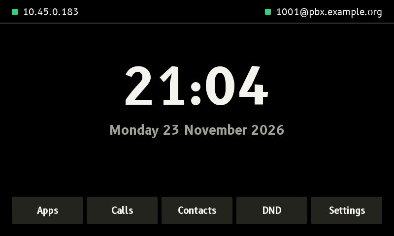
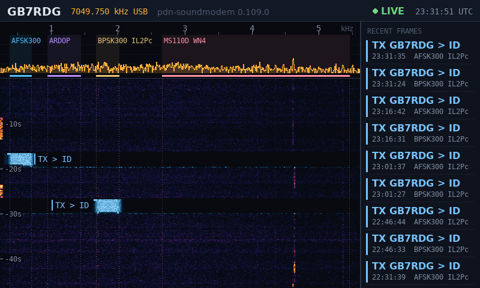

# yealink-t48s

Open firmware for the Yealink SIP-T48S desk phone: Linux 6.18, a SIP phone with up to 16 accounts, contacts and call history, apps, three themes, a web setup page, updates over the network, SSH. Try it from a USB stick without changing the phone. Install it from the phone's own screen, and go back to Yealink's firmware the same way.

## What works

On a T48S: calls on the handset and speaker; hold, mute, transfer, a second call, do not disturb, voicemail; the touchscreen, keys and lamps; Ethernet. The headset socket is untried. Installing, restoring Yealink's firmware and updating have all run on the author's phone, and on no other yet. A T46S has the same stick and installer, [`t46s-stick.zip`](https://github.com/M0LTE/yealink-t48s/releases/tag/t46s-latest); a tester has run it, keys, screen and calls confirmed, and nobody has installed one yet ([docs/models.md](docs/models.md)). Where things stand and what is missing: [docs/status.md](docs/status.md).

## Start

1. **A 5 V power supply of 1.5 A or more.** Yealink's 0.6 A adapter is too small: the phone freezes and USB sticks fail.
2. Unpack `t48s-stick.zip` from the [latest release](https://github.com/M0LTE/yealink-t48s/releases/latest) onto a FAT32 USB stick.
3. Stick in the phone. Hold **Speakerphone** while plugging the power in, then press **2**. The firmware runs from the stick; nothing is written.
4. To keep it: **Settings, Install**. **Back up** copies Yealink's firmware to the stick, then **Install**. About 3 minutes each.
5. To go back: start from the same stick, **Settings, Install, Restore Yealink firmware**.

Every step, and what the screen messages mean: **[docs/guide.md](docs/guide.md)**.

## More

- Apps for the phone: [M0LTE/yealink-t48s-apps](https://github.com/M0LTE/yealink-t48s-apps), written against the app SDK ([sdk/README.md](sdk/README.md)).
- How it is built and how it works: [docs/developing.md](docs/developing.md).
- Contributing, with or without an AI tool: [CONTRIBUTING.md](CONTRIBUTING.md).

## Notice

Not affiliated with or endorsed by Yealink. Yealink is a trademark of its owner. Use at your own risk: installing replaces the phone's firmware, and the way back is Restore from the stick, with the backup the installer made.

## Licence

AGPL-3.0-or-later (`LICENSE`), except code built into or loaded into a Linux kernel (`kernel/drivers/`, `kernel6/drivers/`, `kernel6/dts/`, `kernel6/patches/`, `kmod/`), which is GPL-2.0. Third-party code, its licences, and the source for a release's binaries: [NOTICE.md](NOTICE.md). No Yealink firmware is in the repository or its releases.
