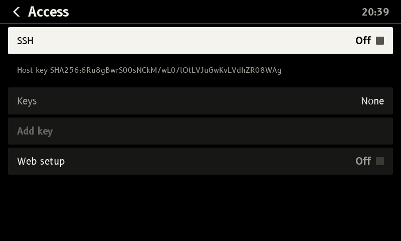
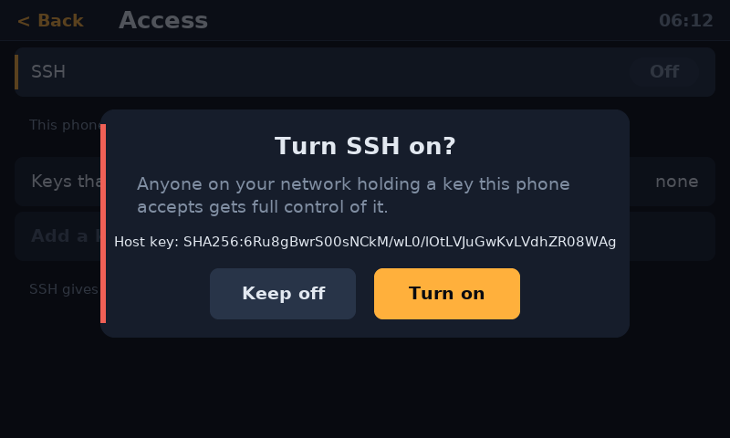
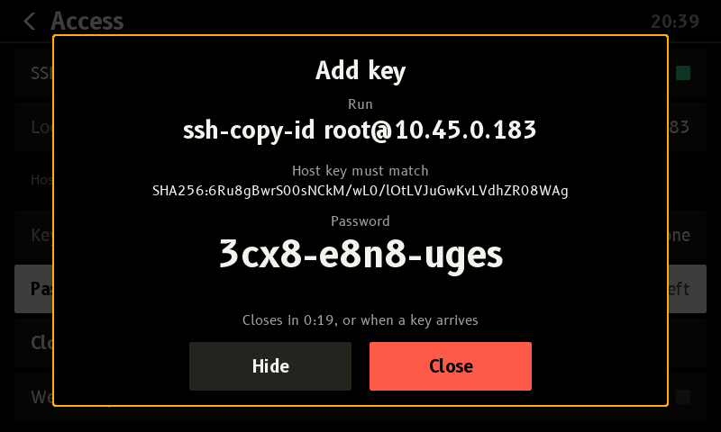
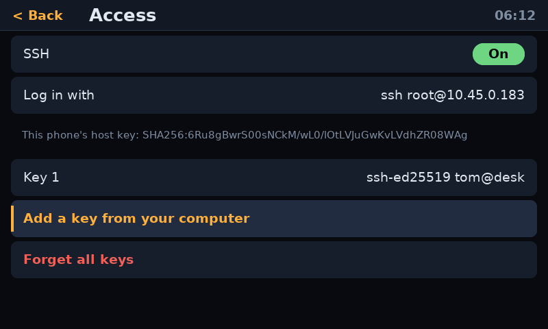
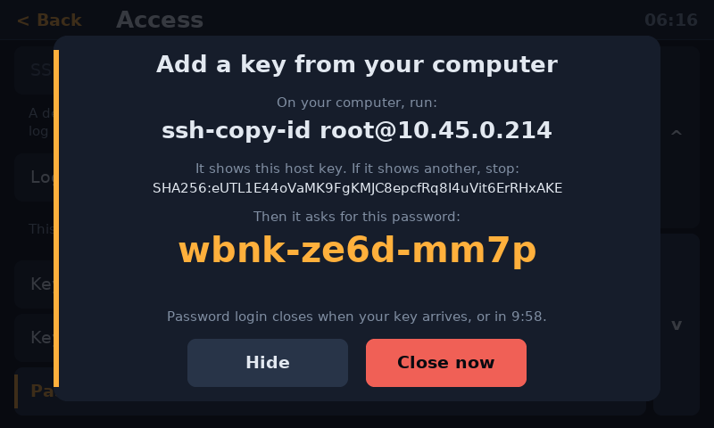

# Access: SSH, and who may log in

Issue [#28](https://github.com/M0LTE/yealink-t48s/issues/28). Design: [architecture.md](architecture.md#access). Source: [`t48-access`](../buildroot/board/t48s/rootfs-overlay/usr/bin/t48-access) (the script that does the work), the Access page in [`shell/settings.c`](../shell/settings.c).

A published image has no password and nobody's key in it, and **SSH is off until the owner turns it on at the phone's own screen**. Being at the phone is the proof of ownership. Login is as root, by key only.

| | |
|---|---|
|  |  |
|  |  |

## Turning it on

Settings, Access, SSH. The phone asks first, and shows its host key's fingerprint; say yes and the SSH server starts. Turning it off asks nothing, stops the server and cuts anyone logged in.

The fingerprint is there so the first `ssh` from a computer can be checked against it. It stays on the Access page afterwards.

## Getting your key onto the phone

With SSH on and no keys, nobody can log in. **Add key** opens password login for ten minutes, with a password the phone makes up and shows on its screen:

```
ssh-copy-id root@10.45.0.214        # the address is on the screen too
```

`ssh-copy-id` shows the host key (compare it with the screen), asks for the password, and puts your public key on the phone. The moment a key arrives the phone closes password login again and says so. It also closes after ten minutes, or at once with **Close now**. The password is never stored or logged; closing the screen with Hide leaves the door open but the password cannot be shown again, only replaced with a new one.

After that the page lists each key by its kind and its comment (`ssh-ed25519 tom@desk`), and **Remove all keys** empties the list.

With the web setup page turned on ([web.md](web.md)) there is an easier way: paste the public key into its Access page.

### Why a password on the screen, and not something else

- Typing a public key on the on-screen keyboard is several hundred characters. Nobody would get it right.
- Fetching keys from a GitHub user name would need only a short word typed, but it ties a phone to one web site, needs the internet at that moment, and a mistyped name gives a stranger root on the phone. It could be added later as a second way.
- A password that is made up by the phone, shown only on its screen, good for ten minutes and for one job needs nothing but the phone and a computer on the same network, and `ssh-copy-id` is the tool people already use. The password is 12 characters from 31 (about 59 bits), so guessing it over the network in ten minutes is not a real risk.
- A live image will also be able to take keys from the settings file beside it (issue #7). Not done yet.

## Our own test builds

`kernel6/build.sh` adds the file named by `AUTHORIZED_KEYS` (or `root.authorized_keys` in its work folder), and `kernel/build.sh` for the 3.6 fallback adds `kernel/kexec-rootfs/root.authorized_keys` if that file is in the build folder, to the image as `/etc/t48-dev/authorized_keys`. That makes it a **development build**:

- SSH is on from boot, whatever the setting says, and those keys can always log in. `tools/ourkernel.sh ssh` and `tools/phone-input.sh` work with nobody at the phone, as before.
- The Access page says so, and its SSH switch cannot be moved. Removing keys removes only keys added later.

The file is gitignored, CI has none, and Buildroot never sees it, so nothing published is a development build. A published image says `initramfs: no ... SSH is off until the owner turns it on at the screen` when it is built.

## The serial console

Always open, as it needs the case off. From there the same things can be done by hand:

```
t48-config set access ssh on && t48-apply access      # or: off
t48-access door-open < password.txt                   # at least 8 characters, one line
t48-access door-close
t48-access forget-keys
cat /run/t48-access/status
```

## Where things are

| | |
|---|---|
| `/data/config/access` | `ssh=on` or `off` (off when missing) |
| `/data/access/host_ed25519` | the host key. Made if it is not there |
| `/data/access/ssh/authorized_keys` | the keys that can log in. `/root/.ssh` is a link to this folder, so `ssh-copy-id` writes here |
| `/etc/t48-dev/authorized_keys` | only in a development build |
| `/run/t48-access/status` | what `t48-access` last did, for the Access page: `dev`, `ssh`, `host_key`, `door`, `door_until`, `key` (one a key: kind and comment), `keys` |

Once `/data` is in flash ([flash.md](flash.md)) the host key, the owner's keys and the SSH setting are kept across restarts. Until `t48-data format` has been run, `/data` is in RAM: the host key is new at every boot and the rest is lost at power off.

The password door sets root's password in `/etc/shadow` and starts dropbear without `-s`; closing it puts `*` back and restarts dropbear with `-s`. Logged-in sessions carry on through both. The system image is read-only, so `rcS` mounts a copy of `/etc/shadow` from `/run` over it, and `set_password` writes it in place.

## Testing

`make -C shell check` runs [`shell/tests/07-access.script`](../shell/tests/07-access.script): the Access page in the simulator with the real `t48-access` behind it, and stand-ins for `dropbear`, `dropbearkey` and `mkpasswd` ([`shell/tests/access/`](../shell/tests/access)). It checks that SSH stays off at boot, the question, keys-only start, the password reaching the script on its standard input and not the log, the door closing when a key arrives and by hand, forgetting keys, off, and a development build staying on.

## On the phone (2026-11-23)

With injected keys and touches, nobody at it, on a development build:

- At boot SSH came up by itself with the built-in keys, and the page says it is a development build.
- **Add a key**: the phone showed a password; a wrong password was refused; `ssh-copy-id` with the shown one put a throwaway key on the phone; within a second or two the phone said so, dropbear was back to keys only (`-s`), root's password was `*` again, and the old password no longer worked. The new key logged in. **Forget** removed it and left the built-in keys.
- **Off until turned on**, tried without locking ourselves out: from the serial console the development marker was moved away and `t48-access apply` run, which is what a published image does at boot. SSH stopped and the port refused connections. Keys injected from the serial console then went to Settings, Access, SSH, and answered the question: SSH came back. Turning it off at the screen stopped it again, at once. Then the marker was put back.



Not tried: booting an image built with no keys at all (the same script path as above, but worth one real boot before a release), and the ten-minute time-out on the phone (the simulator test runs it with twenty seconds).
