# The app manager

Issue [#22](https://github.com/M0LTE/yealink-t48s/issues/22). Design: [architecture.md](architecture.md#the-apps-repository). Source: [`shell/pkg.c`](../shell/pkg.c) (`t48-app`), [`shell/settings.c`](../shell/settings.c) (the screens).

Open **Apps**, then the last tile, **Get apps** (also Settings, Apps; and the Apps page of the web setup page, [web.md](web.md)). It lists what is installed and what the feeds offer; pick one to install, update, open, change its settings or remove it.

| | |
|---|---|
|  | 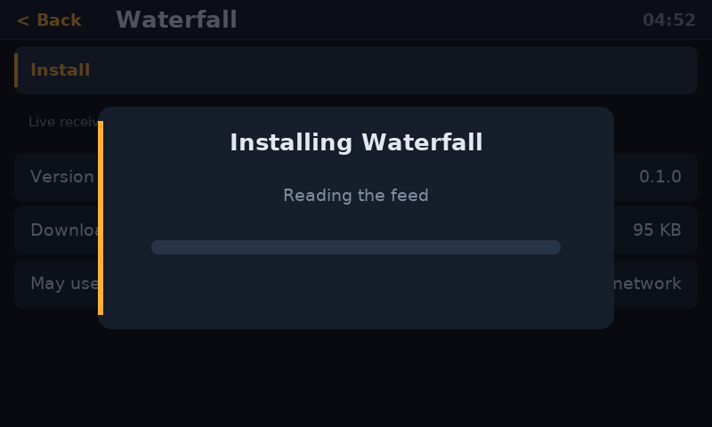 |
| 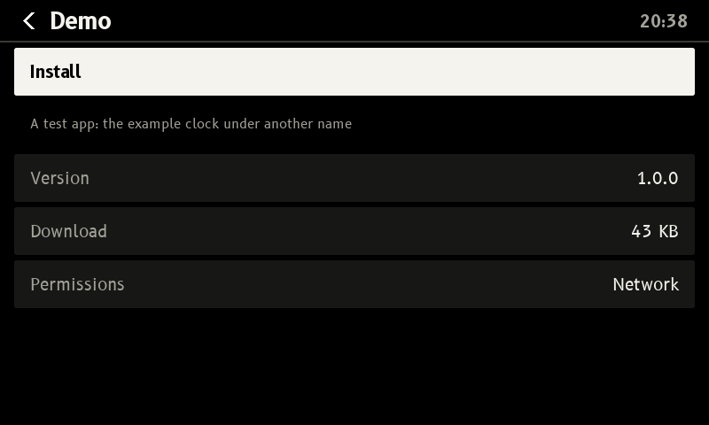 |  |
| 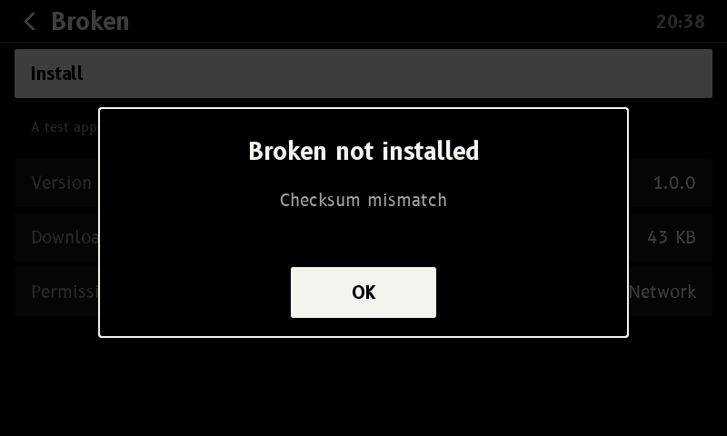 |  |

- Apps are grouped by category under headings: General, Games, Radio, Tools, Media, in that order, installed apps first in each. With only one category there are no headings. The keys step over the headings. An app without a category, or with one this firmware does not know, is General. An installed app's category is its manifest's, else the feed's.
- Each app's page shows its version, its size (download, and on the phone once installed) and what it may use (its manifest's permissions).
- Remove asks first, and takes the app's own data and settings with it. Update keeps them.
- Apps that are part of the firmware (the clock) cannot be removed.
- Installing, updating or removing the app that is open closes it first.
- The feeds are under **Feeds** at the foot of the same screen ([below](#feeds)).

| | |
|---|---|
|  | 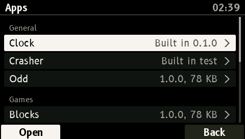 |

## Feeds

Issue [#81](https://github.com/M0LTE/yealink-t48s/issues/81). The official feed, `https://m0lte.github.io/yealink-t48s-apps/index.json` from [M0LTE/yealink-t48s-apps](https://github.com/M0LTE/yealink-t48s-apps), is built in, always first, and cannot be removed. Up to seven more are added by URL under Settings, Apps, Feeds, or on the web setup page's Apps page, and removed there; eight in all.

| | | |
|---|---|---|
| 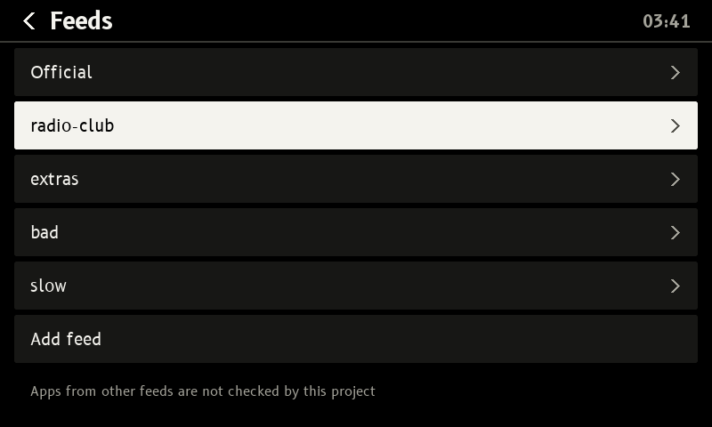 | 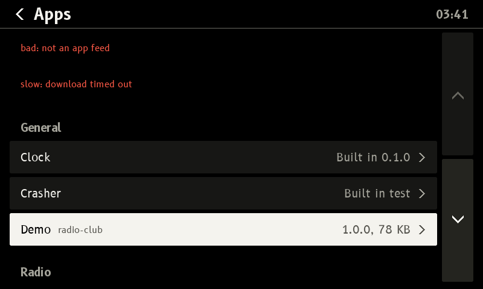 | 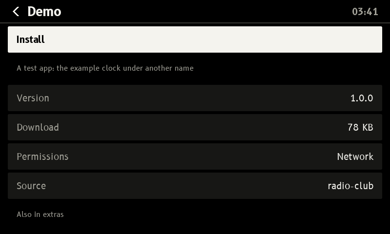 |
| 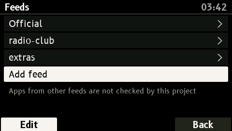 | 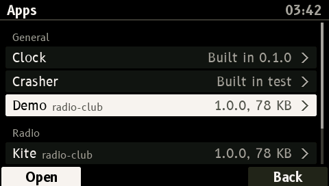 | |

- **Where an app comes from.** Each app shows its feed: `Official`, or the feed's host (two feeds on one host also get the first part of the path). The name is never taken from the feed itself, so no feed can call itself Official. In the list it is quiet type after the app's name, left out for the official feed; on the app's page it is `Source`.
- **An app in two feeds** is listed once, from the first feed that has it, with `Also in` and the others.
- **Updates follow the feed an app was installed from**, kept in `/data/phone/app-sources`: Update, Update all and the daily check's count all ask that feed only. An app installed before this, or from a file, follows the first feed that has it. Remove a feed and its apps stay, without updates.
- **Other feeds are untrusted.** Their apps get every check below and nothing more; the Feeds page says so. Each index may be 512 KB and 128 apps, and a package from an https feed must come over https.
- **One slow or broken feed holds up nothing else.** The feeds are read side by side, each given 15 seconds; one that fails is named in red above the list (`example.org: download timed out`), and the others are listed as usual.
- **Stored** in `/data/config/feed`: `url1` to `url7`, in the order added.
- **The old single feed setting.** Before this, `url` in that file replaced the official feed. It is now kept as the first added feed, after the official one, and left where it is, so a phone taken back to older firmware still uses it as before. Removing it on the Feeds page clears it.

## What is checked before an app is installed

1. The feed's address must be `https://`. curl does the download, with mbedTLS and the image's CA bundle.
2. The app's `api` in the feed must not be higher than the level this shell speaks (4 today). A newer app is listed as "needs newer firmware" and has no Install button.
3. The package must have exactly the `size` and `sha256` the feed it comes from gives. If not it is thrown away and the owner is told.
4. The package must hold one folder, named with a proper app id, with only plain files and folders inside it: no links, no devices, nothing that climbs out with `..`. The shell unpacks the tar itself rather than trusting a tar program with that.
5. The manifest inside must read properly, have the id the feed said, an API level this shell speaks, and a program to run.

Only then is the app moved into `/data/apps` with a rename, so a half-installed app is never visible, and a failed update leaves the old version in place.

## The feed

`index.json`, as `t48-pack --index` writes it ([sdk/README.md](../sdk/README.md#packages-and-feeds)). Nothing had to change: `size` and `sha256` were already there. What the phone reads:

| | |
|---|---|
| `feed` | must be 1 |
| `apps[].id`, `url` | needed. `url` is relative to the index, or a full address |
| `apps[].size`, `sha256` | needed to install: an entry without them is listed but refused |
| `apps[].api` | refused if higher than the shell's |
| `apps[].name`, `version`, `description`, `permissions` | shown to the owner |
| `apps[].category` | the group it is listed under; General when absent (issue [#30](https://github.com/M0LTE/yealink-t48s-apps/issues/30)). Firmware before it ignores the field |

## On the command line

```
t48-app list                  # installed, and what the feeds have, with each app's feed and category
t48-app install hello         # from the first feed that has it
t48-app install /tmp/my-0.1.0.t48app    # a file copied to the phone: no checksum to check it against
t48-app update                # everything its feed has a newer version of
t48-app update hello
t48-app remove hello
t48-app check                 # "2 updates", with ", 1 feed not reached" if one was not: the daily check's question
t48-app --feed https://example.org/apps/index.json list    # that feed instead of the list; --feed again for more
```

`list --machine` gives one tab-separated line per app; the last two fields are the app's feed and the other feeds that have it (commas between, `-` for none). Readers ignore fields they do not know.

Each time `t48-app` reads the feeds it keeps what each offers in `/data/phone/app-offers` (a feed it could not read keeps what it offered last time). The home screen and the web setup page count updates from that against what is installed, so the count goes as soon as an app is updated or removed. The daily check ([install.md](install.md#the-daily-check)) runs `t48-app check` once a night; nothing is installed by itself.

`t48-app` is the shell's own program under another name. The Apps screen runs it as a separate process and reads its progress, so a slow download never holds up the screen or a call.

## Testing

- `make -C shell check` runs [`tests/05-apps.script`](../shell/tests/05-apps.script) against two small feeds made on disk by [`tests/mkfeeds.sh`](../shell/tests/mkfeeds.sh): install, open, the app's settings, an update that keeps them, remove; and the refusals (an app for API level 2, a package one byte wrong, a package that climbs out of its folder, one holding a link, a feed address that is not https, removing the clock, a feed that is not there).
- Several feeds: [`tests/24-feeds.script`](../shell/tests/24-feeds.script) and the T46S's [`tests/small/10-feeds.script`](../shell/tests/small/10-feeds.script) add four (two that share apps, one that is not a feed, one that never answers), check each app's feed and the duplicate note, install from the first, update from that feed only, count across feeds as the daily check does, remove one and fill the list to eight. The official feed there is an empty one on disk (`T48_OFFICIAL_FEED`), and a feed that does not answer is given up on after 2 seconds (`T48_FEED_TIMEOUT`). `webconfig/tests` the same on the web page, with HTML in a feed shown as text.
- Categories: [`tests/23-app-categories.script`](../shell/tests/23-app-categories.script) and the T46S's [`tests/small/09-app-categories.script`](../shell/tests/small/09-app-categories.script) against a feed of apps in several categories, one only in the feed and one this firmware does not know; `webconfig/tests` the same on the web page; [`tools/test-pack.sh`](../tools/test-pack.sh) the packer's check and index.
- `make -C shell check-live RUNNER=qemu-arm` uses the real feed: installs hello, links and waterfall from the Apps screen and starts each one (they are the phone's ARM programs, hence qemu).
- On the phone: below.

## On the phone (2026-11-23)

Done on the real phone with injected touches and keys (`tools/phone-input.sh`), nobody at it; the pictures are read back from its framebuffer.

- Get apps lists the real feed over HTTPS in under a second.
- Hello and Node links were installed by touch, Waterfall by keys: about two seconds each, checksum checked. All three then open from the launcher, each as its own user, and the waterfall and the links screen show live data.
- Hello was removed (it asks first; its data and settings went with it) and installed again. `t48-app update` says everything is up to date.

| | |
|---|---|
| 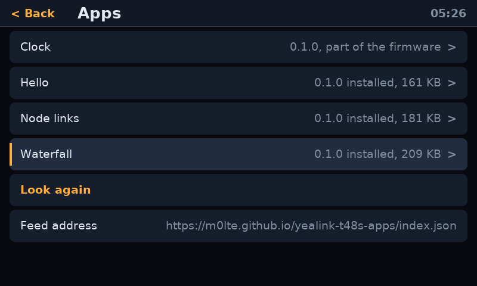 | 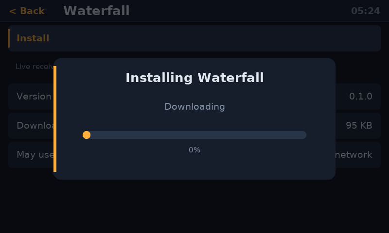 |
| 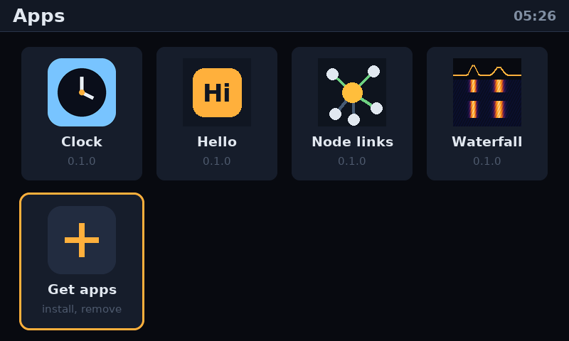 | 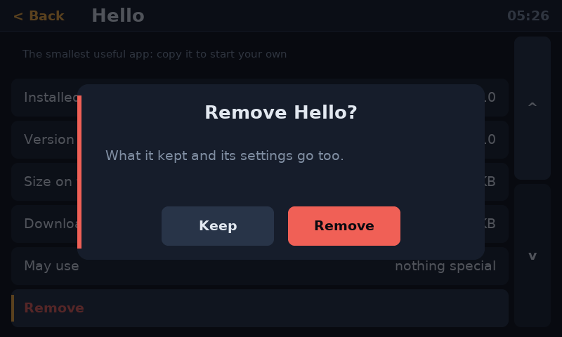 |
| 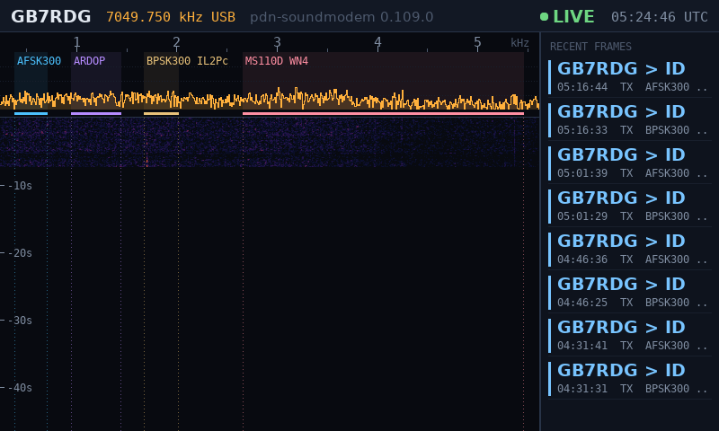 | 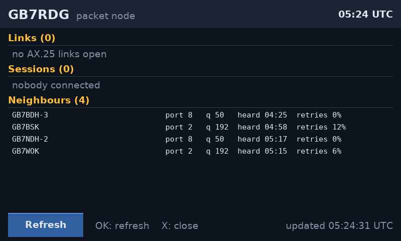 |

Two faults in the image showed up only here and are fixed: curl had no CA bundle, and `/dev/random` blocked for ever ([buildroot/README.md](../buildroot/README.md)). The phone's kernel also has no `flock`, so `t48-app` keeps a small lock file instead.

## Not done

- Signed feeds are for later.
- While `/data` is in RAM (#29), installed apps are lost at power off. Fetching a list of apps again at boot is not written.
- The image's `/dev/random` is pointed at the non-blocking pool so that HTTPS works at all on this kernel (see `rcS`); its randomness just after boot is weak until a seed can be kept across boots (#29).
