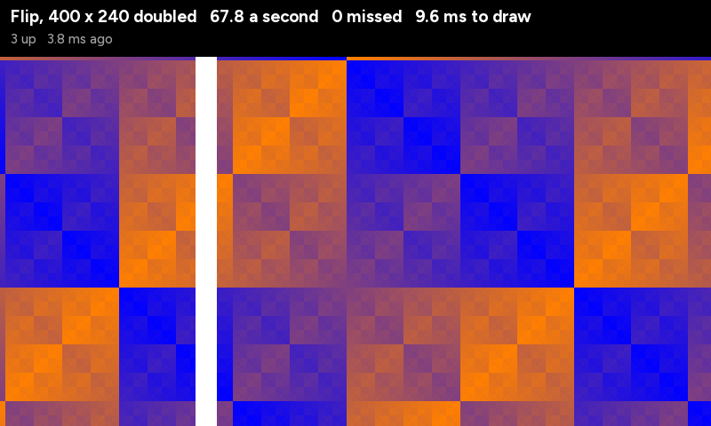

# Firmware architecture and plan

Written 2026-11-23. This is the design for turning what we have (our kernel with drivers, a hand-made root filesystem, one full-screen program) into replacement firmware anyone can run or install: it works as a phone, has apps, and is open and patchable. Each section gives the decision and the main reason. The issues that carry the work are linked throughout and listed in order under [Milestones](#milestones). The tracking issue is [#11](https://github.com/M0LTE/yealink-t48s/issues/11).

Apps live in a separate repository, [M0LTE/yealink-t48s-apps](https://github.com/M0LTE/yealink-t48s-apps) (issues written below as apps#N).

## The shape of it

```
                 +--------------------- t48-shell ----------------------+
 keys, hook,     |  owns /dev/fb0, input devices, LEDs, backlight       |
 touch  -------> |  phone screens: idle, dialler, call, history,        |
                 |  contacts, settings, launcher                        |
                 +----+---------------------+--------------------+------+
                      | app protocol        | call control       | routes, volume,
                      | (Unix socket +      | and events         | tones, ringer
                      |  shared buffer)     |                    |
                 +----v-----+         +-----v-----+        +-----v------+
                 |  one app |         |  baresip  | <----> | t48-audiod | <--> audio hardware
                 | (any     |         |  (SIP,    |  call  | (the only  |      (plain PCM, or the
                 | language)|         |   RTP)    |  audio | audio user)|       voice DSP: see #6)
                 +----------+         +-----------+        +------------+

 busybox init + runit supervise all of it.  Linux 3.6.11 with our drivers underneath.
 Read-only system image (slot A or B)  +  /data (settings, apps, owner's changes).
```

Four long-running programs, each replaceable: the shell, baresip, the audio service, and whichever app is showing. If the shell crashes, runit restarts it and it picks the call back up from baresip; the call itself (baresip to audio service) is not interrupted.

## 1. Userspace base

**Decision: Buildroot, as an external tree in this repo, with musl. The kernel keeps its own build.** Issue [#16](https://github.com/M0LTE/yealink-t48s/issues/16).

- Why not stay with hand-built busybox: the phone now needs a SIP stack, TLS, flash tools and a cross toolchain that other people can download. Buildroot gives all of that from one pinned configuration, and its `make sdk` output is exactly the app SDK we need to publish. Hand-rolled scripts would end up re-inventing it.
- Checked against Buildroot master on 2026-11-23: custom kernel headers back to 3.0 are still offered (`BR2_PACKAGE_HOST_LINUX_HEADERS_CUSTOM_3_6`), the CPU is listed (`arm1176jzf-s`), musl supports ARM. Latest release tag is 2026.08.2; pin one release and move deliberately.
- Stay soft-float (`-mfloat-abi=soft`), as now. Everything in a call path is integer code, and existing binaries keep working. Revisit only if a measurement says so.
- Buildroot does not build the kernel: 3.6.11 needs gcc 4.7, so `kernel/build.sh` stays in its Ubuntu 14.04 container. CI runs both and joins the outputs.
- Base packages: busybox (init, runit, udhcpc, ntpd), dropbear, curl with mbedTLS and a CA bundle, mtd-utils (left out of the image until flash writes are approved, see `docs/nand.md`). baresip and libre are not in Buildroot, so they are packages in our external tree. Our own programs are packages too.
- Almost everything is statically linked, as today. It keeps apps independent of the system image.

**Build in CI.** GitHub Actions builds the kernel (in the container) and the Buildroot tree on every push, with the download directory and toolchain cached; a first build is under an hour on a hosted runner, later ones minutes. A tag publishes a release: kernel image, system image, live-image files, SDK, checksums. No personal SSH keys in published images ([#28](https://github.com/M0LTE/yealink-t48s/issues/28)).

**Boot flow.** Issue [#17](https://github.com/M0LTE/yealink-t48s/issues/17). The kernel image carries only a small first stage. It finds the system image (in RAM beside the kernel for kexec and recovery-mode boots; in flash once installed), mounts it read-only and hands over. One system image, three ways to start it. If nothing mounts, the first stage is the rescue system. Limits that shape this: the kernel file must stay under 4 MB for recovery-mode boots (U-Boot loads the ramdisk 4 MB above the kernel) and under 2.5 MB compressed for the flash slot; the ramdisk has roughly 12 to 16 MB before it reaches U-Boot.

(2026-11-23: done for kexec boots, see [boot.md](boot.md): first stage, squashfs system image, rescue, runit services, watchdog.)

## 2. The phone

### SIP stack

**Decision: baresip, as its own process.** Issue [#25](https://github.com/M0LTE/yealink-t48s/issues/25).

| | baresip + libre | PJSIP | Others |
|---|---|---|---|
| Licence | BSD-3-Clause: fine alongside AGPL-3.0-or-later | GPL-2.0-or-later: also usable, via GPLv3 | liblinphone is AGPL but huge and C++; sofia-sip has no media side |
| Size | about 1 MB static with the modules we need | several MB | |
| ARMv6 + musl | plain C, CMake, no surprises | works, heavier build | |
| Audio hook | audio source and player are small plug-in modules | custom audio device in its media layer | |
| Use | ready-made program with a control interface | a library: we would write the phone logic inside our process | |

baresip wins on being small, permissive and already a complete program: we add one module of our own rather than building a SIP application around a library. G.711 is built in and G.722 comes from sippy's small BSD libg722 (see docs/sip.md); Opus can be added later. Current release is v4.13.0 (2026-11-04). TLS and SRTP come later through libre's OpenSSL support if wanted; plain UDP SIP and RTP first.

Our baresip module does two jobs: audio in and out through the audio service, and call control and events for the shell on a Unix socket only root can open (baresip's stock TCP control port would let any app place calls).

### Audio service

**Decision: one small daemon, `t48-audiod`, is the only program that touches audio hardware.** Issue [#24](https://github.com/M0LTE/yealink-t48s/issues/24).

It handles routes (handset, speakerphone, headset), volumes, mute, locally made tones and ringing, and two streams: a two-way call stream for baresip over a Unix socket, and a playback stream for apps, which is a ring of samples in shared memory and is silenced during calls ([audiod.md](audiod.md#an-apps-sound)).

This is also where the unknown in [#6](https://github.com/M0LTE/yealink-t48s/issues/6) is contained. The hardware side of the daemon has two possible backends and nothing above it changes:

- **Plain PCM to the codec, no DSP.** Codecs run in baresip. Speakerphone echo cancelling is ours to do in the daemon (speexdsp, fixed-point); if the CPU cannot manage it, speakerphone starts as half-duplex.
- **The voice DSP is required.** A kernel driver loads the DSP's firmware and exposes PCM; the DSP does echo cancelling and possibly the codecs. The firmware is Yealink's and is not ours to publish: the plan is to copy it from the owner's own phone at install time (see [Decisions for Tom](#decisions-for-tom)).

Until #6 reports, a null backend and a file backend let SIP and the phone UI go ahead. (2026-11-23: #6 found the first backend is enough, and the microphone half exists as an ALSA capture driver, `kernel/drivers/t48s_audio.c`; see `docs/audio.md`.)

(2026-11-23, later: the daemon exists and is tested off the phone, see [audiod.md](audiod.md). The speakerphone starts with voice switching, a gentler kind of half-duplex, because an echo canceller would take a large share of this CPU; the app playback stream is not written yet.)

### The shell

**Decision: one program, `t48-shell`, owns the screen, every input device, the LEDs and the backlight, and contains the phone UI.** Issues [#19](https://github.com/M0LTE/yealink-t48s/issues/19) (screen, input, launcher), [#26](https://github.com/M0LTE/yealink-t48s/issues/26) (phone UI), [#27](https://github.com/M0LTE/yealink-t48s/issues/27) (extras), [#23](https://github.com/M0LTE/yealink-t48s/issues/23) (settings and keyboard), [#18](https://github.com/M0LTE/yealink-t48s/issues/18) (backlight).

- Plain C drawing straight to the framebuffer, built on the same library apps use. No toolkit: 124 MB of RAM and a 500 MHz CPU, and the waterfall has shown this style is fast (about 9% CPU).
- Screens: idle (time, account status, missed calls, favourite apps), dialler, call, history, contacts, settings, launcher.
- **Phone keys always belong to the shell**: hook, Speakerphone, Headset, Mute, Volume, Hold, Transfer, Redial, Message. Apps never see them. Typing a digit on the idle screen starts dialling.
- **Calls come first.** On an incoming call, or when the handset is lifted, the shell stops showing the app, tells it to pause, and puts the call screen up. The app returns afterwards.
- The call state lives in baresip, the audio state in the audio service; the shell is the glue and the face. That is why a separate "phone daemon" is not needed.
- Settings are plain text files in `/data/config`, edited on the screen (with an on-screen keyboard) or over SSH. No web interface for now.

(2026-11-23: the backlight has a driver and the shell dims and blanks the screen, see [shell.md](shell.md#the-backlight).)

(2026-11-23: settings, the keyboard and the app manager exist, see [settings.md](settings.md) and [apps.md](apps.md). The tool is `t48-config get/set`, and `t48-app` installs from one feed, checked by SHA-256.)

(2026-11-23: the phone UI exists and is tested in the simulator against baresip and the audio service, see [phone.md](phone.md). baresip's control is our own module on a root-only socket, see [sip.md](sip.md#control-interface).)

## 3. Apps

### What an app is

**Decision: a folder with a `manifest.json`, an icon and one static program that speaks the app protocol. Any language.** Issues [#20](https://github.com/M0LTE/yealink-t48s/issues/20), [#22](https://github.com/M0LTE/yealink-t48s/issues/22).

The manifest gives: id, name, version, API level, what to run, permissions (`network`, `audio-out`), and a list of settings (key, label, type, default) that the shell shows with its normal settings screens. A package is that folder as a tar.gz with the extension `.t48app`.

### Screen and input

**Decision: a small display protocol, not direct framebuffer access.** Issue [#19](https://github.com/M0LTE/yealink-t48s/issues/19).

The shell starts the app with a Unix socket. The app gets a shared 800x480 buffer, draws into it, and sends "this rectangle changed"; the shell copies that rectangle to the screen. Keys and touches arrive on the same socket, already converted to pixels.

Why this rather than giving the app the framebuffer and a grab on the input devices:

- It costs nothing extra. The waterfall already draws into its own buffer and copies changed areas to the screen; the shell now does that copy.
- The shell can always take the screen back, at once, without trusting the app. That is what makes "calls come first" reliable.
- Apps need no access to devices at all, so they can run as an unprivileged user.
- The same protocol runs on a PC, which gives a simulator for development and for CI.
- Screen size is told to the app, which leaves room for other models ([#10](https://github.com/M0LTE/yealink-t48s/issues/10)).

#### Flipping

**Decision: games get whole frames of the screen's own memory, and the shell still holds the screen.** API level 3 ([app-protocol.md](app-protocol.md#flipping)).

Copying is what the first design cannot afford at speed. Memory on this chip moves at about 160 MB a second while the screen is being read out of it, so one 800 x 480 picture is 10 ms, and a refresh lasts 14.7 ms (67.8 a second, measured: not 60). An app that fills the shared buffer and has the shell copy it has spent two refreshes before anything shows, and the copy lands part way down the screen.

The boot loader reserved four frames and used one. The other three are now lent to the app in front:

- The app draws in one and sends FLIP. The shell asks the kernel ([`kernel6/drivers/t48s_flip.c`](../kernel6/drivers/t48s_flip.c)) to point the LCD controller at it. The controller takes a new address only at the start of a frame and interrupts when it has, which becomes FLIPPED. No copy, no tearing.
- The shell's own frame is the fourth, and only the shell can point the screen anywhere: the app holds a descriptor it can map and nothing else (the kernel refuses it the rest). So a call or Home still takes the screen at once, by drawing the shell's frame and pointing back at it, and an app that has hung or died leaves nothing on the glass.
- The app's mapping is ordinary cached memory, written out to RAM by the kernel as part of each flip. The framebuffer's own kind of mapping reads back at a fifth of the speed, which matters to anything that blends.
- Where the screen cannot do this (the simulator, a model whose picture is fitted to another screen, a kernel without the driver) the buffers are a file in memory and the shell copies on each FLIP. The app cannot tell, except by the rate.

Tried on the phone (2026-11-24, `libt48/examples/fliptest`, read from its log and the frame the controller was showing): 67.8 pictures a second with none missed, whether a bar, every pixel or a doubled 400 x 240 picture is redrawn each time; Home and back; the app killed while flipping. Nobody has yet looked at the glass.



Looked at and left out:

- **A smaller screen mode.** The PL111 has no scaler and the panel wants its 800 x 480. Doubling in the app costs one write of the frame, 9.6 ms with the picture made as well, and still holds the full rate.
- **16 bits a pixel, or a palette.** It would halve the bytes. The PL111 has both modes, but its documentation puts their colour bits on other pins than the 24-bit mode's, so on a panel wired for 24 bits the colours should come out wrong. Not tried on the glass: it needs someone looking.
- **60 refreshes a second**, which an emulator of a 60 Hz machine would like. It means writing the controller's timing, which we never have.

### Lifecycle

- One app in front at a time; starting another closes the first. Memory is small.
- Messages: start, pause, resume, quit. A paused app is frozen (SIGSTOP) after a one-second grace period and continued on resume; apps should close network connections when paused and reconnect when shown. A stuck app is killed.
- **Home is a long press on X.** A short press goes to the app as "back". The phone has no spare key, and this keeps the whole screen for the app.
- Apps get: digits, `*`, `#`, arrows, OK, short X, touch.

### Permissions

Sized for a hobby phone: apps are trusted about as much as programs you install on a PC. Each app runs as its own unprivileged user, with no access to the screen and input devices, the settings files (the SIP password), or other apps' data. It has its own data folder. Audio goes through the shell, which checks the manifest. Network is open. Linux 3.6 on ARM has no system-call filtering, so there is no stronger sandbox, and we do not pretend otherwise. The app manager shows the permissions at install.

### Library and SDK

**Decision: `libt48`, a small static C library, shipped in a published SDK.** Issues [#20](https://github.com/M0LTE/yealink-t48s/issues/20), [#21](https://github.com/M0LTE/yealink-t48s/issues/21).

- Contents: surface and drawing (fill, blend, text with built-in fonts, images), input, event loop, timers, WebSocket client (ws and wss), a small JSON reader, the on-screen keyboard, settings access. Most of it is lifted out of `native/waterfall.c`.
- The real contract is the protocol (`docs/app-protocol.md`, versioned by an API level). The library is a convenience, linked statically, so an app never breaks because the phone's copy changed.
- The SDK is a release file from this repo's CI: cross compiler and musl (Buildroot's relocatable SDK), libt48, mbedTLS, fonts, the PC simulator, a packaging tool and a sample Makefile.

### The apps repository

**Decision: the apps repo builds only against a pinned SDK release, never a checkout of this repo.** Issues [apps#1](https://github.com/M0LTE/yealink-t48s-apps/issues/1) to [apps#5](https://github.com/M0LTE/yealink-t48s-apps/issues/5).

Its CI downloads the SDK, builds each app, runs it in the simulator for a smoke test and screenshot, packs `.t48app` files, and publishes them with an `index.json` to GitHub Pages. That address is the phone's default feed. A feed is just a web address, so anyone can host their own and owners can add it.

On the phone, `t48-app list | install | update | remove` and an Apps screen do the rest ([#22](https://github.com/M0LTE/yealink-t48s/issues/22)); packages are checked against the SHA-256 in the feed, which is fetched over HTTPS. Copying a `.t48app` over SSH and installing it by hand also works.

The existing pages become apps: the waterfall ([apps#3](https://github.com/M0LTE/yealink-t48s-apps/issues/3), from [#13](https://github.com/M0LTE/yealink-t48s/issues/13)), the GB7RDG links screen ([apps#4](https://github.com/M0LTE/yealink-t48s-apps/issues/4)), and later the station picker and UberSDR client ([apps#5](https://github.com/M0LTE/yealink-t48s-apps/issues/5), from [#15](https://github.com/M0LTE/yealink-t48s/issues/15) and [#14](https://github.com/M0LTE/yealink-t48s/issues/14)). Once the waterfall runs as an app, its copy here is deleted, so the separation is real. (2026-11-23: done for the waterfall and the links screen, which are `apps/waterfall` and `apps/links` there.)

## 4. Configuration, patchability and safety

### Never brick

**Rule: we never write the loader, U-Boot, U-Boot's environment, the logo or the safe-mode kernel and root filesystem.** U-Boot's recovery mode (Speakerphone at power-on) therefore always works, and can boot our live image or put Yealink's firmware back whatever state the rest of the flash is in. Before our first write to any phone, the whole flash is copied off and checked ([#30](https://github.com/M0LTE/yealink-t48s/issues/30)).

### Flash layout

Issue [#29](https://github.com/M0LTE/yealink-t48s/issues/29), needs NAND access ([#5](https://github.com/M0LTE/yealink-t48s/issues/5)).

| Partition | Size | Ours? | Use |
|---|---|---|---|
| ubl, uboot, env, userenv, logo, smkern, smrfs | | never touched | the way back |
| kernel | 2.5 MB | yes | our kernel with its first stage |
| rfs | 15 MB | not at first | left as Yealink's; reserve for a fuller rescue system if the first stage will not fit the kernel slot |
| app | 75 MB | yes | UBI: system A, system B (read-only images, about 20 MB each), data (the rest) |
| cfg, data | 4 + 10 MB | not at first | left as Yealink's, so going back to stock keeps the old settings |

- **A/B system slots.** An update is written to the unused slot and tried once. The running system marks itself healthy after a minute of normal running; if that never happens (the watchdog sees to hangs), the next boot uses the old slot.
- **One kernel slot**, because U-Boot's boot command is fixed and we do not change it. Kernel updates are rare, written with a read-back check, and the fallback for a bad one is recovery mode.
- **`/data`** holds settings (`/data/config`), apps (`/data/apps`), and the owner's changes (`/data/local`). A factory reset wipes it.

(2026-11-24: the full layout, the installer, updates with fallback and the way back are written and rehearsed off the phone; the first write waits for Tom: [install.md](install.md).)

(2026-11-23: a first step is in place, see [flash.md](flash.md). `/data` is in UBI on the 60 blocks at the end of `app` that Yealink's filesystem never used, so Yealink's firmware still works beside it; the kernel partition and the rest of `app` wait until the phone can start without Yealink. The backup and the way back are in [backup.md](backup.md).)

### Patchability

**Decision: read-only system plus `/data/local` overrides, rather than an overlay filesystem** (Linux 3.6 has none in mainline, and a backport is not worth carrying).

- Full root over SSH. Nothing is hidden or locked.
- `/data/local/bin` comes first on the path, `/data/local/service` adds or replaces supervised services (including the shell itself), and `/data/local/boot.sh` runs at start-up. That covers "change one thing on my phone" without a rebuild.
- For bigger changes: fork, let CI build an image, install it to the other slot with the same updater. If it does not boot, the phone falls back by itself.
- The rescue menu ([#32](https://github.com/M0LTE/yealink-t48s/issues/32), hold X at boot) can start without `/data/local`, start the other slot, wipe `/data`, or sit in rescue with SSH.

### Access

Issue [#28](https://github.com/M0LTE/yealink-t48s/issues/28). SSH (dropbear) is off on a fresh phone and has no built-in password or key. The owner turns it on at the phone's own screen: being at the phone is the proof. A live image can also take keys from the settings file beside it. The serial console stays open.

(2026-11-23: done, see [access.md](access.md). A first key gets onto the phone through password login that the screen opens for ten minutes, with a password it makes up and shows; it closes when the key arrives. Our own test builds, the only ones with keys in them, always run SSH. Keys from the live image's settings file wait for #7.)

### The web setup page

Issue [#37](https://github.com/M0LTE/yealink-t48s/issues/37). (2026-11-23: written, and run on the phone, see [web.md](web.md).) A small HTTP server of our own on the LAN, off until the owner turns it on at the screen. A browser pairs by typing a code the screen shows. It uses the same settings store as the Settings screens, and the shell notices changed files by itself. Plain HTTP, and it says so.

### Updates

Issue [#31](https://github.com/M0LTE/yealink-t48s/issues/31). `t48-update` reads the latest GitHub release over HTTPS, downloads the system image, checks its SHA-256, writes the unused slot and reboots. Never automatic unless the owner asks; owners can point it at their own builds. Signed releases come later (see Decisions for Tom).

### How someone else's phone gets it

1. **Try it: live image** ([#7](https://github.com/M0LTE/yealink-t48s/issues/7)). Three files on a TFTP server or USB stick, recovery mode, nothing written to flash. Settings come from a `T48S.conf` file beside the image (SIP account, SSH keys, apps to fetch) and are otherwise lost at power-off. The live image must clear the recovery flag so Yealink's firmware does not try to reflash itself on the next normal boot.
2. **Install it** ([#8](https://github.com/M0LTE/yealink-t48s/issues/8)). From the running live image: back up the flash to a PC, write the kernel and app partitions, reboot. No exploit and no downgrade of Yealink's firmware is needed, because recovery mode is in U-Boot.
3. **Go back.** Restore the two partitions from the backup, or use recovery mode with a stock Yealink firmware file.

## Milestones

Each milestone ends with something that can be shown. M1 and M2 do not need audio, so they run alongside the audio research.

**M0. Foundations** (now)
- [#16](https://github.com/M0LTE/yealink-t48s/issues/16) Buildroot root filesystem, built in CI, with releases
- [#17](https://github.com/M0LTE/yealink-t48s/issues/17) Boot flow: first stage plus one system image
- [#3](https://github.com/M0LTE/yealink-t48s/issues/3) LEDs (the last part of that issue; driver done 2026-11-23, waiting for someone to look at the lamps)
- [#18](https://github.com/M0LTE/yealink-t48s/issues/18) Backlight and screen blanking
- [#6](https://github.com/M0LTE/yealink-t48s/issues/6) Audio research (in progress, separate)
- [#5](https://github.com/M0LTE/yealink-t48s/issues/5) NAND access, read-only first (needed by M5, can start any time)

**M1. Shell and one app.** Shown by: the phone boots to a launcher, starts the waterfall as an app, long-press X returns.
- [#19](https://github.com/M0LTE/yealink-t48s/issues/19) Shell: screen, input, launcher, app lifecycle
- [#20](https://github.com/M0LTE/yealink-t48s/issues/20) libt48, the app protocol, PC simulator
- [#21](https://github.com/M0LTE/yealink-t48s/issues/21) SDK published from CI
- [apps#1](https://github.com/M0LTE/yealink-t48s-apps/issues/1) Apps repo layout, CI and feed
- [apps#2](https://github.com/M0LTE/yealink-t48s-apps/issues/2) Hello app and app-writing guide
- [apps#3](https://github.com/M0LTE/yealink-t48s-apps/issues/3) Waterfall as an app (finishes [#13](https://github.com/M0LTE/yealink-t48s/issues/13))

**M2. Apps you can install, settings you can change.** Shown by: install the links app from the feed on the phone's screen; set the time zone.
- [#23](https://github.com/M0LTE/yealink-t48s/issues/23) Settings store, settings screens, on-screen keyboard
- [#22](https://github.com/M0LTE/yealink-t48s/issues/22) App manager and feeds
- [apps#4](https://github.com/M0LTE/yealink-t48s-apps/issues/4) GB7RDG links app
- [apps#5](https://github.com/M0LTE/yealink-t48s-apps/issues/5) Station picker and UberSDR client ([#15](https://github.com/M0LTE/yealink-t48s/issues/15), [#14](https://github.com/M0LTE/yealink-t48s/issues/14); not on the path to a phone)

**M3. It is a phone.** Shown by: a call in and a call out on the handset, with an app running when the call arrives. Tracked by [#12](https://github.com/M0LTE/yealink-t48s/issues/12).
- [#25](https://github.com/M0LTE/yealink-t48s/issues/25) baresip on the phone (can start now against the null audio backend)
- [#24](https://github.com/M0LTE/yealink-t48s/issues/24) Audio service (real backend needs [#6](https://github.com/M0LTE/yealink-t48s/issues/6))
- [#26](https://github.com/M0LTE/yealink-t48s/issues/26) Phone UI: idle, dialler, call screen, hook and keys
- [#27](https://github.com/M0LTE/yealink-t48s/issues/27) Phone extras: history, contacts, hold, transfer, DND, message lamp

**M4. Anyone can try it.** Shown by: someone else boots it on their phone from a download and makes a call.
- [#28](https://github.com/M0LTE/yealink-t48s/issues/28) First-boot access
- [#7](https://github.com/M0LTE/yealink-t48s/issues/7) Live image through recovery mode
- [#33](https://github.com/M0LTE/yealink-t48s/issues/33) User guide (first version: try it)

**M5. Anyone can install it.** Shown by: a phone that powers up into our firmware, updates itself, and has been taken back to stock and forward again.
- [#5](https://github.com/M0LTE/yealink-t48s/issues/5) NAND access, with writes
- [#30](https://github.com/M0LTE/yealink-t48s/issues/30) Backup and return to stock
- [#29](https://github.com/M0LTE/yealink-t48s/issues/29) Flash layout with A/B fallback
- [#32](https://github.com/M0LTE/yealink-t48s/issues/32) Rescue menu
- [#8](https://github.com/M0LTE/yealink-t48s/issues/8) Installer
- [#31](https://github.com/M0LTE/yealink-t48s/issues/31) Updates over the network
- [#33](https://github.com/M0LTE/yealink-t48s/issues/33) User guide (install, update, go back)

**Later**
- [#10](https://github.com/M0LTE/yealink-t48s/issues/10) Other T4xS models

## Decisions for Tom

Answered 2026-11-23:

1. **Yealink's DSP firmware:** use it only if #6 shows it is absolutely necessary. Never published by us; the installer copies it from each owner's own phone.
2. **Licence for libt48 and the SDK:** AGPL-3.0-or-later for now, like everything else. Tom may move it (or more) to MIT later, so libt48 keeps its own directory and LICENSE file to make that easy. (MIT would let other people's apps carry any licence; AGPL makes every app AGPL.)
3. **Licence for the apps repo:** AGPL-3.0-or-later.
4. **First write to the flash of the test phone** (M5): Tom gives the go-ahead when we get there, once backup and restore have been shown to work as far as they can without writing.
5. **Release signing:** decide when updates reach other people's phones.

## Risks and open points

- **Audio** is the one thing that could stop this being a phone. Everything else has a known route. The design keeps it behind one daemon so the rest does not wait.
- **Kernel slot size.** 2.5 MB for kernel plus first stage is tight; xz compression and a minimal first stage should do it, with the rfs partition as the fallback home for rescue.
- **NAND writes and UBI** on this controller under 3.6 are unproven. Reading is done and the ECC layout is known and matches U-Boot's and Yealink's ([#5](https://github.com/M0LTE/yealink-t48s/issues/5), `docs/nand.md`), so U-Boot should read a kernel we write; how its loader treats a bad block in the kernel partition is still to check. Backups must include the spare bytes, or Yealink's partitions cannot be put back.
- **Speakerphone echo cancelling in software** on this CPU, if there is no DSP. Half-duplex is the fallback.
- **TFTP server address in the live image**: our kernel ignores what U-Boot passes, so the live image needs another way to find its settings file (DHCP, or reading U-Boot's environment). Part of [#7](https://github.com/M0LTE/yealink-t48s/issues/7).
- **USB** is not planned: no driver in our kernel, and nothing above needs it.
