# The look: three themes

One look for the phone's screen, the web setup page and apps, to go with the one voice in [style.md](../style.md). Three were drawn and all three are built: the owner picks one in **Settings, Screen, Theme** or on the web setup page (Sound and screen), and the screen, the open app and the page change together, at once, with nothing restarted. Switchboard is the one a new phone starts in.

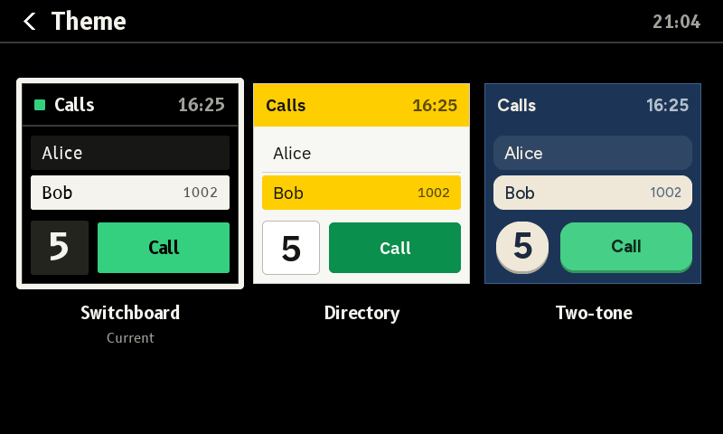

Every phone picture is the shell's own simulator running the real code with the real fonts (`render.sh`); every web picture is the real server in Chromium at twice the size (`web.sh`). Each folder has the same set: the phone's idle screen, launcher, dialler, a call, a settings list, the theme chooser and the keyboard; the web overview, accounts form, backup page and Sound and screen (the whole page, with its theme chooser), desktop and phone-width, dark and light.

A small screen (the T46S's 480x272) has the same three, with the same type and less room around it: a 30 pixel header, and the actions as labels over the phone's four soft keys ([shell.md](../shell.md#small-screens)).

 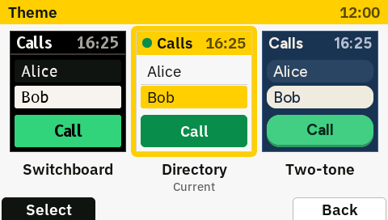 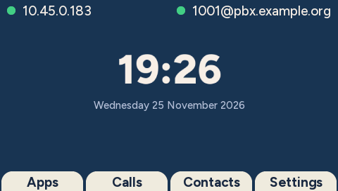

What all three share: an 8 pixel grid with 24 pixel margins, a 48 pixel header (the screen's name, the time, a way back), actions in one row along the bottom, a type scale of 15, 19, 26, 40 and 104 pixels, and no icon font: the few marks (back, rub out, plus, the scroll arrows, lamps) are drawn from fills. Flat drawing only, as the phone has no GPU. A state is a lamp and a word with no box round it, as the header's network and account are: DND, and a call's Speaker, Muted and On hold (`t48_ui_tag`). A box is something to press.

## Switchboard

 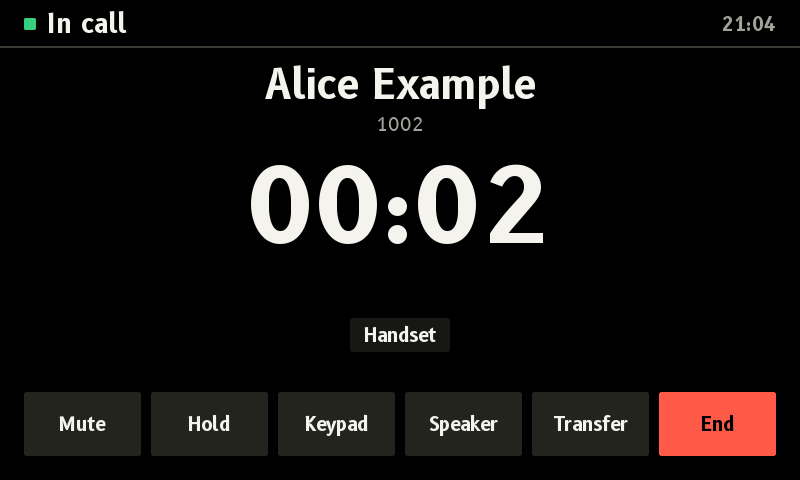
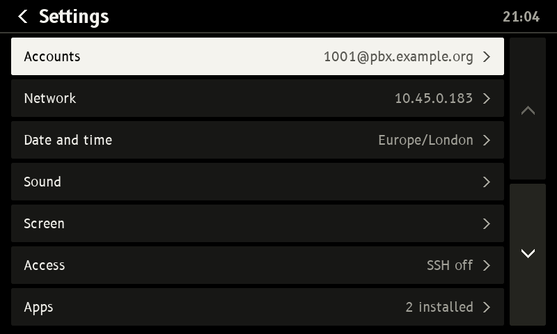 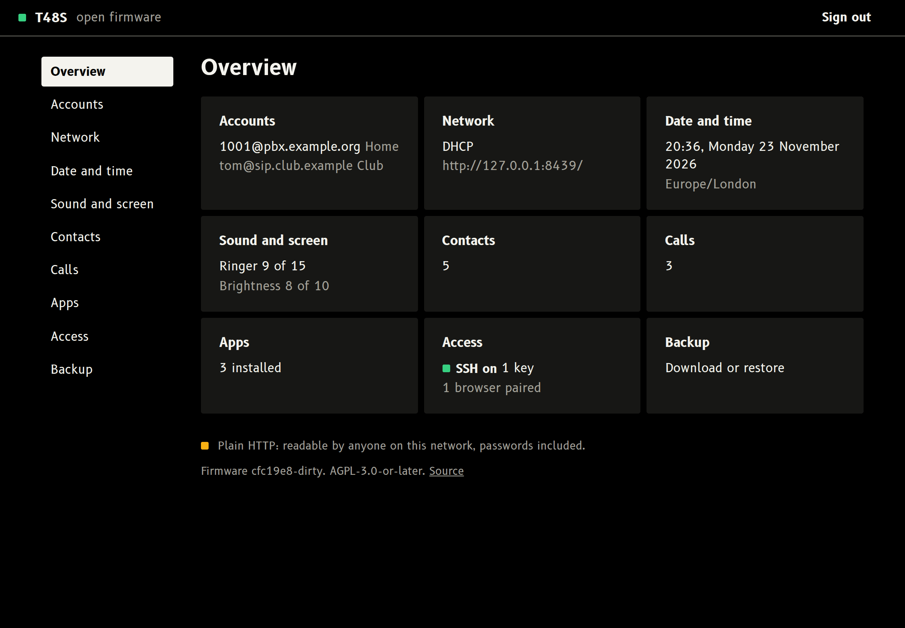

Black to the edge, so the screen runs into the phone's black bezel. White type in B612, the face Airbus had drawn for cockpit displays, which holds up on a coarse panel. The thing you are on is shown in inverse, as on every telephone display before this one, and it cannot be missed from across a desk. Corners are square. Colour is kept for lamps: green is live, amber is held or switched on, red stops something. The web page is the same in a browser: black or, where the browser asks for light, paper; the current page in inverse; lamps for state. Folder: [switchboard/](switchboard).

## Directory

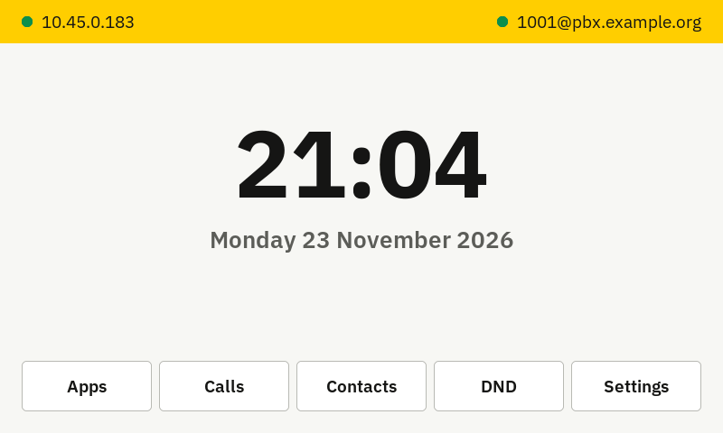 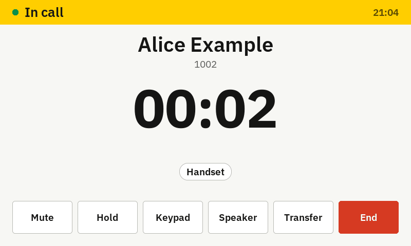
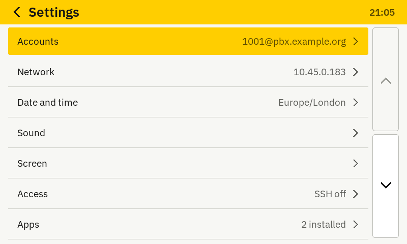 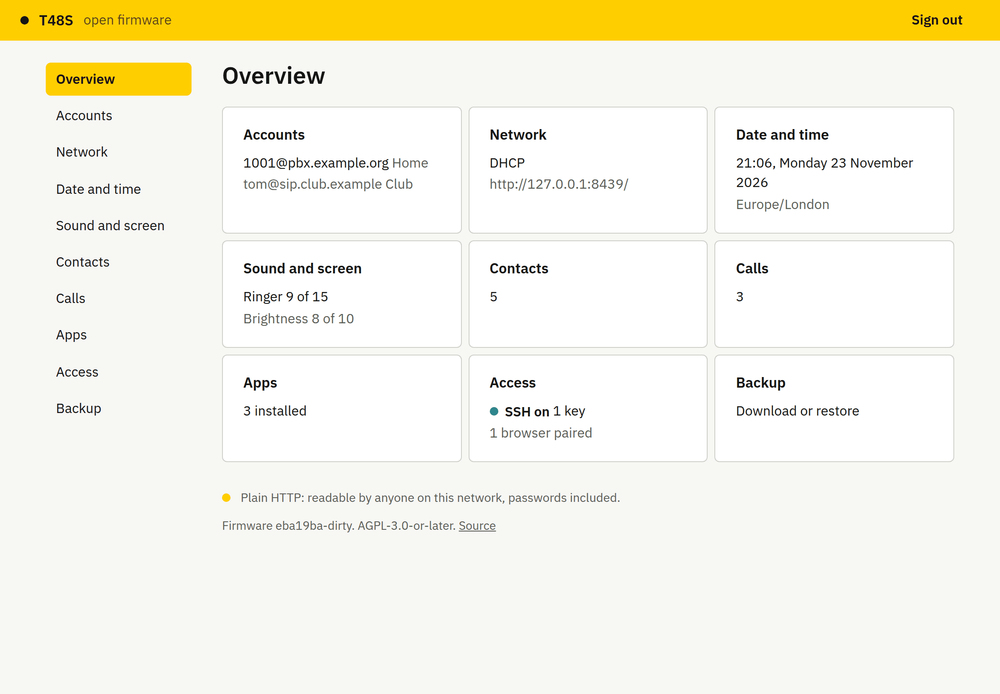

Paper and ink, in IBM Plex Sans, with one telephone yellow: the header band, and the line your finger is on, like a marked entry in a phone book. Lists are ruled lines, keys are outlined. The brightest of the three and the easiest to read in daylight. Folder: [directory/](directory).

## Two-tone

 
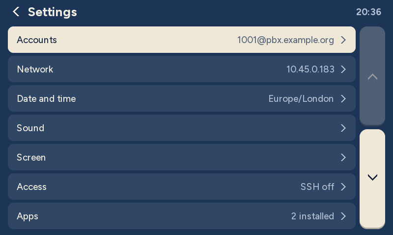 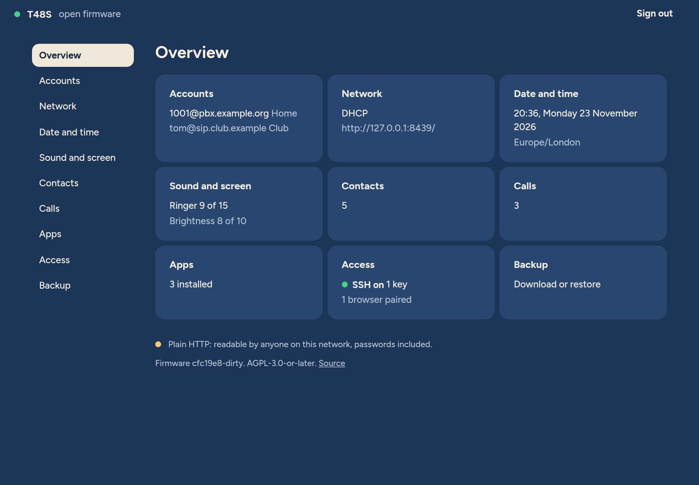

The coloured body and ivory keys of a 1960s desk telephone, in Figtree: a deep blue ground, round ivory keys with a lip under them, and the ground itself turning green while a call rings and amber while one is held. The friendliest, and the least like anything else. Folder: [twotone/](twotone).

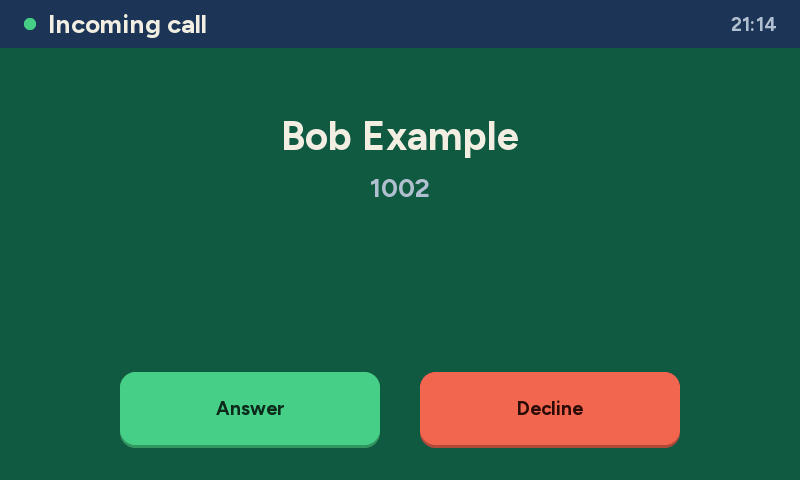 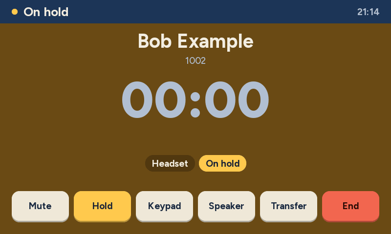

The web page follows the browser between a dark and a light form of each. Switchboard and Two-tone are dark unless the browser asks for light (Two-tone light is ivory with blue keys). Directory is paper unless the browser asks for dark, and then it is ink with the same yellow band.

## Why Switchboard is the default

It has the most contrast on a panel that has little to spare, it uses colour only where colour means something, and squares and flat fills are the cheapest thing this processor can draw. It is also the one that looks like part of the phone rather than a picture on it. Directory is the one to pick for a light screen.

## How it works

A theme is one row of a table: colours by what they are for (ground, ink, a key, the selected row, the header, go, stop), a few shapes (corner radii, whether a key is flat, outlined or has a lip, how list rows are told apart) and a font family. What a theme does that the others do not is in its row: Two-tone's ground while a call rings, is up and is held (green, blue, amber), Directory's header being the yellow band. Screens ask for "the ground of a ringing call" or "a selected row" and never ask which theme it is.

| | |
|---|---|
| [`libt48/src/theme.c`](../../libt48/src/theme.c) | the three themes, and the one in use |
| [`libt48/src/ui.c`](../../libt48/src/ui.c) | the parts every screen is made of, drawn in the theme in use: header, buttons, keys, rows, switches, levels, lamps, tags, boxes. Apps can use them too (`t48_ui_*`) |
| [`shell/ui.c`](../../shell/ui.c) | which theme is in use: the `theme` key of the settings file `screen` ([settings.md](../settings.md#the-files)). Changing it, telling the open app, the chooser's small pictures |
| [`libt48/fonts/`](../../libt48/fonts), `libt48/tools/mkfont.py` | the font files and their licences; `make -C libt48 fonts` renders them into `src/fonts_gen.c` (B612), `fonts_plex.c` and `fonts_figtree.c` |
| [`webconfig/style.css`](../../webconfig/style.css), `webconfig/fonts/` | the web page: one style sheet with all three, chosen by `<html data-theme>`, and two faces of each family served by the phone |
| [app-protocol.md](../app-protocol.md#the-theme) | how an app is told: a THEME message when it starts and on every change, and the fonts in a file it maps |

**Both UIs in step.** There is one setting. The phone's page writes it and applies it; the shell looks at the settings files once a second, so a change from the web page (or `t48-config set screen theme directory`) shows on the screen within a second; the web page reads the setting for every page it sends.

**Apps.** The shell sends the theme before an app's first picture and again when it changes. libt48 then switches the fonts and dresses the keyboard and the `t48_ui_*` parts, so an app that takes its colours from `t48_theme_now()` and draws again on `T48_EV_THEME` matches with no more work. Apps built before this keep their own colours and B612.

## What it costs

Each family is eight faces as 8-bit coverage, ASCII only. Measured on the ARM builds:

| | table | gzip |
|---|---|---|
| B612 (was there already) | 220 KB | 64 KB |
| IBM Plex Sans and Mono | 190 KB | 55 KB |
| Figtree (its fixed-width faces are B612 Mono's, shared) | 173 KB | 48 KB |

`t48-shell` grew from 571 KB to 966 KB (238 KB to 356 KB gzipped) and `t48-web` from 259 KB to 293 KB (four more font files of 5 to 7 KB each): about 145 KB more in a compressed image. Only the shell has the two new families. An app has B612 and maps the rest from a file the shell hands it, which exists only while the app runs (about 590 KB of RAM). An app built with this libt48 is up to 110 KB bigger (35 KB gzipped) than before, because it now keeps every B612 face, not only the ones it draws with.

## Tests and pictures

`make -C shell check` runs `10-themes.script`: choosing by key and by touch, the setting kept, a change from outside followed, an open app and a frozen one told, the dialler over an app. `make -C webconfig check` has the page's side and both together. `sip/test/phone-test.sh` runs `phone/21-themes.script` against real calls: the ringing and held grounds, and the theme changed in the middle of a call and under a call over an app. The two call pictures above are from that run.

`docs/design/render.sh`, then `CHROMIUM=/path/to/chrome NODE_PATH=.../node_modules docs/design/web.sh`: one build, run once in each theme.
