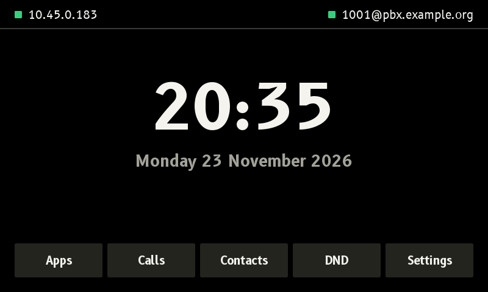
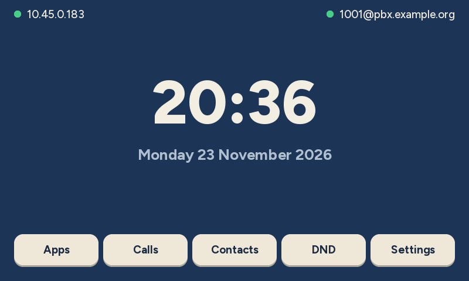
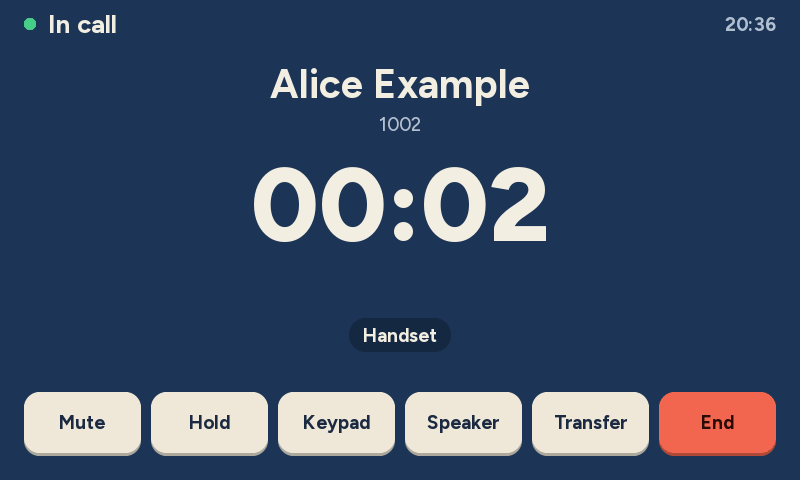

# The look: three directions

One look for the phone's screen and the web setup page, to go with the one voice in [style.md](../style.md). Three directions were drawn; **Switchboard is the one built** on this branch, in both UIs. The other two are pictures, plus the few lines that made them, so switching is a small job.

Every phone picture is the shell's own simulator running the real code with the real fonts (`render.sh`); every web picture is the real server in Chromium at twice the size (`web.sh`). Each folder has the same set: the phone's idle screen, launcher, dialler, a call, a settings list and the keyboard; the web overview, accounts form and backup page, desktop and phone-width, dark and light.

What all three share: an 8 pixel grid with 24 pixel margins, a 48 pixel header (the screen's name, the time, a way back), actions in one row along the bottom, a type scale of 15, 19, 26, 40 and 104 pixels, and no icon font: the few marks (back, rub out, plus, the scroll arrows, lamps) are drawn from fills. Flat drawing only, as the phone has no GPU.

## Switchboard (recommended, and built)

 
 

Black to the edge, so the screen runs into the phone's black bezel. White type in B612, the face Airbus had drawn for cockpit displays, which holds up on a coarse panel. The thing you are on is shown in inverse, as on every telephone display before this one, and it cannot be missed from across a desk. Corners are square. Colour is kept for lamps: green is live, amber is held or switched on, red stops something. The web page is the same in a browser: black or, where the browser asks for light, paper; the current page in inverse; lamps for state. Folder: [switchboard/](switchboard).

## Directory

 
 

Paper and ink, in IBM Plex Sans, with one telephone yellow: the header band, and the line your finger is on, like a marked entry in a phone book. Lists are ruled lines, keys are outlined. The brightest of the three and the easiest to read in daylight. Folder: [directory/](directory).

## Two-tone

 
 

The coloured body and ivory keys of a 1960s desk telephone, in Figtree: a deep blue ground, round ivory keys with a lip under them, and the ground itself turning green while a call rings and amber while one is held. The friendliest, and the least like anything else. Folder: [twotone/](twotone).

## Why Switchboard

It has the most contrast on a panel that has little to spare, it uses colour only where colour means something, and squares and flat fills are the cheapest thing this processor can draw. It is also the one that looks like part of the phone rather than a picture on it. Directory is the one to pick for a light screen.

## Where it lives, and switching

| | |
|---|---|
| [`shell/ui.c`](../../shell/ui.c) | the palette and the parts every screen is made of: header, buttons, keys, rows, switches, levels, lamps, tags, boxes. The three palettes are a table at the top; `-DT48_THEME=0`, `1` or `2` picks one when it is built (0 unless told) |
| [`libt48/src/kbd.c`](../../libt48/src/kbd.c) | the keyboard, which the shell dresses to match (`t48_kbd_style`), so apps get it too |
| [`libt48/fonts/`](../../libt48/fonts), `libt48/tools/mkfont.py` | B612 and its licence; `make -C libt48 fonts` renders it into `src/fonts_gen.c`. The script knows the other two sets as well |
| [`webconfig/style.css`](../../webconfig/style.css), `webconfig/fonts/` | the web page: Switchboard, with B612 served by the phone itself (14 KB). `directory/web.css` and `twotone/web.css` are the other two, with their fonts beside them |

To switch: change the default `T48_THEME` in `shell/ui.c`, run `make -C libt48 fonts FONTSET=plex` (or `figtree`) with the font files in `libt48/fonts`, and copy the direction's `web.css` and two `.woff2` files over `webconfig/style.css` and `webconfig/fonts/`.

To make the pictures again: `FONTDIR=/folder/with/the/ttf/files docs/design/render.sh`, then `NODE_PATH=.../node_modules docs/design/web.sh`. The other two directions need IBM Plex Sans, IBM Plex Mono and Figtree from Google Fonts in `FONTDIR`; they are not in the repository.
