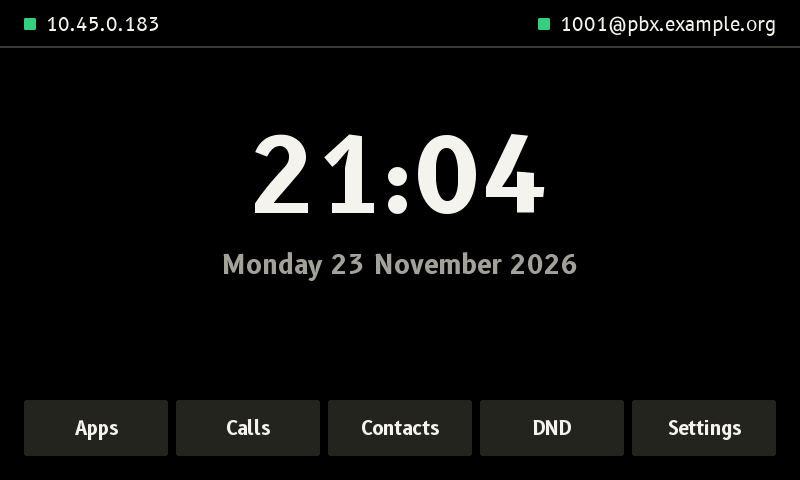
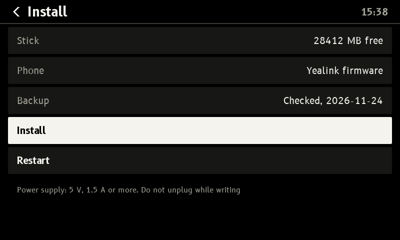
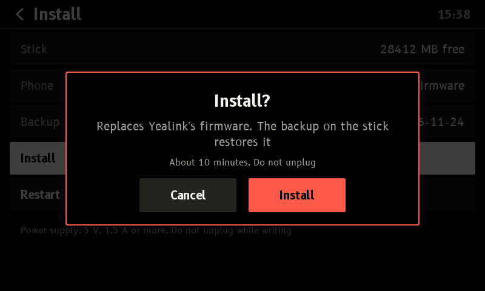
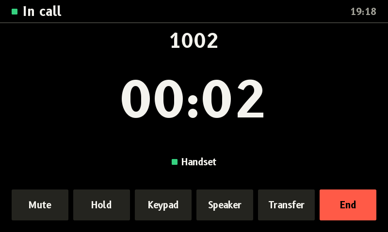
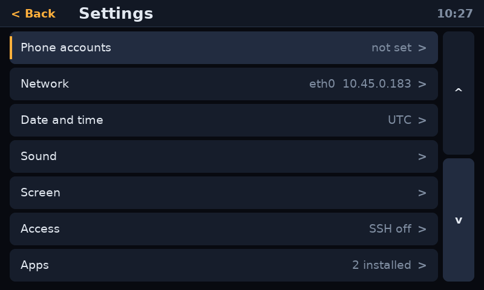
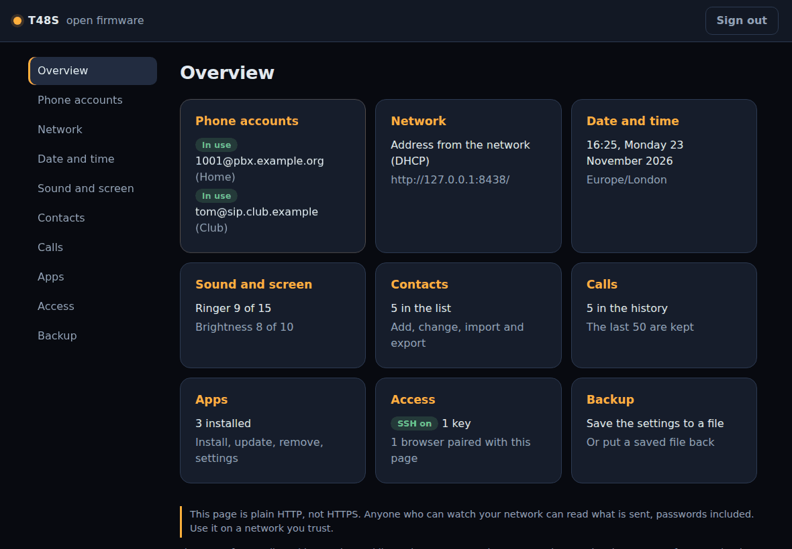

# Guide

Open firmware for the Yealink SIP-T48S. Try it from a USB stick, install it from the phone's own screen, go back to Yealink's firmware from the same screen.

**Status, 2026-11-24.** The stick start works. The Install page, its backup and the kernel's USB stick support are written and rehearsed off the phone; they have not yet run on one ([what is left](installer.md#test-plan-for-a-real-phone)). Until they have, install only a phone you can afford to recover over a serial lead.

## You need

- A T48S on any Yealink firmware.
- **A 5 V power supply of 1.5 A or more.** Yealink's 0.6 A adapter cannot run the phone and a stick: the phone freezes at "Start Updating".
- A USB 2.0 stick, 1 to 32 GB, with 200 MB free.
- A computer, once, to fill the stick.

## Make the stick

1. Download `t48s-stick.zip` from the [latest release](https://github.com/M0LTE/yealink-t48s/releases/latest).
2. Format the stick: one partition, MBR partition table, FAT32. This erases it.
   - **Windows**, Command Prompt as administrator: `diskpart`, `list disk`, `select disk N`, `clean`, `convert mbr`, `create partition primary`, `format fs=fat32 quick label=T48S`, `assign`, `exit`.
   - **macOS**: `diskutil list`, then `diskutil eraseDisk FAT32 T48S MBRFormat /dev/diskN`.
   - **Linux**: `sudo tools/mkusbstick.sh /dev/sdX FOLDER` does this step and the next, and checks the result. `FOLDER` is the unpacked zip.
3. Unpack the zip onto the stick: `T48S.rom`, `T48S.bin`, `T48S.rfs`, `README.txt` and the `install` folder at the top. Eject it properly.

## Try it

Nothing is written to the phone.

1. Unplug the power. Put the stick in the phone's USB socket.
2. Hold **Speakerphone**, plug the power in, keep holding until the screen shows `1. TFTP  2. USB` (5 seconds). Let go. **Do not press OK** at this menu: it resets Yealink's settings.
3. Press **2**. "Start Updating" shows, then the open firmware's clock within a minute.

The idle screen says `Running from USB. Nothing is installed.` Settings typed now are lost at power-off.

To go back: unplug the power, **take the stick out**, plug the power in. With the stick left in, Yealink's firmware tries to update itself from it and resets its settings.

## Install it

Yealink's firmware is replaced. The backup is the way back, so it comes first and Install is greyed until it is done.

| | |
|---|---|
|  |  |
|  |  |

1. Start from the stick, as above.
2. **Settings** (Down on the idle screen), **Install**.
3. **Back up.** The phone's whole flash is copied to the stick, 138 MB in the folder `t48s-backup`, and checked three ways. About 10 minutes.
4. **Install**, and answer the question. About 10 minutes. Do not unplug.
5. `Installed`. **Restart**. The phone starts the open firmware by itself from now on. The stick can come out.

Copy `t48s-backup` from the stick to a computer and keep it. It is the only copy of this phone's Yealink firmware, and it holds Yealink's settings, passwords included.

If the power fails during Install: start from the stick again and choose Install again. The steps are made to be repeated.

## Use it

| Key on the idle screen | |
|---|---|
| Digits | dial |
| OK | apps |
| Up | calls |
| Left | contacts |
| Right | do not disturb |
| Down | Settings |

- **Accounts.** Settings, Accounts: up to six SIP accounts. User, Password and Domain are enough for most. Calls go out from the default account; Left and Right in the dialler pick another. More in [phone.md](phone.md).
- **Calls.** Lift the handset or press Speaker. Hold, mute, transfer, a second call, voicemail on the Message key.
- **Web setup.** Typing a password on the phone is slow. Settings, Access, Web setup turns on a page for a browser on the same network; the phone shows a code to pair it. Accounts, contacts, a settings backup. [web.md](web.md).
- **Apps.** Settings, Apps lists what the feed offers. Install, update, remove. [apps.md](apps.md); to write one, [sdk/README.md](../sdk/README.md).
- **Themes.** Settings, Screen, Theme. Three: [design](design/README.md).
- **SSH.** Off until turned on: Settings, Access. [access.md](access.md).
- **Updates.** Settings, Update checks the release channel and installs into the slot not in use. A bad update falls back by itself. [install.md](install.md#updates-and-fallback).

| | |
|---|---|
|  |  |
|  |  |

## Go back to Yealink

1. Start from the stick that holds `t48s-backup` (Speakerphone, 2).
2. **Settings, Install, Restore Yealink firmware**, and answer the question. About 10 minutes.
3. `Restored`. Unplug the power, **take the stick out**, plug the power in.

The phone's flash is then byte for byte what the backup holds. The open firmware's settings are gone.

## Troubleshooting

| | |
|---|---|
| Stops at "Start Updating" | The power supply. Use 5 V at 1.5 A or more |
| The menu never shows | Speakerphone was let go too early, or another key was held |
| "Usb failed" | The stick could not be read: not FAT32 on an MBR partition, or a stick this U-Boot dislikes. Try a plain USB 2.0 stick of another make |
| "Update failed" | The files on the stick are damaged. Copy them again |
| `RESCUE` on the screen | The kernel started and found no system. From a stick: `T48S.rfs` is damaged, copy it again. On an installed phone: start from the stick and Install again |
| Install page: Stick `Not found` | The phone was not started from this stick, or the supply is too small for it |
| `Stick needs 160 MB free` | Make room, or use another stick |
| `The stick holds another phone's backup` | Move that `t48s-backup` folder off the stick first |
| `Backup on the stick is damaged` | The stick has lost data. If the phone is still on Yealink's firmware, rename the folder and Back up again |
| `Bad block in kernel or app. Not supported yet` | This phone's flash has a worn block where the firmware goes. It cannot be installed yet |
| `Kernel not written. Do not restart` | Choose Install (or Restore) again before anything else. A phone restarted now stops at the logo; the stick start still works and repeats the step |
| The logo, and nothing more, after an install | Start from the stick and Install again, or Restore |
| Settings were reset after trying it | The stick was in the phone at the next ordinary start. Yealink's firmware did that; the backup, if one was taken, has the old settings |

Recovery mode (Speakerphone at power-on) is in the phone's loader, which is never written. Whatever else is in the flash, the stick starts.

The older way, with a TFTP server and a second computer, still works: [live-image.md](live-image.md).

## For developers

[developing.md](developing.md).
