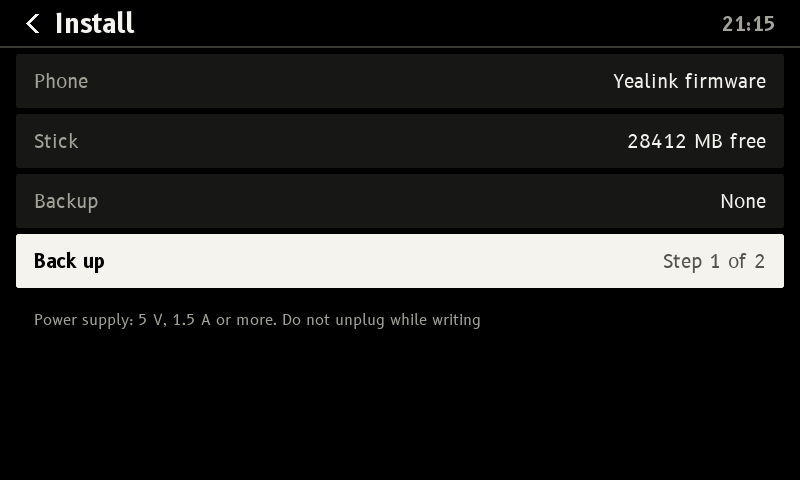
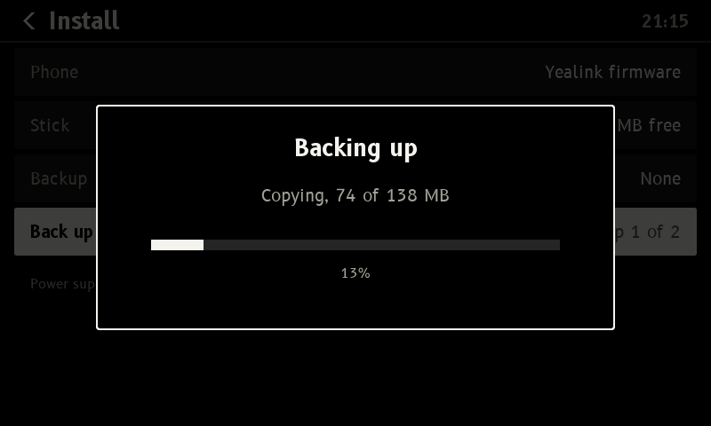
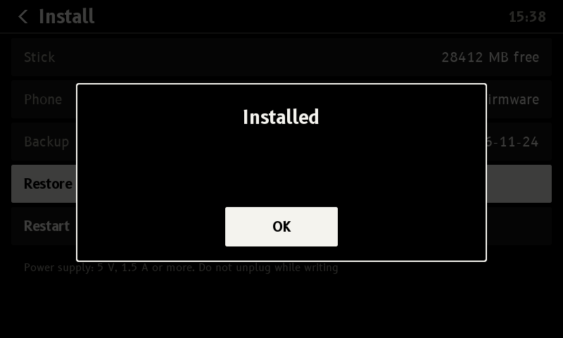
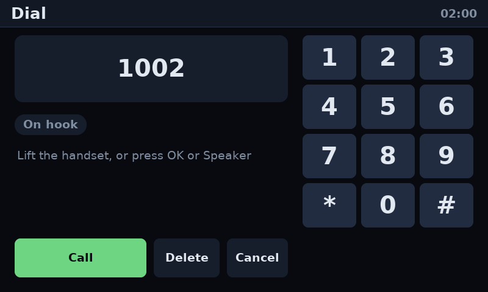
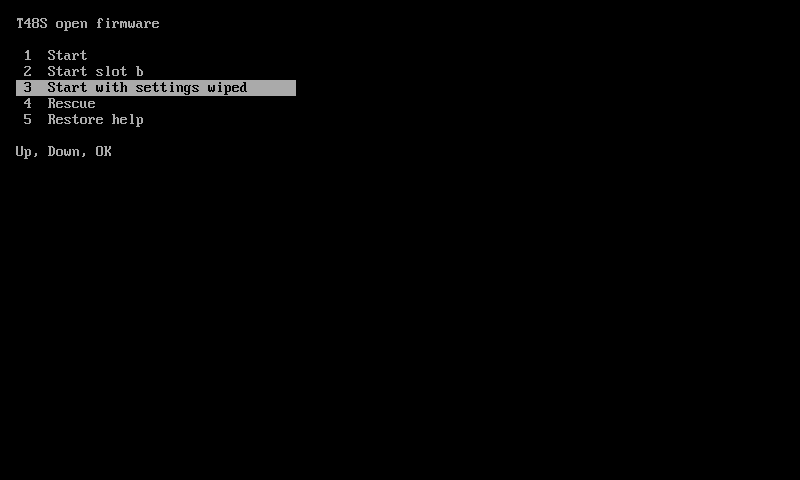

# Guide

Open firmware for the Yealink SIP-T48S. Try it from a USB stick, install it from the phone's own screen, go back to Yealink's firmware from the same screen.

**Status, 2026-11-24.** Trying, Back up, Install and Restore have run end to end on one phone, the author's. Yours would be the second: install only a phone you could do without.

Not affiliated with or endorsed by Yealink; Yealink is a trademark of its owner. Use at your own risk. Installing replaces the phone's firmware; the way back is [Restore](#go-back-to-yealink), from the stick, with the backup the installer made.

## You need

- A T48S on any Yealink firmware.
- **A 5 V power supply of 1.5 A or more.** Yealink's own adapter is 0.6 A, and the phone draws up to 0.9 A. On it the phone freezes at "Start Updating", sticks are not read, and a busy phone can freeze later.
- A USB 2.0 stick, 1 to 32 GB, with 200 MB free.
- A computer, once, to fill the stick.

## Make the stick

1. Download `t48s-stick.zip` from the [latest release](https://github.com/M0LTE/yealink-t48s/releases/latest).
2. Format the stick: one partition, MBR partition table, FAT32. This erases it.
   - **Windows**, Command Prompt as administrator: `diskpart`, `list disk`, `select disk N`, `clean`, `convert mbr`, `create partition primary`, `format fs=fat32 quick label=T48S`, `assign`, `exit`.
   - **macOS**: `diskutil list`, then `diskutil eraseDisk FAT32 T48S MBRFormat /dev/diskN`.
   - **Linux**: `sudo tools/mkusbstick.sh /dev/sdX FOLDER` does this step and the next, and checks the result. `FOLDER` is the unpacked zip.
3. Unpack the zip onto the stick: `T48S.rom`, `T48S.bin`, `T48S.rfs`, `README.txt` and the `install` folder at the top. Eject it properly.

## Try it

Nothing is written to the phone.

1. Unplug the power. Put the stick in the phone's USB socket.
2. Hold **Speakerphone**, plug the power in, keep holding until the screen shows `1. TFTP  2. USB` (5 seconds). Let go. **Do not press OK** at this menu: it resets Yealink's settings.
3. Press **2**. "Start Updating" shows, then the open firmware's clock within a minute.

The idle screen says `Running from USB. Nothing is installed.` Settings typed now are lost at power-off.

To go back: unplug the power, **take the stick out**, plug the power in. With the stick left in, Yealink's firmware tries to update itself from it and resets its settings.

## Install it

Yealink's firmware is replaced. The backup is the way back, so it comes first: the page offers one step at a time.

| | |
|---|---|
|  |  |
|  |  |

1. Start from the stick, as above.
2. **Settings** (Down on the idle screen), **Install**.
3. **Back up.** The phone's whole flash is copied to the stick, 138 MB in the folder `t48s-backup`, and checked three ways. About 3 minutes.
4. **Install**, and answer the question. About 3 minutes. Do not unplug.
5. `Installed`. **Take the stick out.** The phone restarts by itself, into the open firmware from now on.

Copy `t48s-backup` from the stick to a computer and keep it. It is the only copy of this phone's Yealink firmware, and it holds Yealink's settings, passwords included, and the phone's private keys. Keep it private.

If the power fails during Install: start from the stick again and choose Install again. The steps are made to be repeated.

## Use it

| Key on the idle screen | |
|---|---|
| Digits | dial |
| OK | apps |
| Up | calls |
| Left | contacts |
| Right | do not disturb |
| Down | Settings |
| X, or any key above, held 5 s | key test ([shell.md](shell.md#the-key-test)) |

- **Accounts.** Settings, Accounts: up to six SIP accounts. User, Password and Server host are enough for most; `host:port` gives a port. Calls go out from the default account; Left and Right in the dialler pick another. [phone.md](phone.md).
- **Calls.** Lift the handset or press Speaker. Hold, mute, transfer, a second call, voicemail on the Message key. On Speaker one side is heard at a time. The headset socket is untried.
- **Contacts and calls.** Left for contacts, Up for the call list. A name shows wherever its number does.
- **Do not disturb.** Right on the idle screen, or Settings, Do not disturb. DND shows in the header, after the network address. Callers are told the phone is not available, nothing rings, and each call is listed as missed.
- **Web setup.** Typing a password on the phone is slow. Settings, Access, Web setup turns on a page for a browser on the same network; the phone shows a code to pair it. Accounts, contacts, sound, keys, a settings backup. [web.md](web.md).
- **Apps.** Settings, Apps lists what the feed offers. Install, update, remove. [apps.md](apps.md); to write one, [sdk/README.md](../sdk/README.md).
- **Themes.** Settings, Screen, Theme. Three: [design](design/README.md).

| | |
|---|---|
|  |  |
|  |  |

## Updates

On an installed phone: **Settings, Update**, **Check now**, then **Install** and **Restart**. Nothing is fetched or installed unless asked.

- **Channel.** `stable` is the newest release. `testing` is the newest build of `main`, a few times a day and untried.
- An update goes into the system slot not in use and gets one try. If the phone is not up a minute after the restart, the next start goes back to the slot that worked.
- **Install kernel** shows when the channel's kernel differs from the phone's. There is one kernel, with no fallback: a kernel that does not start needs the stick.

More: [install.md](install.md#updates-and-fallback).

## SSH

Off until turned on: **Settings, Access, SSH**. The phone shows its host key first. Login is as root, by key only.

**Add key** opens password login for ten minutes with a password shown on the screen, so `ssh-copy-id root@ADDRESS` can put a key on the phone; it closes when the key arrives. Or paste the key into the Access page of web setup. **Remove all keys** empties the list. [access.md](access.md).

## Rescue menu

On an installed phone, hold **X** from power-on until the menu shows, about 3 seconds after the logo. Up, Down and OK, or the number.

| | |
|---|---|
| Start | as usual. Also what happens after a minute |
| Start slot b | the other system slot, this once |
| Start with settings wiped | asks first. Settings, accounts, keys and apps are moved aside in `/data`, not deleted |
| Rescue | a small system: the address on the screen, SSH with a one-time password it shows, a serial shell |
| Restore help | how to go back to Yealink's firmware |

The same menu shows by itself when no system starts, with Rescue, Restart and Restore help.

## Go back to Yealink

1. Start from the stick that holds `t48s-backup` (Speakerphone, 2).
2. **Settings, Install, Restore Yealink firmware**, and answer the question. About 3 minutes.
3. `Restored`. **Take the stick out.** The phone restarts by itself, into Yealink's firmware.

The phone's flash is then byte for byte what the backup holds. The open firmware's settings are gone.

Restore needs this phone's own backup. Without the `t48s-backup` folder there is no way back from the screen.

## Troubleshooting

| | |
|---|---|
| Stops at "Start Updating" | The power supply. Use 5 V at 1.5 A or more |
| Freezes, then restarts itself half a minute later | The power supply again. Loud ringing, a bright screen and a busy phone together are more than 0.6 A |
| The menu never shows | Speakerphone was let go too early, or another key was held |
| "Usb failed" | The stick could not be read: not FAT32 on an MBR partition, or a stick this U-Boot dislikes. Try a plain USB 2.0 stick of another make |
| "Update failed" | The files on the stick are damaged. Copy them again |
| `RESCUE` on the screen | The kernel started and found no system. From a stick: `T48S.rfs` is damaged, copy it again. On an installed phone: start from the stick and Install again |
| Install page: Stick `Not found` | The phone was not started from this stick, or the supply is too small for it |
| Install page: `Restore needs the stick that holds this phone's backup` | The phone has the open firmware and this stick has no `t48s-backup`. Copy the folder back onto it |
| Install: `No install files` | The `install` folder is missing from the stick. Unpack the zip again |
| `Installed` or `Restored`, the stick is out, no restart | Unplug the power and plug it in. Nothing is lost |
| `Stick needs 160 MB free` | Make room, or use another stick |
| `The stick holds another phone's backup` | Move that `t48s-backup` folder off the stick first |
| `Backup on the stick is damaged` | The stick has lost data. If the phone is still on Yealink's firmware, rename the folder and Back up again |
| `Bad block in kernel or app. Not supported yet` | This phone's flash has a worn block where the firmware goes. It cannot be installed yet |
| `Kernel not written. Do not restart` | Choose Install (or Restore) again before anything else. A phone restarted now stops at the logo; the stick start still works and repeats the step |
| The logo, and nothing more, after an install | Start from the stick and Install again, or Restore |
| Settings were reset after trying it | The stick was in the phone at the next ordinary start. Yealink's firmware did that; the backup, if one was taken, has the old settings |

Recovery mode (Speakerphone at power-on) is in the phone's loader, which is never written. Whatever else is in the flash, the stick starts.

If no stick will start, the same recovery mode takes the files over the network: menu option 1, a TFTP server on a second computer, and `t48s-live.tar.gz` from the release. [live-image.md](live-image.md). Started that way, the idle screen says so if Yealink's settings will be reset at its next start.

## For developers

[developing.md](developing.md).
