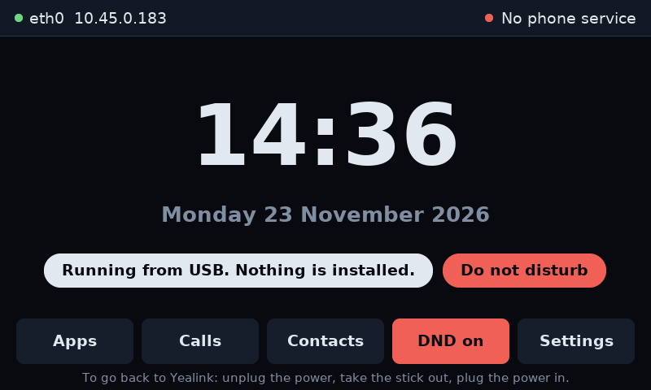

# Live image: try our firmware without installing it

Issue [#7](https://github.com/M0LTE/yealink-t48s/issues/7). This is the "try it" path from [architecture.md](architecture.md): an owner copies four files to a USB stick, holds Speakerphone while powering the phone up, presses 2, and our firmware runs from RAM. Nothing of ours is written to the phone, and a normal power-up brings Yealink back. The same files also work from a TFTP server (menu option 1), which is how we tested first.

**Where this stands (2026-11-23).** Proven on the phone: our kernel and root filesystem boot through recovery mode over TFTP. Done offline since: a ROM file we are allowed to share, the stick generator and checker, the formatting script, the live boot step and its screen note, and the move onto the first stage and system image of [boot.md](boot.md) (built and checked; not yet started on the phone in this form). **Not working: the USB stick.** Two different sticks (a 4 GB one on 2026-11-22, a 32 GB SanDisk Ultra Fit on 2026-11-23) both froze U-Boot at the same line, before it read anything from them. It is not the files, the format or anything the stick says: see [Why the sticks froze](#why-the-sticks-froze). **Until a stick is seen to work, the way to try our firmware is TFTP** (menu option 1), which works.

## The stick

| File | What |
|---|---|
| `T48S.rom` | a 4 KB label, built by `tools/mkliveimage.py`. U-Boot checks it before it will start anything. Not Yealink firmware |
| `T48S.bin` | our kernel with the first stage built in (U-Boot legacy image), `kernel/build.sh live`. 2.5 MB; must stay under 4 MB. Linux 6.18 can be the kernel instead: see [The same with Linux 6.18](#the-same-with-linux-618) |
| `T48S.rfs` | the system image: Buildroot's `system.img` as the one file in a cpio archive, padded with zeros to exactly 8 MB |
| `README.txt` | the owner's instructions, plain text |

Build the set and put it on a stick (Linux):

```
buildroot/build.sh WORKDIR                                # WORKDIR/output/images: firststage.cpio, system.img
ROOTFS=firststage.cpio sh kernel/build.sh live            # in the kernel container: T48S.bin
tools/mkliveimage.py usb STICK bin=T48S.bin system=WORKDIR/output/images/system.img
sudo tools/mkusbstick.sh /dev/sdX STICK                   # ERASES the stick, then checks it
```

`mkusbstick.sh` refuses anything that is not a whole USB disk. It ends by reading the stick back the way U-Boot will (`tools/mkliveimage.py checkstick`), which you can also run on any stick or image: it says `PASS` or names what U-Boot would trip over.

For TFTP, `tools/mkliveimage.py build OUT bin=... system=...` writes the same three files without the README; serve them with `sudo tools/tftpd.py OUT 69 --rom-once`.

### What kind of stick, and how to format it

What U-Boot 2.5.3.0-T48S needs is read from its code (`dumps/uboot.dis`); what it likes is Yealink's own advice plus caution. **No stick has worked on our phone yet**: two have frozen U-Boot before it looked at their contents ([Why the sticks froze](#why-the-sticks-froze)), so nothing in this section is proven and none of it can cure that freeze.

| | Needed (from the code) | Why |
|---|---|---|
| Partition table | **MBR** ("msdos"), with the files in primary partition 1 | U-Boot only ever asks for partitions 1 to 4 of the first stick and takes the first that exists. A stick formatted with no partition table is rejected, and so is GPT (its protective entry looks like partition 1 and holds no FAT) |
| Filesystem | **FAT32** or FAT16. Not exFAT, not NTFS | the FAT code looks for the "FAT32"/"FAT" label in the boot sector |
| Sector size | 512 bytes | checked against the filesystem |
| Files | in the top folder, names exactly `T48S.rom`, `T48S.bin`, `T48S.rfs` | upper or lower case does not matter: U-Boot compares the 8.3 names without case |
| Speed | a USB 2.0 "high speed" device | U-Boot drives the high-speed controller only |

Recommended, to give the old USB code as little to dislike as possible:

- **A plain, name-brand USB 2.0 stick of 4 to 32 GB.** Yealink's support notes say Kingston work best. Good buys today: SanDisk Cruzer Blade 16 or 32 GB (USB 2.0), Kingston DataTraveler SE9 or DT20 (USB 2.0). A few pounds each.
- **One partition, FAT32, default cluster size, freshly formatted**, then only our four files copied on. That keeps each file in one piece at the start of the stick.
- Avoid: USB 3 sticks (blue socket tongue), sticks over 32 GB (they come as exFAT and Windows will not make FAT32 on them), sticks with a built-in "CD" or security partition, multi-slot card readers, hubs and extension leads.
- Fallbacks if a stick fails: another brand of USB 2.0 stick; an old small one from a drawer (1 to 8 GB); a single-slot USB 2.0 card reader with a 2 to 8 GB SD card.

Formatting without Linux. Both of these erase the stick; check the disk number twice.

- **Windows** (Command Prompt as administrator): `diskpart`, then `list disk`, `select disk N`, `clean`, `convert mbr`, `create partition primary`, `format fs=fat32 quick label=T48S`, `assign`, `exit`. Then copy the four files in Explorer and use "Eject".
- **macOS** (Terminal): `diskutil list`, then `diskutil eraseDisk FAT32 T48S MBRFormat /dev/diskN`. Copy the four files in Finder and eject. The hidden files macOS adds do no harm.

### What is in the two files, and why

A boot of ours is a first stage and a system image ([boot.md](boot.md)). U-Boot gives us two files to put them in: the kernel, and a ramdisk it loads 4 MB above the kernel. The split is:

- **`T48S.bin` holds the kernel and the first stage**, built in as on a kexec boot. It carries no keys.
- **`T48S.rfs` holds the system image**, the same `system.img` a kexec boot uses, byte for byte, as the single file `system.img` in a cpio archive. The kernel unpacks that archive over the first stage, so the first stage finds `/system.img` in RAM beside it and mounts it read-only, exactly as on a kexec boot. `buildroot/board/t48s/firststage/init` needed no change.

Why this way round:

- **It is the only split that fits.** The kernel file must stay under 4 MB. Kernel and first stage are 2.5 MB; the system image is 2.4 MB and growing, so it cannot go in the kernel file, and the ramdisk's 8 MB has room for it.
- **One system image however the phone was started**, which is the point of the boot design: what is tried from a stick is what kexec runs today and what an install will write.
- **Rescue still works.** With the first stage inside the kernel, a stick whose `T48S.rfs` is missing, cut short or damaged does not end in a kernel panic: the kernel falls back to the first stage alone, and that comes up as the rescue system with the reason on the screen. Putting the first stage in the ramdisk beside the system image would have saved 1 MB of kernel file and lost that.
- **Nothing is unpacked twice.** The archive is not compressed, because the system image already is (squashfs, xz). The old way (the whole root filesystem as a gzip cpio, unpacked into RAM) cost about 7 MB of RAM; this costs the system image's own size.

`/data` is in RAM on a live boot whatever the flash holds: `t48-data` sees `t48boot=live` and leaves the flash alone, and `t48-data format` refuses. So a phone that already keeps our `/data` in flash ([flash.md](flash.md)) still starts clean from a stick, and the stick writes nothing.

### Why the ramdisk is padded

U-Boot's `bootstorage` loads the kernel at 0x02680000 and the ramdisk 4 MB higher at 0x02a80000, then starts the kernel with no word about the ramdisk's size. Our kernel's built-in command line says `initrd=0x02a80000,0x800000`: it takes 8 MB from there whatever the file's length. So `T48S.rfs` is the archive followed by zeros up to 8 MB. Linux unpacks the archive and skips zeros after it; with anything else after it (whatever was in RAM) it gives up. Both cases were run under QEMU with this archive and Linux 3.6.11 (2026-11-23): padded, it unpacks without a word; with a random tail the kernel says "rootfs image is not initramfs (junk in compressed archive)", puts the first stage back, and that comes up as rescue. What QEMU did not show is the step after it, the first stage mounting the image: the test board's kernel stopped before starting any init, with or without a ramdisk. That step is the same script and the same file name as a kexec boot, which runs on the phone daily; the first real proof is test 4 below.

Limits: the kernel file under 4 MB (or the ramdisk lands on its end; `kernel/build.sh` and the generator both check), the system image under 8 MB (today 2.4 MB). There is room above that: about 15 MB lies between the ramdisk address and U-Boot's own stack, if the kernel's command line is changed to match.

## The same with Linux 6.18

Issue [#55](https://github.com/M0LTE/yealink-t48s/issues/55). The stick or TFTP folder is the same three files; only `T48S.bin` differs. **Linux 6.18 is the default since 2026-11-24**: CI builds this set and the release carries it as `t48s-live.tar.gz`. The 3.6 set described above is the fallback and is built by hand. **Built and checked on a PC (2026-11-23); not yet started on the phone**: the [cold-boot test](#cold-boot-test-for-linux-618) below is that first start.

```
ROOTFS=firststage.cpio LIVE=1 sh kernel6/build.sh WORKDIR     # in the kernel6 container: WORKDIR/T48S.bin
tools/mkliveimage.py usb STICK bin=WORKDIR/T48S.bin system=system.img kernel=6.18     # or: build OUT ... for TFTP
```

Without `kernel=6.18` the generator refuses a 6.18 file, and with it refuses anything else, so the two cannot be mixed up by accident. `T48S.rom` and `T48S.rfs` come out byte for byte the same as for 3.6.

**What U-Boot hands over, and what we do with it.** Read from U-Boot's code (0x03B20448) and its serial log: it copies the kernel from 0x02680000 to the load address named in the file's header, and enters it there with the machine number 2342 and a short list of "tags": one block of memory and Yealink's own command line (`root=/dev/ram0`, `mem=124M`, no console). There is **no tag for the ramdisk and no device tree**. Linux 6.18 needs a device tree, and nothing in those tags is of use to us, so the 6.18 live kernel **ignores them entirely**: memory, command line and the ramdisk's place (the 8 MB at 0x02a80000) are all in the device tree that rides on the end of the kernel file (`kernel6/dts/t48s-live.dtsi`), the same arrangement the kexec start already uses on the phone every day. Merging U-Boot's tags into the device tree, which the kernel can do, was rejected: it would bring in Yealink's command line and gain nothing.

**Where it is loaded.** Yealink's kernels and our 3.6 one tell U-Boot to copy them to 0x0e000000, which is above the phone's 128 MB (U-Boot does it, and it works, so that address reaches RAM some other way). A 6.18 kernel must not go there: its device tree would be left at an address outside the memory the kernel is told about, and the kernel would later hand that memory out with the device tree still in it. So the 6.18 file names **0x00408000**, where the kexec loader puts the same kind of file. From there the kernel's unpacker does what it does on every kexec start: finds from the device tree that RAM starts at 0x00400000, moves itself and the device tree up out of the way, and unpacks the kernel underneath.

| | Address |
|---|---|
| U-Boot reads `T48S.bin` (2.05 MB) | 0x02680000 to 0x0288d000 |
| U-Boot reads `T48S.rfs` (8 MB) | 0x02a80000 to 0x03280000 |
| U-Boot copies the kernel to, and enters it at | 0x00408000 |
| The unpacked kernel and its zeroed data | 0x00408000 to 0x00a18008 |
| The unpacker, moved clear, with the device tree, its stack and heap | below 0x00c46000 |
| Free between that and the ramdisk | 30 MB |
| U-Boot itself | 0x03b00000 |

`tools/mkliveimage.py checkbin T48S.bin kernel=6.18` works this table out from the finished file (the sizes the kernel records about itself, and the device tree on its end) and refuses a file in which anything would overlap, the ramdisk is not the 8 MB U-Boot loads, the load address is outside declared RAM, or the command line lacks `t48boot=live`. `kernel6/build.sh` runs it on every live build.

**Checked under QEMU** (`kernel6/qemu-live-test.sh`, a test board with the same kind of processor): the files are placed in memory as U-Boot places them, and the kernel is entered as U-Boot enters it, with a copy of U-Boot's tag list including Yealink's command line. The kernel placed itself at 0x00400000, took the ramdisk from the device tree, used our command line and nothing of U-Boot's, unpacked the system image, and the first stage started it: the whole system came up to its shell, and the running system image had the same SHA-256 as the file that went in. Also run with the kernel left where U-Boot reads it (load address 0x02680040, the fallback in the test below), and with rubbish after the archive in the ramdisk. In that last case 6.18 differs from 3.6: it reports `Initramfs unpacking failed` but keeps what it had already unpacked, so the system image still starts.

**What QEMU cannot show**: that this U-Boot copies a kernel to 0x00408000 as happily as to 0x0e000000 (it is ordinary U-Boot code, and Yealink's own kernel unpacks itself to the same place, so the memory is free), and every phone driver starting cold. The cold-start table further down applies to 6.18 as well; its drivers are ports of the same code.

## What U-Boot does on the USB route

From the code at 0x03B1581C, in order, with what the serial port and the screen show:

1. Speakerphone held: `scan key=40` twenty times, then the menu "1. TFTP / 2. USB" on the screen.
2. **2** pressed: "Start Updating..." on the screen. Serial: `usb_detect start`, `USB: Port 1 has been brought up as Host`, `scanning bus 1 for devices...`, `2 USB Device(s) found` (the phone's own port and the stick).
3. `scanning usb for storage devices...` then `1 Storage Device(s) found`. **This is where both sticks froze**, after the first of these two lines.
4. `Usb detect,dev:0 part:1`. If instead it prints `Usb no detect` lines and the screen says **"Usb failed(-4)"**, the stick was read but has no usable partition: wrong format. "Usb failed(-1)" is the USB port failing to start. After "Usb failed" U-Boot just stops; power-cycle.
5. It reads the first 128 bytes of `T48S.rom` and checks them: `Rom check ok`, or "Update failed(N)" on the screen.
6. Only now does it write anything: `BOOTMODE=usbmode` into its settings partition (`userenv`), one save.
7. `run bootstorage`: loads `T48S.bin` and `T48S.rfs`, `## Booting kernel from Legacy Image at 02680000`, and our kernel's own log follows.

So a stick that fails at steps 3 to 5 has changed nothing in the phone: power-cycle and it is an ordinary Yealink start. (If `T48S.bin` is missing from an otherwise good stick, U-Boot boots Yealink's safe-mode system instead, which then tries to install the `.rom`. The generator never makes such a stick and the checker rejects one.)

## Why the sticks froze

**In short.** Two different sticks stop U-Boot dead at the same line. We have ruled out, with high confidence, everything a stick owner can change: the files, the partition table, the filesystem, and every answer the stick gives. U-Boot's own code, run on a PC with the second stick's real answers, finishes the scan and reports the stick. So the processor is being stopped by something below what software on a PC can see: how this U-Boot drives the phone's real USB controller once it starts talking to a stick's storage side. **Exactly what, we do not know**, and it cannot be found without the phone on the bench. No stick layout avoids it, and no U-Boot setting touches it.

**What the serial log shows** (`/root/t48s/session4.log` on proxmox0). Both times: `2 USB Device(s) found` (2.75 s and 2.70 s after `usb_detect start`), `scanning usb for storage devices...`, then nothing at all until the power was pulled, 230 s later the first time. No error, no timeout message, no reset.

| | Stick | Format |
|---|---|---|
| 2026-11-22 | a 4 GB stick, make not recorded | as it came |
| 2026-11-23 17:33 UTC | SanDisk Ultra Fit 32 GB (0781:5583, a USB 3 stick running at USB 2.0 speed, 224 mA) | `tools/mkusbstick.sh`: MBR, one FAT32 partition at sector 2048, checked `PASS` |

**What the second stick answers.** `tools/usbreplay.py` asks a stick, from a PC, exactly what U-Boot's scan asks, with U-Boot's lengths, and shows each answer. Run on proxmox0 against the Ultra Fit (read-only), every answer is the plainest one possible:

| U-Boot asks | The Ultra Fit answers |
|---|---|
| GET MAX LUN (how many units) | `00`: one unit, not refused |
| INQUIRY, 36 bytes | exactly 36 bytes: a removable disk, "SanDisk", "Ultra Fit", "1.00"; status good |
| TEST UNIT READY | ready first time; no REQUEST SENSE needed |
| READ CAPACITY, 8 bytes | 62566488 sectors of 512 bytes (under the 2 TB limit of this request) |
| READ sector 0, 512 bytes | our partition table, signature `55 aa` |

No answer is longer than the buffer U-Boot gave, none is short, nothing is refused, every status block is the right 13 bytes with the right tag. One caveat: the PC asked a stick that had been powered for a while, and the phone asks 2.7 s after power comes on. The variants below cover what a just-powered stick might say instead.

**What U-Boot's code does with those answers.** `tools/ubootusbsim.py` runs the phone's own U-Boot code (`usb_init`, then `usb_stor_scan`, straight from `dumps/mtd1-uboot.bin`) in a processor emulator, against a model of the USB controller and a stick that gives the answers above. It applies the phone's rule that any unaligned access or stray pointer is a silent freeze (and has a self-test showing that check fires). The result:

- **With the Ultra Fit's answers the scan completes**: `1 Storage Device(s) found`, one unit, MBR partition table seen, right size and name. No unaligned access, nothing read or written outside U-Boot's own memory. The emulated first phase takes 2725 ms of U-Boot's own delays, against 2.70 s on the phone, which fits the phone having run the same path up to the scan.
- **Every awkward stick we could invent ends in a printed message, never a freeze**: not ready (3 or 30 times), GET MAX LUN refused, 4 or 8 units, answers that never come (`EHCI timed out on TD` after 10 s each), a stick that goes silent altogether (`error in inquiry` after 105 s), 4096-byte sectors, zero or absurd capacity, a non-disk INQUIRY, random leftovers in U-Boot's stack and heap, a controller reporting more ports.
- Reading the disassembly agrees: every buffer the scan hands the controller is 32-byte aligned and padded (so the "Misaligned buffer address" warning never prints), the data cache and MMU are off (`enable_caches` is never called), interrupts are never enabled, a division by zero prints `raise: Signal # 8 caught` and carries on, and every wait on the controller is bounded by a timer that prints when it expires.

**So what is left.** The stick's partition table and files are never the cause: sector 0 is the last thing the scan reads and the scan handles any content. What the PC cannot reproduce is the phone's real controller, its PHY and its power, driven by this U-Boot. The scan is the first time U-Boot sends anything but small set-up requests: the first traffic on the stick's two bulk endpoints, the first 512-byte packets. Something in that stops the processor (no exception handlers are installed, so any fault is silent), and it happened with two unrelated sticks. Whether a different stick would get through is unknown: Yealink's support notes say Kingston sticks "have better compatibility", which suggests some do.

Confidence: high that it is not the files, the format or the stick's answers; high that no layout can fix it; low on the actual mechanism.

**Is there a setting?** No. Nothing in U-Boot's environment is read by its USB start-up or its storage scan, and we do not write U-Boot's environment anyway.

**What would tell us more** (each is one power-up with the serial log running; none writes anything to the phone):

1. **No stick at all**: hold Speakerphone, power on, press 2 with the socket empty. The emulator predicts `1 USB Device(s) found`, `scanning usb for storage devices...`, `0 Storage Device(s) found`, then `Usb no detect` lines and "Usb failed" on the screen. If that is what happens, the freeze needs real traffic to a stick. If it freezes even so, the stick was never involved.
2. **The same Ultra Fit through a mains-powered USB 2.0 hub** (U-Boot has hub support; expect `3 USB Device(s) found`). If it then prints `1 Storage Device(s) found`, the cause is the power the stick draws from the phone.
3. **A plain low-power USB 2.0 stick of another make**, a Kingston DataTraveler for choice, formatted by `tools/mkusbstick.sh`. If it works, the freeze depends on the stick at the electrical level, and the recipe becomes "this kind of stick".

To record a stick that froze: `lsusb -v -d VENDOR:PRODUCT`, `sudo tools/usbreplay.py VENDOR:PRODUCT` and `sudo tools/mkliveimage.py checkstick /dev/sdX` on a Linux PC.

## What U-Boot checks in the ROM

U-Boot checks only the head of the ROM (128 bytes from a stick; about 2936 bytes over TFTP, where it then aborts the transfer on purpose), prints `Rom check ok`, and boots the `.bin` and `.rfs`. The check is in U-Boot at 0x03B15274; it was read out of the disassembly and confirmed byte for byte against a genuine 66.82.0.31 ROM (the generator reproduces that ROM's stored CRC exactly). There is **no cryptographic signature** anywhere; the whole gate is a CRC plus model and version fields.

The header is 128 bytes of big-endian 32-bit words:

| Offset | Field | How U-Boot uses it |
|---|---|---|
| 0x00 | magic | must equal `0xAD24EC0B`, else `Rom magic Err` |
| 0x04 | header length | how many bytes the CRC covers (0x80) |
| 0x08 | header CRC32 | `crc32` over the header with this field zeroed, seed 0, ordinary IEEE; else `Rom crc Err` |
| 0x0c | tool/format | not checked against the board |
| 0x10 | flags | bit 0 "force" skips the hwid and swid checks; bit 16 "skipoem" skips the OEM check |
| 0x14 | body length | informational; U-Boot never reads the body |
| 0x1c | module count | not checked (U-Boot runs no module loop; that is the userspace updater, which we never reach) |
| 0x20 | primary hwid | compared to the phone's hwid; if different, U-Boot scans the list at 0x64 |
| 0x34 | OEM name | `strcmp` against the phone's `phoneoem` env, unless skipoem; else `Rom OEM Err` |
| 0x44 | version string | not checked |
| 0x5c | hw revision | must be >= the phone's, unless force |
| 0x60 | swid | must be >= the phone's `phonesid` env, unless force |
| 0x64 | supported-hwid list | 16 bytes; the phone's hwid must appear here (or at 0x20) |

Hardware ids: 65 = T48S, 66 = T46S, 67 = T42S, 68 = T41S, 69 = T27G, 70 = T54S, 74 = T52S.

`tools/mkliveimage.py` writes a header with the right magic and CRC, sets **force** and **skipoem** (so hwid, swid and OEM are never compared; those differ between firmware versions and resellers), and lists every T4xS hwid at 0x20 and 0x64. The body is zero padding. It carries none of Yealink's code. `tools/mkliveimage.py check T48S.rom 65` runs U-Boot's exact logic on any ROM and prints `PASS` or `REJECTED`.

## Leaving the phone as it was: the BOOTMODE flag

The danger is not U-Boot and not our image; it is Yealink's own firmware on the **next** normal boot. U-Boot saves `BOOTMODE` in its `userenv` partition before a recovery boot, and Yealink's start-up script (`rcS`) reads it, clears it, and runs the matching script:

| Route | U-Boot saves | What Yealink then does once | Effect on the owner |
|---|---|---|---|
| USB | `BOOTMODE=usbmode` | `usbmode.sh`: waits 20 s for a stick. **If one is plugged in**, runs `reserve.sh` and tries to install `T48S.rom` from it. If none, it does nothing | stick left in: **settings wiped**. Stick taken out: nothing lost |
| TFTP | `BOOTMODE=resumemode` (and the addresses typed in) | `resumemode.sh`: runs `reserve.sh`, then tries to fetch and install the ROM | **settings wiped**, every time. This was the "factory reset" of 2026-11-22 |

`reserve.sh` is the wipe: it erases the whole `/config` partition and puts back four whitelisted paths. Account, timezone, language and web password are gone.

So the USB route is the gentle one: **take the stick out before powering back up and nothing is lost**, even if nothing clears the flag. That is from reading Yealink's scripts and is on the test plan to confirm, including one detail: on that first boot `usbmode.sh` runs instead of the script that starts the phone application, so the phone may sit at the logo and need one more power cycle.

### Clearing it ourselves

Tom approved one write (2026-11-23): the live image may take `BOOTMODE` out of `userenv`, exactly as Yealink's own start-up does on every boot. It is built so that it cannot become anything more:

- **The kernel does it, not userspace** (`kernel/drivers/t48s_bootmode.c`). `/sys/kernel/t48s_bootmode/mode` reads the flag. Writing the word `BOOTMODE` to `clear` is the whole interface: no data comes from userspace. The kernel reads the 4 KB settings block, checks its CRC, builds the same list of variables without `BOOTMODE`, and hands it to the flash driver. No flag, no write. At most one write per boot. An unreadable block is never rewritten.
- **The flash driver does the write and checks the address itself.** The file above contains no flash-writing code. It calls `t48s_nand_userenv_rewrite(block, data, len)`, which the flash driver must provide and which may accept only one block inside `userenv`. **The flash driver does not provide it yet**: it writes our `/data` range and nothing else ([flash.md](flash.md)), so today "clear" answers "this kernel's flash driver cannot write" and `userenv` is not touched. Giving the driver this one function (erase that block, program two pages with its usual error correction, erased check and read-back, refuse any other address) is what switches the clearing on, and is the step to review.
- **The logic is tested without the phone.** `tools/test-bootmode.sh` runs the kernel's own parsing and rebuilding code on a PC against made-up blocks and the real `userenv` dumps, and compares with an independent implementation. `tools/test-live.sh` runs the boot step through every case.

`t48-live boot` (run by `rcS`, before the services start) does this on a live boot only (the live kernel's command line says `t48boot=live`), then leaves a note that the idle screen shows for the whole session. Its first line leads the screen's one row of notices, ahead of missed calls, messages and do not disturb; its second takes the bottom line:



The second line is always true for what actually happened: "take the stick out" on the USB route, and on the TFTP route either "unplug the power and plug it in again" or, if the flag could not be cleared, a plain warning that Yealink's settings will be reset. `t48-live status` prints what was found and done.

**Settings** are typed on the phone (Settings on the idle screen: network, SIP account, access). On a live boot they are in RAM and gone at power-off. There is no settings file to prepare; a web page for this is issue #37. SSH is off until turned on at the screen ([access.md](access.md)).

## Cold start: drivers when Yealink never ran

On a recovery boot the chain is **boot ROM -> U-Boot -> our kernel**; Yealink's kernel never runs, so anything Yealink's drivers used to set up is either left by U-Boot or not set at all. Status per driver (the kexec-from-Yealink path is unchanged in every case; each driver detects "already running" and only initialises what it finds cold):

| Driver | On the live (U-Boot only) path | Cold-start code |
|---|---|---|
| LCD (`t48s_fb`) | U-Boot sets the PL111 up and keeps scanning out the framebuffer | none needed; works cold |
| Keypad (`t48s_keypad`) | U-Boot runs the keypad controller (it scans keys for the recovery menu), so it is found enabled | `t48s_keypad_start()` sets pin mux, bus clock, prescaler and control if `KEYC_CTRL_EN` is clear. Present, guarded, **untested from true cold** |
| Hook switch | GPIO29 read only | works cold |
| Backlight (`t48s_backlight`) | U-Boot leaves the lamp on at level 8; the driver starts from what it finds | works cold |
| LEDs (`t48s_leds`) | U-Boot state unknown; the driver sets the mux to plain GPIO, directions to output and the pins high unconditionally | cold-safe already |
| Touch (`t48s_touch`) | U-Boot does not use SPI, so this is the real cold case; the driver sets the pin mux, SPI-host bus clock, chip-select and pen-down direction unconditionally, then probes the PL022 | present; **untested from true cold** (U-Boot may leave the SPI clock gated) |
| Ethernet (`t48s_eth`) | over TFTP, U-Boot's own transfer has just used the switch. **From a stick U-Boot makes no network transfer**, so the switch may not be in the state our driver expects | works on the TFTP path; a full switch bring-up is not written. **To find out on the first USB boot** |
| Audio APM (`t48s_audio`) | **truly cold.** U-Boot does no audio, so the APM codecs are not enabled. The driver detects this and warns "cold start is not supported yet" | **not implemented.** Needs the APM reset, clock, sample-rate, FIFO and codec-enable sequence, and the voice-DSP firmware for echo cancelling. Blind replay is unsafe without the phone |

So a live boot should show the UI, keypad, touch, screen and LEDs with no Yealink. Calls need the audio cold start, and on the USB route the network is an open question; neither blocks "try the phone's interface".

## Test plan for a daytime session

**After the second freeze (2026-11-23):** the plan below was written when one stick had failed. Its first three rows are now a search for any stick that gets past `scanning usb for storage devices...`; do the three checks at the end of [Why the sticks froze](#why-the-sticks-froze) first, the empty socket before anything else. Row 3's "the format was the cause" is settled: it was not.

Goal: find a stick U-Boot will read, see our firmware come up from it, and confirm the phone comes back with its settings. Allow an hour. The phone must not be in use by anything else, and it should be on Yealink's firmware with its settings backed up (`tools/nandbackup.sh` on the issue #29 branch) before starting.

**To have on the desk**

- Two new USB 2.0 sticks of different makes, 16 or 32 GB: a SanDisk Cruzer Blade and a Kingston DataTraveler (SE9 or DT20). Plus the 4 GB stick that froze.
- The stick files, built beforehand into two folders: `A` (the smoke test of 2026-11-22: Yealink's kernel and our tiny `usbinit` ramdisk from `dumps/usbtest`, with a crafted ROM; it clears BOOTMODE itself with Yealink's tool) and `B` (our kernel with the first stage, and the system image, `mkliveimage.py usb`).
- proxmox0 writes the sticks (it has the tools): plug a stick into it, `lsblk -d -o NAME,TRAN,SIZE,MODEL` to find it, `tools/mkusbstick.sh /dev/sdX A`.

**Watch the serial port first.** The logger on proxmox0 is already running: `ssh root@proxmox0 tail -f /root/t48s/session4.log`. Have it on screen before each power-up.

**Each attempt, the same six moves**

1. Power off (pull the network cable or the power lead). Stick into the phone's USB socket.
2. Hold **Speakerphone**, power on, keep holding until the screen shows "1. TFTP / 2. USB" (about 5 s). Let go. Do not touch OK.
3. Press **2**.
4. Watch the serial log against the list in "What U-Boot does on the USB route".
5. Note where it stopped, or that it booted.
6. Power off. **Take the stick out.** Power on with no keys held.

**The order**

| # | Stick | Files | What it answers |
|---|---|---|---|
| 1 | new SanDisk | A | can this U-Boot boot from a good stick at all? Success: "BOOTED FROM USB" on the screen, `alive N s` lines on serial, and the next normal boot is ordinary |
| 2 | new Kingston | A | a second make, so the recipe is not one lucky stick |
| 3 | the old 4 GB, reformatted by `mkusbstick.sh` | A | does it still freeze at `scanning usb for storage devices...`? Expected yes: that pins the freeze on the stick, not the format. If it now works, the format was the cause after all |
| 4 | whichever worked | B | our firmware from a stick: kernel log on serial, `t48 boot: starting the system image /system.img`, then the clock on the screen with the "Running from USB" note. "RESCUE" on the screen instead means the kernel started but did not get the system image out of `T48S.rfs`: keep the serial log |

During 4, on the serial shell: `t48-live status` (expect `from=usb`, and `clear=this kernel's flash driver cannot write` until the flash driver has the hook), `t48-data status` (expect `RAM`), `ip addr` and a ping (does Ethernet work when U-Boot never used it?), and try touch and keys on the screen.

After 4, the going-back check: power off, stick out, power on. Watch serial for Yealink's "Enter USB Mode" and "Not USB mounted!". If the phone has not reached its normal screen in two minutes, power-cycle once more. Then check the account and settings are as before. That confirms the owner's instructions in `README.txt`.

**If something goes wrong**

- Freeze or "Usb failed" before `Rom check ok`: nothing was written. Power-cycle, no keys: normal Yealink start.
- Our kernel hangs or the screen stays blank after `Booting kernel`: power off, stick out, power on.
- Settings lost anyway (stick left in, or the going-back check shows the scripts do something we did not read): restore from the backup. Booting stick A once also clears a stuck `BOOTMODE`, as does the TFTP rescue set (`tools/mkrescue.sh`).
- Nothing here can brick the phone: recovery mode lives in U-Boot, and U-Boot is never written.

**What to bring back:** the serial log section for each attempt, which sticks worked (make, model, size), and for the old stick the `lsusb -v` output from a PC.

## Cold-boot test for Linux 6.18

Goal: see Linux 6.18 start from U-Boot with no Yealink kernel before it, which only the kexec start has done so far (item 6 of the hands-on list in issue #55). Fifteen minutes. The procedure is the 3.6 one with a different `T48S.bin`.

**Before starting**, build two sets (they differ only in where U-Boot is told to put the kernel):

```
ROOTFS=firststage.cpio LIVE=1 sh kernel6/build.sh W                                    # W/T48S.bin
ROOTFS=firststage.cpio LIVE=1 LOADADDR=0x02680040 OUT=T48S-inplace.bin sh kernel6/build.sh W
tools/mkliveimage.py build B6  bin=W/T48S.bin         system=system.img kernel=6.18
tools/mkliveimage.py build B6i bin=W/T48S-inplace.bin system=system.img kernel=6.18
```

**By TFTP** (the route proven on this phone): `sudo tools/tftpd.py B6 69 --rom-once` on 10.45.0.183, serial log on screen (`ssh root@proxmox0 tail -f /root/t48s/session4.log`). Power off, hold **Speakerphone**, power on, let go at the menu, press **1**, and enter the addresses as before (phone 10.45.0.214, mask 255.255.255.0, gateway 10.45.0.1, server 10.45.0.183). **By stick**, once a stick is known to work (tests 1 to 3 above): `mkliveimage.py usb` instead of `build`, `mkusbstick.sh`, and press **2**. That is test 4 above with the 6.18 files.

**What to watch on serial, in order**

| Line | Means |
|---|---|
| `Rom check ok` | U-Boot accepted the label |
| `Image Name: Linux-6.18.65-t48s`, `Load Address: 00408000`, `Entry Point: 00408000` | it has our file. (Yealink's and 3.6 say `0e000000` here; `00408000` is right for 6.18) |
| `Loading Kernel Image ... OK`, `Starting kernel ...` | U-Boot copied it and jumped |
| `Uncompressing Linux... done, booting the kernel.` | the unpacker ran from 0x00408000 and found RAM from the device tree |
| `Booting Linux on physical CPU 0x0`, `Linux version 6.18.65` | the kernel is running |
| `Kernel command line: console=tty0 console=ttyAMA0,115200 earlycon t48boot=live loglevel=8` | our command line, not U-Boot's. If `root=/dev/ram0` or `mem=124M` shows here, something is wrong: keep the log |
| `Unpacking initramfs...` then `Freeing initrd memory: 8192K` | the ramdisk was found at 0x02a80000 and unpacked |
| `t48 boot: starting the system image /system.img` | the first stage found the system image |
| the shell prompt on serial; the clock and the "Running from" note on the screen | done |

**Where it can stop**

- Nothing after `Starting kernel ...`: U-Boot's copy to 0x00408000, or the jump, did not work. Power off and repeat with set `B6i` (the kernel runs where U-Boot read it; expect `Load Address: 02680040`). If that starts, the low address is what U-Boot dislikes, and `B6i` becomes the default.
- `Uncompressing Linux...` and no `done`: the unpacker. Keep the log; it is the same code path as kexec, so this would be a surprise.
- `Initramfs unpacking failed`, or "RESCUE" on the screen: the kernel is fine and the ramdisk is not where or what it expects. Keep the lines around `Unpacking initramfs`.
- The log runs but stops at a driver: note the last driver named. This is a cold start, so the table in "Cold start" applies.

**Once it is up**, on the serial shell: `cat /proc/cmdline`; `t48-live status` (expect `from=network` over TFTP, `from=usb` from a stick, and the flag not cleared); `t48-data status` (expect RAM); `dmesg | grep -i -e t48s -e initrd`; `ip addr` and a ping; then keys, touch and the lamps by hand, and `aplay` if audio came up (cold audio is not expected to work yet).

**Going back.** From a stick: power off, stick out, power on. After TFTP the flag U-Boot saved is `resumemode`, and Yealink's next start would reset its settings and with them the kexec boot hook in `/config`. So before any normal power-up, do one more recovery start with the rescue set (`tools/mkrescue.sh`, as on 2026-11-22), which clears the flag; then power up normally.

**What to bring back:** the serial log from `Rom check ok` to the prompt, which set started (B6 or B6i), and what worked of network, keys, touch, lamps and sound.

## Decisions (Tom, 2026-11-23)

1. The live image may clear `BOOTMODE` in `userenv`: yes, that one write.
2. Settings are typed on the phone. No settings file is fetched from anywhere; a web configuration page is issue #37.
3. The public image ships with SSH off until enabled at the screen.
4. USB is the preferred route; TFTP stays as the developer's one.

Note on 4 (2026-11-23): two sticks have frozen U-Boot and none has worked, so today TFTP is the only route that runs. The decision stands as the aim; it needs a stick that works before it can be the instruction.
