# The phone: dialler, calls, history, contacts

Issues [#26](https://github.com/M0LTE/yealink-t48s/issues/26), [#27](https://github.com/M0LTE/yealink-t48s/issues/27) (contacts, do not disturb, a second call, the message lamp) [#36](https://github.com/M0LTE/yealink-t48s/issues/36) (several accounts) and [#77](https://github.com/M0LTE/yealink-t48s/issues/77) (the dial plan). Design: [architecture.md](architecture.md#the-shell). Source: [`shell/phone.c`](../shell/phone.c), [`contacts.c`](../shell/contacts.c), [`dialplan.c`](../shell/dialplan.c), with [`sipc.c`](../shell/sipc.c) (baresip), [`audioc.c`](../shell/audioc.c) (the audio service) and [`leds.c`](../shell/leds.c) (lamps).

## Summary

- The shell now behaves like a desk phone. Lift the handset for dial tone, or just start typing a number. Calls ring, can be answered with the handset, Speakerphone or Headset, and can be muted, held, transferred and ended the usual ways.
- A call takes the screen from whatever is showing, including an app, and gives it back afterwards.
- **New (2026-11-23, #27):** a contact list kept on the phone, with names shown wherever a number is; do not disturb; a second call (call waiting, hold one and talk to the other, swap); asking someone first before a transfer; the lamp at the top right as the ringing, voicemail and missed-call lamp; the Message key calls voicemail.
- **New (2026-11-25, #77):** up to 16 accounts; per account an Account name, and under Advanced registration expiry, DTMF mode (RFC 2833, SIP INFO, in-band), codecs and their order, NAT keepalive ([sip.md](sip.md#running-it)).
- **New (2026-11-23, #36):** up to six SIP accounts, each with its own registration, and a choice of which one a call goes out from. See [Several accounts](#several-accounts).
- **New (2026-11-25, #77):** with the handset lifted (or Speaker or Headset on), a number is called without the Call key: at once when it is complete, such as 999 or an eleven-digit UK number, otherwise 4 s after the last digit. See [Dial plan](#dial-plan).
- **Tested in the simulator against the real services**: baresip with our modules, `t48-audiod` on its silent backend and a throwaway SIP server, with two more baresips as the people at the other end. Eighteen scripted scenarios pass, and pass again with the phone's own ARM builds of the shell, baresip and the audio service running under qemu. The new parts (#27, #36) have not run on the phone yet.
- Apps can no longer reach call control: baresip's TCP control port is gone, replaced by our own module on a socket only root can open ([sip.md](sip.md#control-interface)).

| | |
|---|---|
| 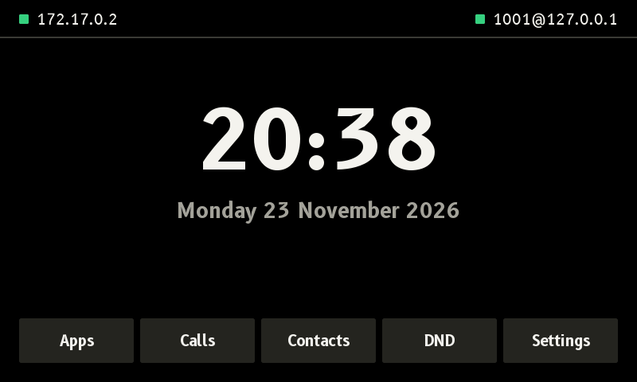 | 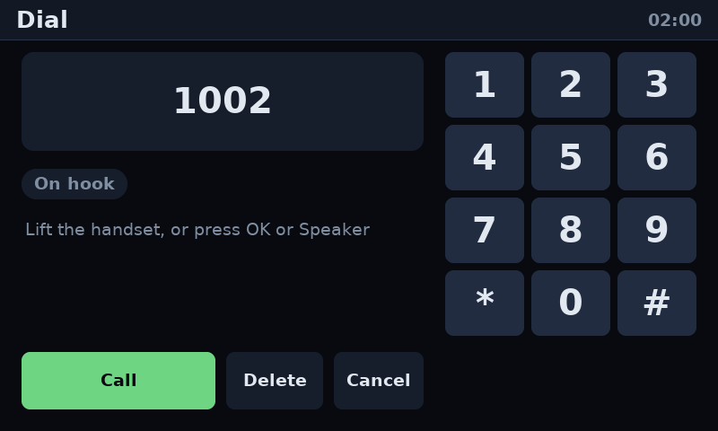 |
|  |  |
| 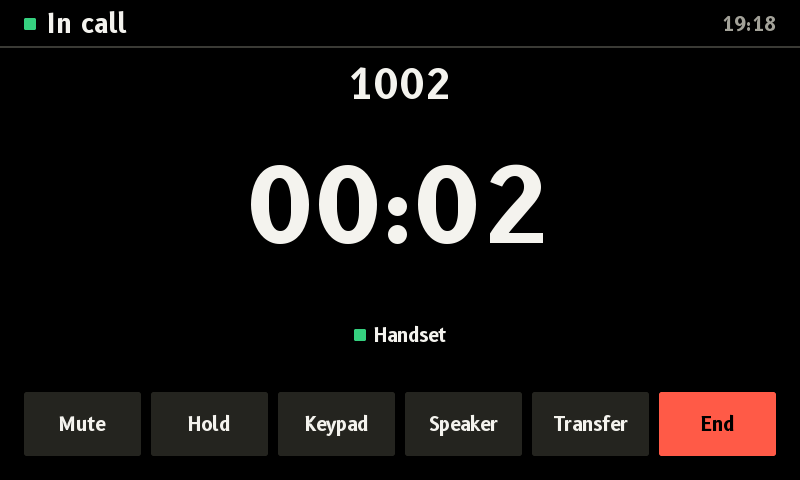 | 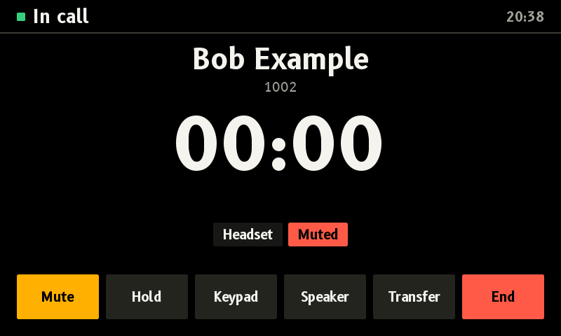 |
|  |  |
| 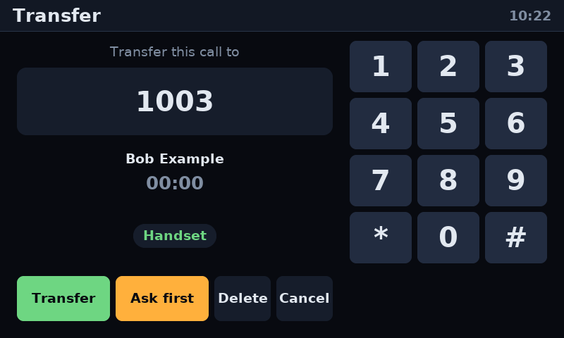 | 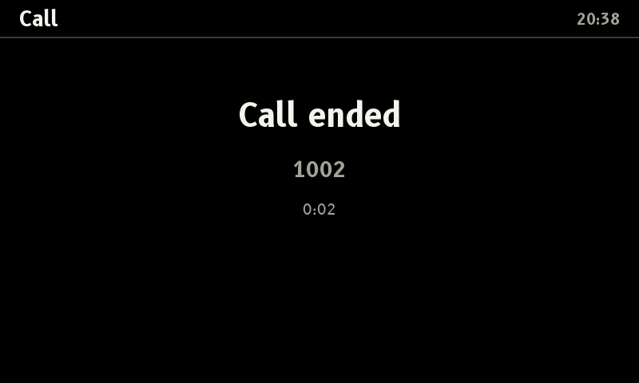 |
|  |  |
| 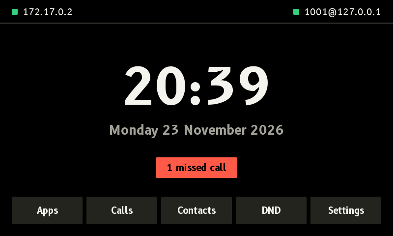 | 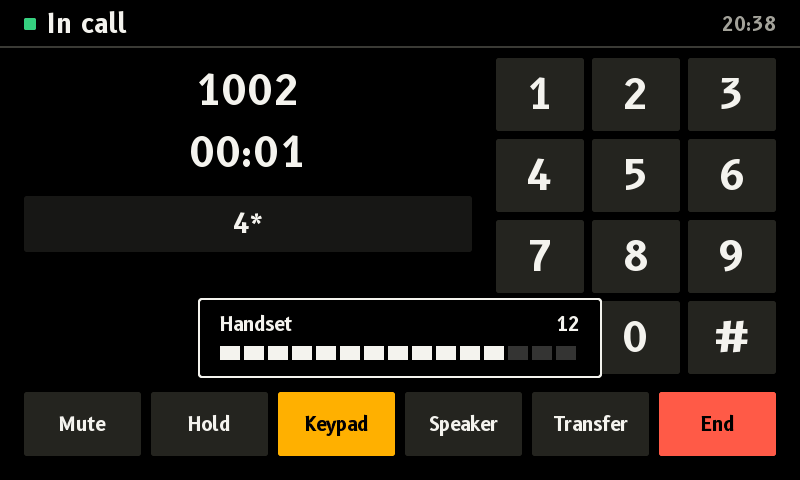 |
| 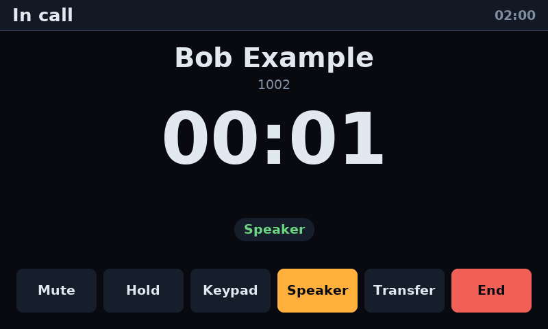 |  |
| 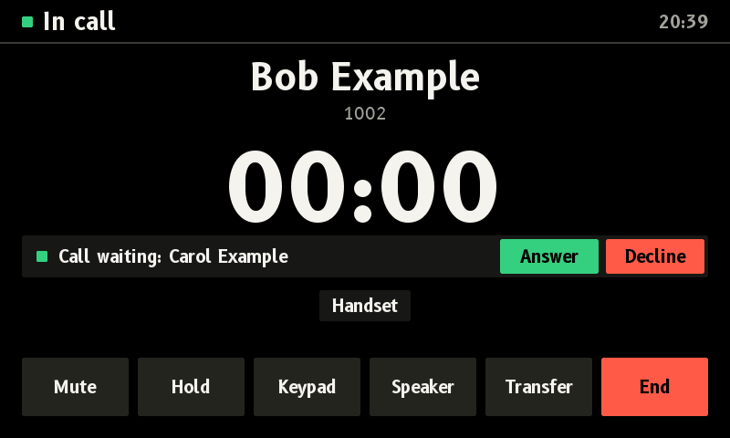 | 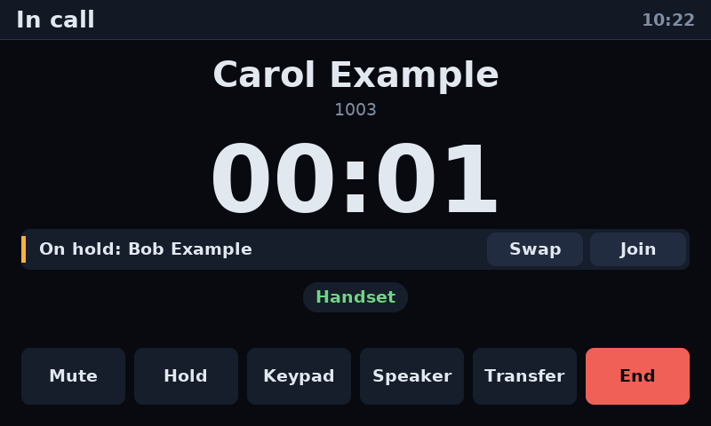 |
| 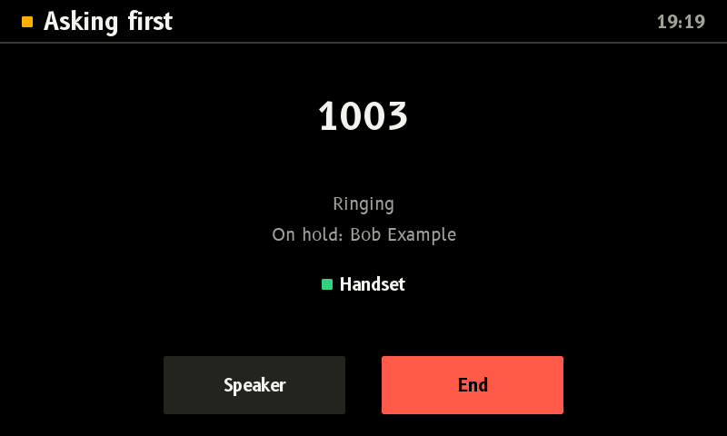 | 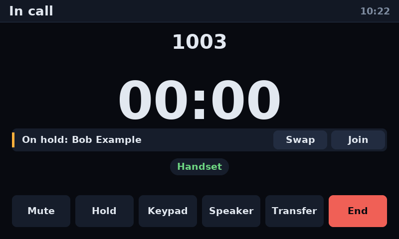 |
| 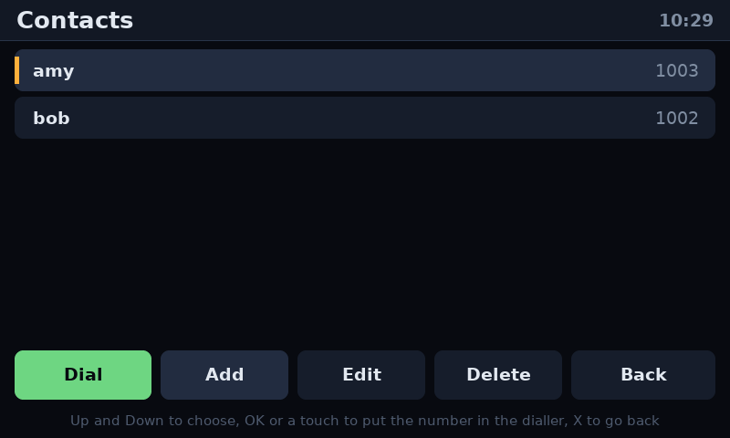 | 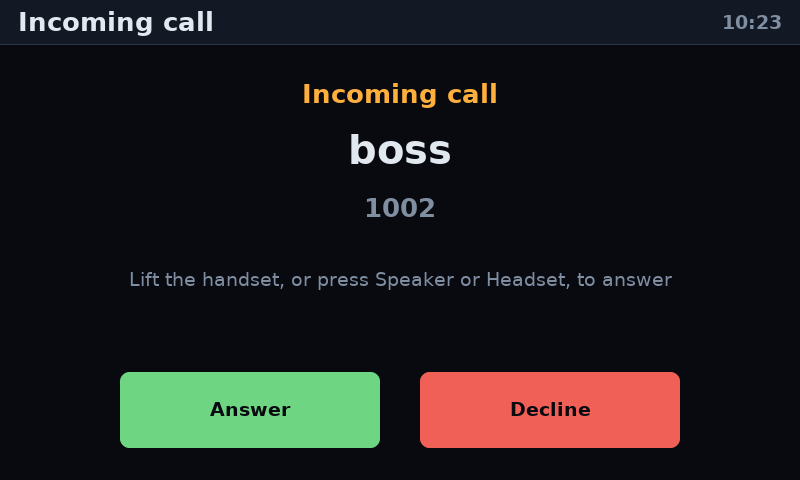 |
| 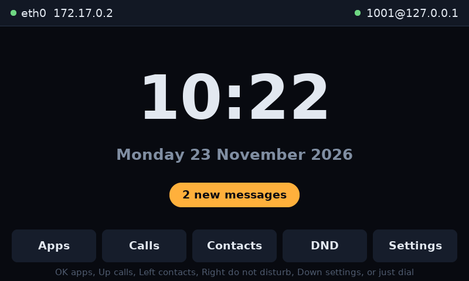 | 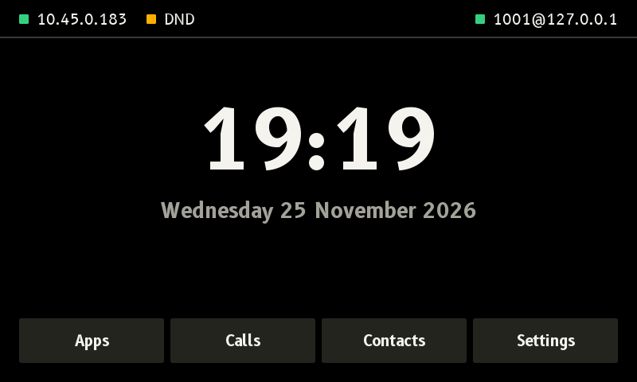 |
| 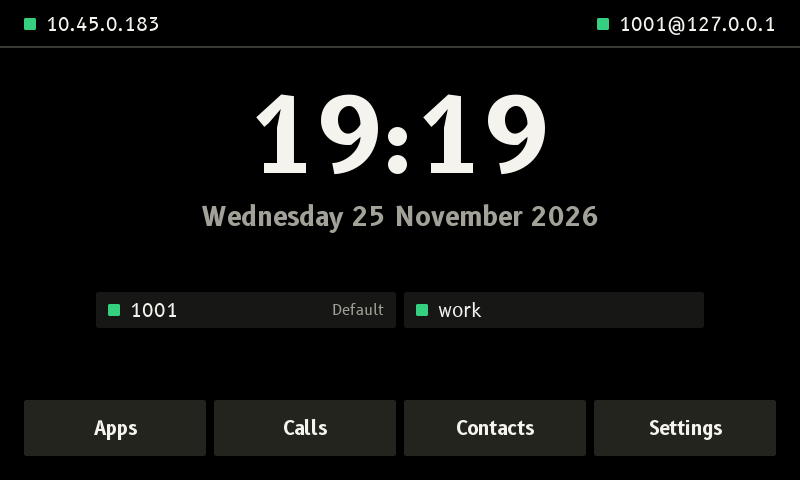 | 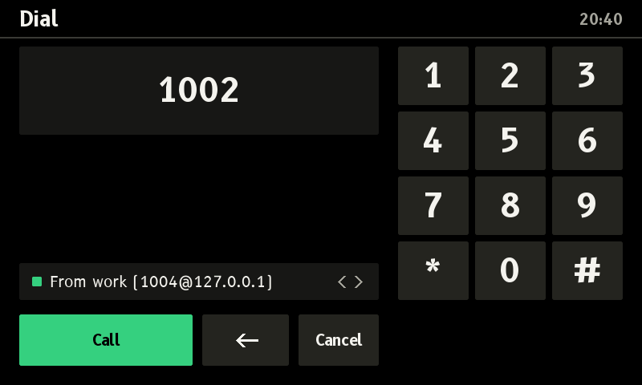 |
| 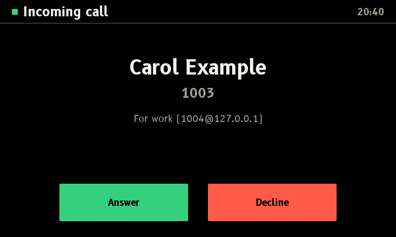 | 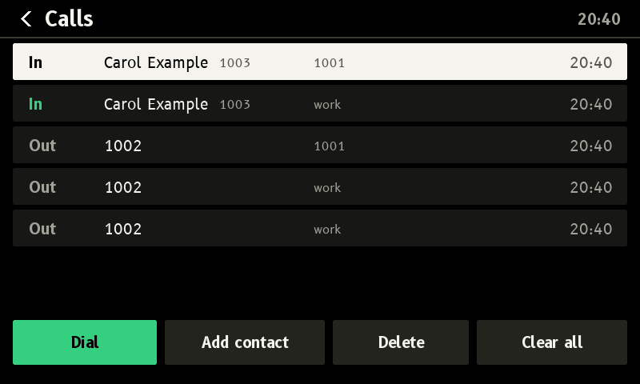 |

## What each thing does

| | Idle | Dialling | Ringing (incoming) | Calling or in a call |
|---|---|---|---|---|
| **Lift the handset** | dial tone | calls the number typed; else dial tone | answers | moves the sound to the handset |
| **Put it down** | | closes the dialler | | ends the call, if the sound was on the handset |
| **Speaker**, **Headset** | dial tone there | calls the number typed there | answers there | moves the sound there. Pressed again: back to the handset if it is lifted, otherwise ends the call |
| **Digits, `*`, `#`** | start a number | add to it; with the sound on, the number goes when complete ([dial plan](#dial-plan)). `#` is Call where the plan has no place for it | | send tones |
| **OK** | apps | calls (on the speaker if the handset is down) | answers | answers a call that is waiting; with a call on hold, swaps to it |
| **X** | | rubs out a digit; closes when empty | declines | cancels a call that has not connected; turns away a call that is waiting; closes the keypad |
| **Mute** | | | silences the ringer | microphone off and on; silences the call waiting beep |
| **Hold** | | | | hold and resume |
| **Transfer** | | | | asks for a number; then Transfer sends the caller there at once, OK calls them first. With one call on hold and one in front, puts the two through to each other |
| **Redial** | calls the last number dialled, from the account it was dialled from | the same | | |
| **Message** | calls the voicemail number | the same | | |
| **Volume** | ringer | where the sound is | ringer | where the sound is |
| **Up** | call history | | | |
| **Left** | contacts | chooses the account to call from | | |
| **Right** | do not disturb on and off | chooses the account to call from | | |

Other things worth knowing:

- Volumes are kept per place (handset, speaker, headset, ringer) in `/data/config/audio` and given to the audio service at start.
- The touch screen has the same things as buttons: a keypad in the dialler and in a call, Answer and Decline, Mute, Hold, Keypad, Speaker, Transfer, End. The on-screen Speaker button only moves the sound; it never hangs up.
- Two calls at most; a third caller hears busy.
- A call that fails plays busy or error tone in the handset (or on the speaker) until you hang up. With the phone on the hook nothing is played.
- Missed calls are counted on the idle screen until the history has been looked at. History is the last 50 calls, in `/data/phone/history`. Picking one puts its number in the dialler. Its buttons: Dial, Add contact (for a number not in the list yet), Delete (that line) and Clear all (asks first).
- If the shell is restarted in the middle of a call, the call carries on (it lives in baresip and the audio service) and the new shell picks it up: same screen, same timer, same route and mute.
- If baresip stops, the idle screen says "No phone service" and a call in progress ends as "Call lost".

Not done: a three-way conference; speed-dial line keys.

## A second call

- **Call waiting.** A call that arrives while you are on another is shown in a line across the call screen, the lamp blinks and the audio service plays a quiet beep where the sound is. OK or Answer takes it and puts the first call on hold. X or Decline tells the caller busy. Mute stops the beep. If the caller gives up it is a missed call.
- **Two calls.** The line then says who is on hold. OK or Swap changes over. End ends the one you are talking to and the other comes straight back. Putting the handset down ends the one you are talking to and leaves the other on hold, saying so on the screen; lifting the handset or pressing Speaker carries on with it.
- **Asking first (attended transfer).** Transfer, type the number, then OK or "Ask first": the caller is put on hold and the number is called. X gives up and goes back to the caller. Once they answer, Transfer or Join puts the two through to each other and takes this phone out of it. Transfer pressed instead of OK is the blind transfer as before.
- Join also works on two calls that started as call waiting.

## Contacts

Left on the idle screen, or the Contacts button. A list of names and numbers, in name order, up to 200.

- Add, Edit and Delete (which asks first) are buttons under the list; names and numbers are typed with the same keyboard as Settings ([settings.md](settings.md#the-keyboard)).
- OK, Dial, or a second touch on a contact puts the number in the dialler.
- A number in the list shows its name everywhere: the dialler as you type, calls going out, calls coming in (in place of the name the caller sends), a waiting or held call, and the history. The history's Add contact button starts a new contact with the number filled in.
- The file is `/data/phone/contacts`, one contact a line, `name|number`. A list made elsewhere can be imported as CSV or vCard on the web setup page ([web.md](web.md)), or copied there over SSH; the shell reads the file at start and again whenever it changes.

| | |
|---|---|
| 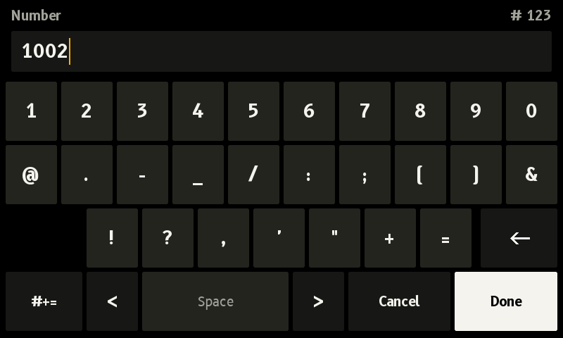 | 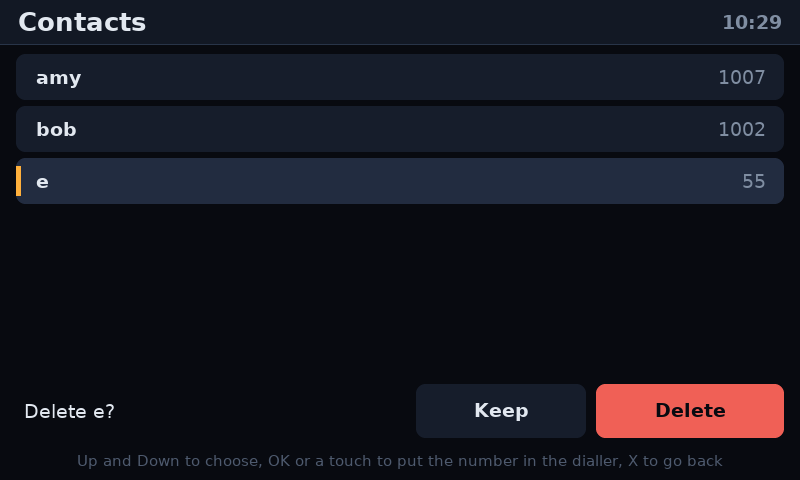 |
| 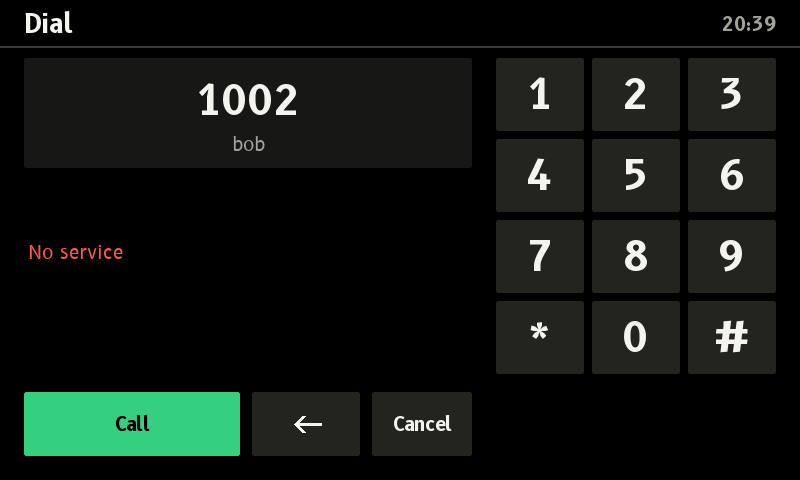 | 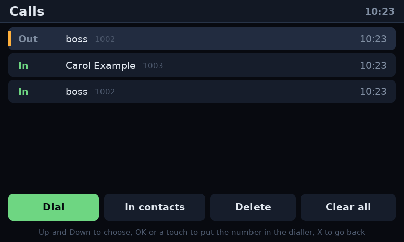 |

## Dial plan

With the handset lifted, or Speaker or Headset on, the dialler calls a number by itself. A **digit map** decides when: one setting for all accounts, in Settings, Accounts, Advanced, and on the web setup page under Accounts, Advanced. It is kept in `/data/config/phone` as `dialplan`; empty or missing is the default.

- **Complete**: called as the last digit is typed.
- **Could still go on**: called 4 s after the last digit. The dialler shows `Dialling in 3 s` beside the route and counts down. Another digit, X or Left and Right starts the time again.
- **`#`** is Call, and is not sent, unless the map has a place for it there (a code such as `*21*number#`).
- **Call, OK, the handset or Speaker** still call whatever has been typed, complete or not.
- **On the hook** nothing goes by itself: the number waits for Call or the handset, as before.
- **999 and 112** always dial at once, whatever the map, even one that allows longer numbers starting with them.
- **After X** nothing dials at once: the countdown starts again at most.

The syntax is the MGCP one (RFC 3435) that Polycom, Cisco and others take, so a provider's map can be pasted in. Patterns are separated by `|`; in a pattern `0`-`9 * # +` are themselves, `x` is any digit, `[2-9]` or `[*#x]` one of a set, `.` after an element any number of it (none included), and `T` at the end "when typing stops", 4 s, or `T2` for 2 s (1 to 99). A number matched by a pattern without `T`, which no other such pattern could make longer, is complete; patterns with `T` never hold one up, so `x.T` can be the catch-all.

The default suits the UK; anything it does not know waits for the pause:

```
999|112|101|105|111|116xxx|118xxx|0[1237]xxxxxxxxx|05[56]xxxxxxxx|08[47]xxxxxxxx|0808xxxxxxx|09xxxxxxxxx|[*#][*#x][*#x].T|+xx.T|x.T
```

Emergency and service numbers, then the UK numbers that are always eleven digits (geographic, 03, mobiles, 055 and 056, 084, 087, 0808, 09); the ten-digit 01 numbers and 0800 wait for the pause. Elsewhere, eleven digits starting 01, 02, 03, 05, 07, 08 or 09 would go at once: paste the local plan, or `x.T` for the pause alone. A map that is not valid is refused on the phone and on the page; one broken by hand in the file is ignored and the default used.

| | |
|---|---|
| 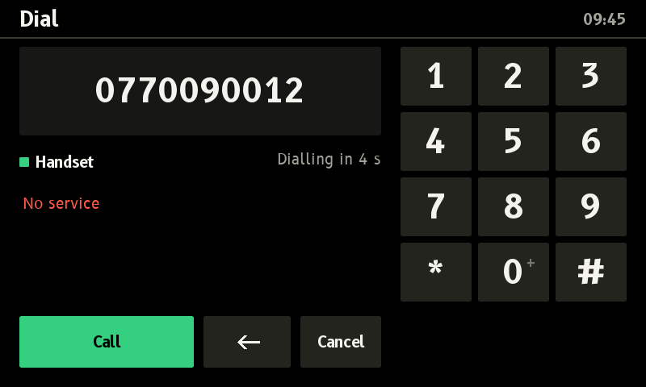 | 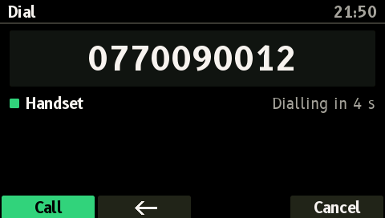 |
| 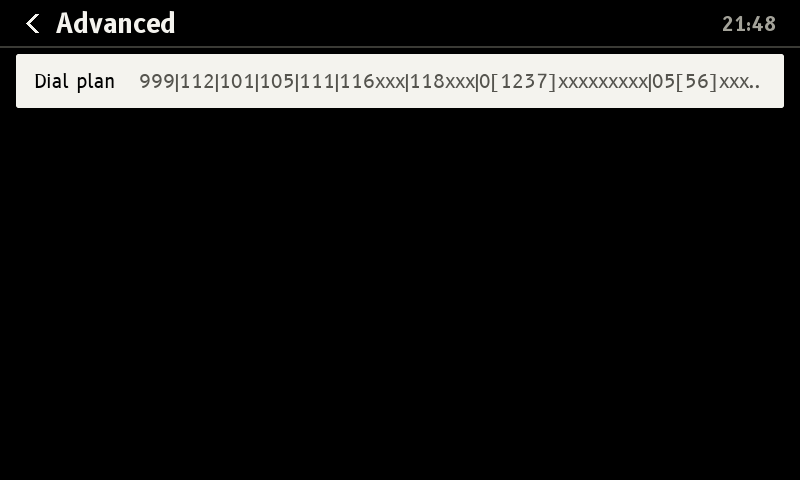 | 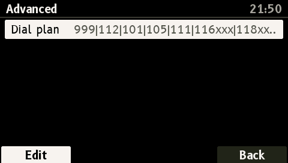 |

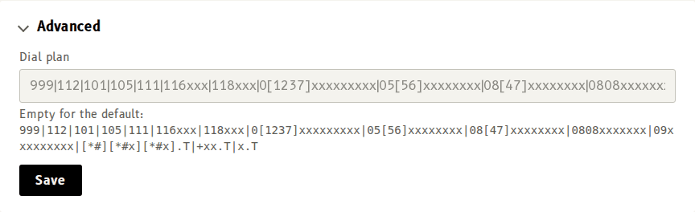

## Do not disturb

Right on the idle screen, Settings, Do not disturb, or the Accounts page of the web setup ([web.md](web.md)), on both models. While it is on, callers are told the phone is not available (SIP 480), nothing rings, and each call is listed as missed. Calls out work as usual. It is kept in `/data/config/phone` (`dnd=on`) so it survives a restart. The idle screen's header says so with an amber lamp and DND after the network address, whatever notices are up.

## Call forwarding

Issue [#77](https://github.com/M0LTE/yealink-t48s/issues/77). Per account, in Settings, Accounts, the account, Call forwarding, or on the web setup page. Three kinds, each on or off with its own number, all off at first:

| Kind | When |
|---|---|
| Always | every call. It never rings here |
| Busy | the owner is on another call (in place of call waiting), or turns a ringing call away with X |
| No answer | the call has rung for its delay (5 to 60 s, 20 at first) |

The phone answers the caller with **302 Moved Temporarily**, the target in its Contact, and the caller's phone or server makes the new call itself; this phone is out of it. That only works where the provider passes the 302 on to the caller, or follows it itself; many do, some refuse it or treat it as a failed call. Try it with a real call from outside before relying on it. A number is taken as one at the account's own server (`1003` becomes `sip:1003@server`); a `sip:` address or `user@host` is used as it is. The account's own number is refused, on the phone and on the web setup page: the call would come straight back. Each forwarded call is listed in Calls as an incoming call that was turned away, not as missed. Always wins over do not disturb; do not disturb wins over Busy and No answer.

While any account that is on forwards Always, the idle screen's header says FWD with an amber lamp, as for DND.

A call this phone makes that is answered with a 3xx is followed: baresip calls the new place, and the call screen carries on with it, showing the new number and "Forwarded". After three forwards in one call the phone gives up ("Call failed", "Forwarded too often"): that is a loop.

| | |
|---|---|
| 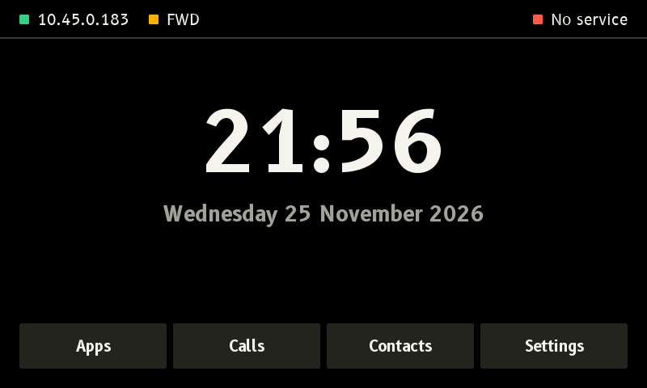 | 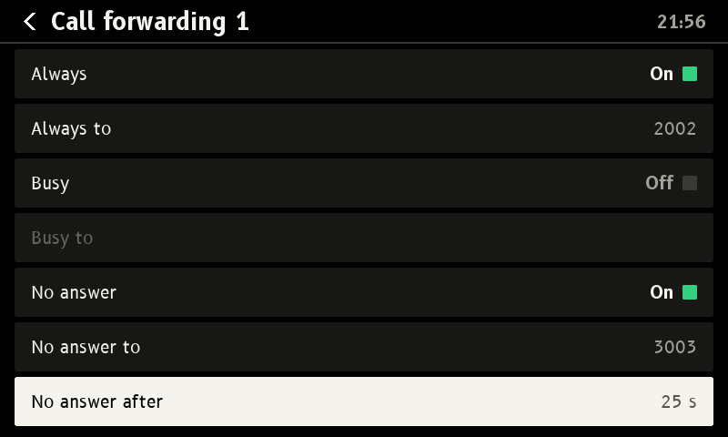 |

## Ringtones

Each account has its own ringtone, and the ringer plays the one of the account a call came in on. Four are built in, all made in the audio service from sines, faded in and out ([audiod.md](audiod.md#ringtones)):

| Ringtone | Sound |
|---|---|
| Standard | two notes in turn, in the UK double ring (as before) |
| Long | the same notes, one long ring |
| Chime | two falling notes |
| Pulse | three short beeps |

**Custom:** a WAV given on the web setup page ([web.md](web.md)), up to 2 MB (ten seconds of CD-quality stereo). The page turns it into the phone's 16 kHz mono, cuts it to 10 s, brings its peak to the built-in ringtones' level (so the ringer volume means the same) and fades its ends; it is kept in `/data/phone/ringtones/sipN.s16` and goes when the account is removed. The sound is not in a settings backup: after a restore an account set to Custom rings Standard until a sound is given again. It plays through the loudspeaker's limiter like every other sound, with a second's gap between plays. Nothing is played while choosing.

## Messages waiting

For each account the phone asks the server to tell it about waiting voicemail (SIP message-summary, RFC 3842). While there are new messages the lamp blinks slowly and the idle screen says how many. The Message key calls the account's voicemail number, set in Settings, Phone accounts ("Voicemail number"). A server without voicemail just says no and nothing more happens.

## Several accounts

Up to 16, the stock firmware's number of lines, set in Settings, Accounts ([settings.md](settings.md)). Account 1 is `/data/config/sip`, as it always was, so a phone that already has an account needs nothing done; accounts 2 to 16 are `sip2` to `sip16` beside it. The Accounts page lists those that are set and the first free one.

- **All of them ring.** The incoming call screen says which account was called.
- **Calls go out from the default account** unless another is chosen: Left and Right in the dialler step through the accounts, as does a touch on the "From" line. A touch on an account's line on the idle screen opens the dialler already set to it.
- **Which is the default** is set on the Accounts page. The status bar shows that one; with more than one account the idle screen has a line for each with its own dot. Over six, the sixth line is the rest: how many, and the dot of the worst of them; a touch on it opens the dialler. The small screen's one line becomes dots alone when the names do not fit.
- **The history keeps the account** of each call, and Redial and the history call back from the same one.
- An account can be switched off without forgetting it ("Enabled"), given an **Account name** for the phone's own screens (the idle screen, the dialler's From, the call list, and later the line keys; `label` in the file), and removed. Display name is different: it is what the far end is told.

The dot beside an account is green when registered, amber while trying, red when the server refused or baresip is not running. The shell reads the same files `t48-sip` does ([sip.md](sip.md#running-it), example in [`sip/config/sip.example`](../sip/config/sip.example)), and only for what it shows; the passwords are baresip's business. No account is in the repository; the tests use made-up ones on a server that exists for a minute.

The T48S has no line keys beside the screen and no lamps for them (the screen itself is where Yealink draws them), so the account lines on the idle screen are the line keys.

## Lamps

The phone decides what each lamp should do, and [`shell/leds.c`](../shell/leds.c) passes that to the kernel's LED driver ([#3](https://github.com/M0LTE/yealink-t48s/issues/3), [kernel/README.md](../kernel/README.md)) through `/sys/class/leds`:

| Lamp | When |
|---|---|
| message (top right of the case) | blinks fast while a call is ringing or waiting (0.3 s on, 0.3 s off, as Yealink does); blinks slowly while voicemail waits (1 s on, 1 s off); on while there are missed calls |
| speaker, headset (in those keys) | on while the sound is there |
| mute (in the Mute key) | on while muted |

The app in front may borrow lamps ([app-protocol.md](app-protocol.md#lamps)). What the phone wants is kept meanwhile and goes back on the lamp when the app lets go, is paused or closes; a call pauses the app, so a call always has its lamps.

The message lamp was called "power" here until 2026-11-23 (Yealink's own files call it that). The kernel driver now names it `t48s:red:message`; the shell also accepts the old name, so it works with a kernel built before the change.

## How it fits together

```
 keys, hook, touch            baresip (t48ctrl)                  t48-audiod
        |                 /run/t48-sip/ctrl.sock           /run/t48-audiod/ctl.sock
        v                          ^                                 ^
   main.c  --->  phone.c  ---  sipc.c: dial, accept, hangup,   audioc.c: route, volume,
   (screens)   (one call,      hold, resume, transfer,         mute, tone, ring, key
                the rules)     sndcode; events back            sounds; state back
```

`phone.c` is one small state machine: idle, dial, outgoing, incoming, in call, ended, for the call in front; beside it sits at most one other call, either waiting to be answered or on hold. It follows baresip's events (`CALL_INCOMING`, `CALL_RINGING`, `CALL_ESTABLISHED`, `CALL_CLOSED`, `REGISTER_OK`, ...) and tells the audio service what the owner should hear, in the order [audiod.md](audiod.md#the-control-socket-the-shell) asks for. Both clients keep trying once a second if their service is not there, and say everything again when it comes back.

## Testing

```
make -C shell check          # no services needed: includes the phone screens on their own
sip/test/phone-test.sh       # the real thing; in the sip/Dockerfile container (see sip.md)
ARM=1 sip/test/phone-test.sh # the same, with the phone's side as the ARM builds under qemu-arm
```

`phone-test.sh` starts Kamailio, the phone's `t48-audiod` (null backend) and baresip registered as 1001, two far ends, 1002 and 1003, and `mwi.py`, which plays a voicemail server's message-waiting side. Then it runs each script in [`shell/tests/phone/`](../shell/tests/phone) through `t48-sim`. The scripts press keys, lift the handset and touch the screen; make the far ends dial, answer and hang up; check the phone's state, the audio service's own state and what the far ends saw; and save pictures. The pictures on this page are from that run.

Result on 2026-11-23, all passing, both as PC builds and with `ARM=1`:

| Scenario | What it shows |
|---|---|
| 01 outgoing, answered | type 1002, lift the handset: the call goes out on the handset, ringback plays, the far end answers, tone stops, the audio service has the call's sound; handset down ends it and the far end sees it close |
| 02 incoming, answered by hook | the ringer and the lamp start; lifting the handset answers and stops them; the far end hangs up and the phone goes back to idle by itself |
| 03 speakerphone | answered with Speaker; handset lifted takes the sound; Speaker gives it back; the handset can go down without ending the call; Speaker again ends it |
| 04 mute, hold | on the headset: Mute reaches the audio service and back; Hold and resume reach the far end |
| 05 far end hangs up | dialled with the handset down (OK): goes out on the speaker; far end hangs up; Redial calls the same number; X cancels |
| 06 call while an app is open | the clock app is paused and frozen, the call screen takes over, keys go to the call, and the app is back and running when the call ends |
| 07 keypad and volume | dial tone on lifting the handset, stopping at the first digit; tones sent from the touch keypad arrive at the far end; Volume changes the handset's level in the audio service, not the ringer's |
| 08 blind transfer | the caller is sent to 1003, 1003 rings and answers, our call ends as transferred |
| 09 missed call, history | Mute silences the ringer; an unanswered call is counted on the idle screen; a call that is turned down plays busy tone until the handset goes down; the history lists both and clears the count |
| 10 call waiting, declined | a second caller shows on the call screen with the beep and the lamp; Mute stops the beep; X tells them busy; one who gives up is a missed call; the first call is not disturbed |
| 11 shell restart | the shell exits in the middle of a muted speakerphone call; a new one finds the call, the route and the mute, and ends it normally |
| 12 call waiting, answered | OK answers the second call and the first far end sees itself held; OK and the Swap button change over, each far end seeing hold and resume; End brings the held call back; both are in the history |
| 13 attended transfer | Transfer, a number, OK: the caller is held and 1003 rings; X goes back to the caller; again, 1003 answers, Transfer puts 1002 and 1003 through to each other and our calls end as transferred |
| 14 do not disturb | the caller gets 480, nothing rings, the call is listed as missed; calls out still work; off again and the next call rings |
| 15 message waiting | the server says two messages: the idle screen and the slow lamp; the Message key calls voicemail; a ringing call takes the lamp and gives it back; the server says none and the lamp shows the missed call alone |
| 16 contact names | a contact added on the phone names the caller in place of what the caller sends, in the call, the history and when dialled from the list; a stranger keeps their own name |
| 22 dial plan | 1002 with the handset lifted goes out 4 s after the last digit and the far end rings; with a map of `1002\|x.T` it goes on the fourth digit; 999 goes at once under a map of `9999\|x.T`; `#` calls 1003 at once without sending the # |
| 23 call forwarding | Always to 1003: bob's call reaches carol, the phone never rings and lists it; Busy to 1002 while on a call to bob: carol's call reaches bob and the call goes on undisturbed; a ringing call turned away with X goes to bob too; No answer after 5 s: the phone rings, then the call is at bob's; the phone calls carol, who forwards it to bob: the phone follows, shows 1002 and "Forwarded", and the call is bob's; carol forwarding to herself: the phone gives up after three |
| 24 ringtones | the audio service plays the ringtone of the account called: Standard, then Chime for 1001 and Pulse for a second account, 1004; a custom sound for 1004; its file gone, Standard |
| 25 block direct calls | off, as it starts: an INVITE straight to the phone from 127.0.0.2, not the registrar, rings. On: the same call gets 403 and nothing rings, and bob's call through the registrar still rings |
| 20 several accounts | a second account is typed in on the Settings screens and the phone service restarts with both registered; a call out from the chosen account arrives from 1004, Redial uses it again, a plain call still goes from 1001; calls in to each say which was called; the history has the account; the usual account is changed and changed back; the account is removed and one is left |

`make -C shell check` also runs `20-calls.script` (and `small/06-calls.script` on the T46S's screen): the ringtone row (Custom once there is a sound), the forwarding page and Block direct calls on the Advanced page, and FWD in the header.

`make -C shell check` also runs `tests/test_dialplan.c` (the matcher: the syntax refused and taken, and what the default and other maps say of some 170 numbers), `19-dialplan.script` and `small/05-dialplan.script` (the dialler and the Advanced page on both models, with no services), and `08-contacts.script`: the contact list, the history's buttons and do not disturb with no services behind them.

Also checked by hand in the container, with baresip running as root: root can connect to the control socket; another user gets "permission denied" (the folder and the socket are closed to it); and with those opened up on purpose the module still turns that user away by its user number. The older tests (`call-test.sh`, `audiod-test.sh`) now drive baresip through the same socket and still pass, including the ARM baresip under qemu.

## What needs the phone, and Tom

1. **Sound.** Everything here asks the audio service for the right thing; whether the right thing comes out waits on the kernel's playback driver and the daytime audio tests ([audiod.md](audiod.md#what-needs-the-phone-and-tom)).
2. **A real account.** Put one in `/data/config/sip`, start `t48-audiod`, `t48-sip` and the shell, and make a call each way with fingers. The key meanings above are what a desk phone does, but only using it will say if any feel wrong.
3. **Six function keys still need their labels matched** (kernel/README.md): if Hold, Transfer or Redial turn out to be different keys, the fix is in the kernel's key table, not here.
4. **Lamps:** the driver is in; someone has to look at them once (the list is in issue #3).
5. **Being transferred by the other end**: `t48audio` now carries more than one call, which this needed, but it has still not been tried.
6. **The new parts** (#27, #36), each once with fingers: a second caller while on a call (the beep in the earpiece, answer, swap, end one); Transfer with "Ask first"; DND; a contact; and, if the server has voicemail, the lamp. Then a second account.
7. **The lamp's new name** needs a kernel built from this branch; until then the shell finds it under the old name. Someone should still look at it blinking fast (ringing) and slowly (voicemail).
