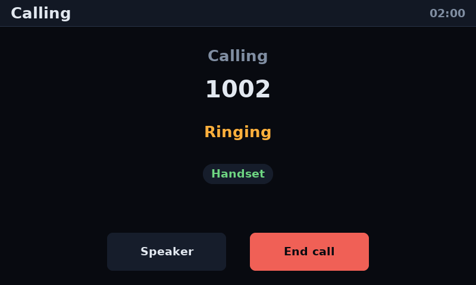
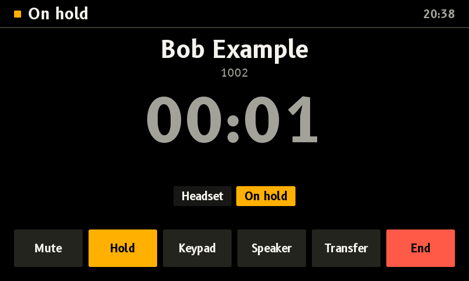
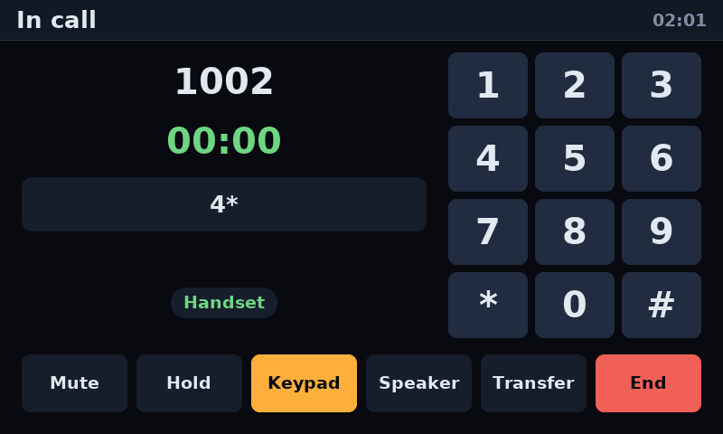
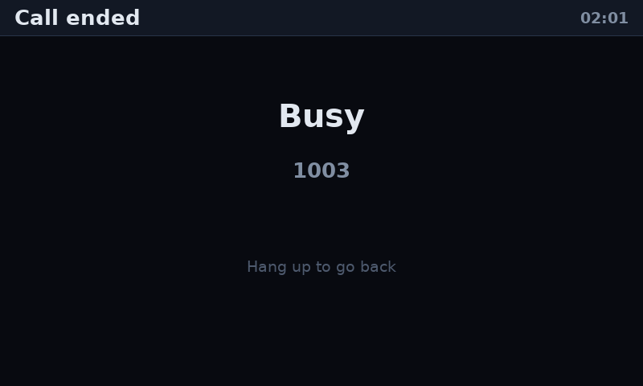
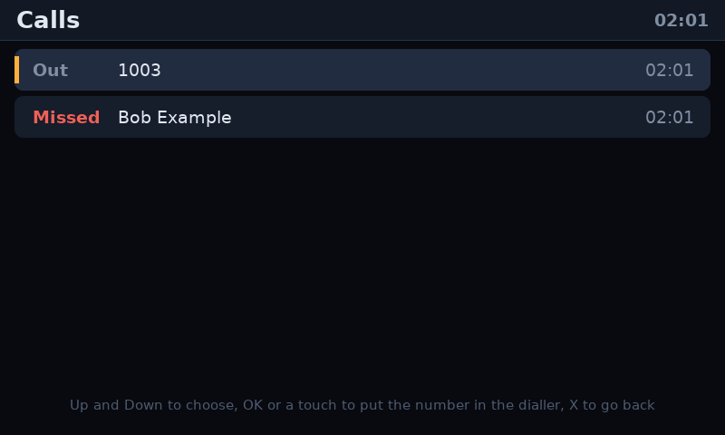
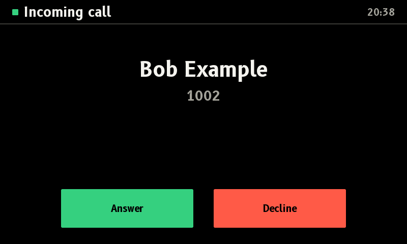

# The phone: dialler, calls, history

Issue [#26](https://github.com/M0LTE/yealink-t48s/issues/26). Design: [architecture.md](architecture.md#the-shell). Source: [`shell/phone.c`](../shell/phone.c), with [`sipc.c`](../shell/sipc.c) (baresip), [`audioc.c`](../shell/audioc.c) (the audio service) and [`leds.c`](../shell/leds.c) (lamps).

## Summary

- The shell now behaves like a desk phone. Lift the handset for dial tone, or just start typing a number. Calls ring, can be answered with the handset, Speakerphone or Headset, and can be muted, held, transferred and ended the usual ways.
- A call takes the screen from whatever is showing, including an app, and gives it back afterwards.
- **Tested in the simulator against the real services**: baresip with our modules, `t48-audiod` on its silent backend and a throwaway SIP server, with two more baresips as the people at the other end. Twelve scripted scenarios pass, and pass again with the phone's own ARM builds of the shell, baresip and the audio service running under qemu. Nothing has run on the phone yet and nothing made a sound.
- Apps can no longer reach call control: baresip's TCP control port is gone, replaced by our own module on a socket only root can open ([sip.md](sip.md#control-interface)).

| | |
|---|---|
|  |  |
|  |  |
|  |  |
|  |  |
|  |  |
|  |  |
|  |  |
|  |  |

## What each thing does

| | Idle | Dialling | Ringing (incoming) | Calling or in a call |
|---|---|---|---|---|
| **Lift the handset** | dial tone | calls the number typed; else dial tone | answers | moves the sound to the handset |
| **Put it down** | | closes the dialler | | ends the call, if the sound was on the handset |
| **Speaker**, **Headset** | dial tone there | calls the number typed there | answers there | moves the sound there. Pressed again: back to the handset if it is lifted, otherwise ends the call |
| **Digits, `*`, `#`** | start a number | add to it | | send tones |
| **OK** | apps | calls (on the speaker if the handset is down) | answers | |
| **X** | | rubs out a digit; closes when empty | declines | cancels a call that has not connected; closes the keypad |
| **Mute** | | | silences the ringer | microphone off and on |
| **Hold** | | | | hold and resume |
| **Transfer** | | | | asks for a number, then Transfer or OK sends the caller there (blind transfer) |
| **Redial** | calls the last number dialled | the same | | |
| **Volume** | ringer | where the sound is | ringer | where the sound is |
| **Up** | call history | | | |

Other things worth knowing:

- Volumes are kept per place (handset, speaker, headset, ringer) in `/data/config/audio` and given to the audio service at start.
- The touch screen has the same things as buttons: a keypad in the dialler and in a call, Answer and Decline, Mute, Hold, Keypad, Speaker, Transfer, End. The on-screen Speaker button only moves the sound; it never hangs up.
- One call at a time. A second caller hears busy and is listed as a missed call.
- A call that fails plays busy or error tone in the handset (or on the speaker) until you hang up. With the phone on the hook nothing is played.
- Missed calls are counted on the idle screen until the history has been looked at. History is the last 50 calls, in `/data/phone/history`. Picking one puts its number in the dialler.
- If the shell is restarted in the middle of a call, the call carries on (it lives in baresip and the audio service) and the new shell picks it up: same screen, same timer, same route and mute.
- If baresip stops, the idle screen says "No phone service" and a call in progress ends as "Call lost".

Not done: contacts, voicemail (the Message key only logs), do not disturb, conference, attended transfer, call waiting with two calls held (all [#27](https://github.com/M0LTE/yealink-t48s/issues/27)); dialling a number by itself after a pause; ringing tones to choose from.

## The account

The shell reads the same file `t48-sip` does, `/data/config/sip` ([sip.md](sip.md#running-it), example in [`sip/config/sip.example`](../sip/config/sip.example)), and only for the `user` and `domain` it shows on the idle screen. The password is baresip's business. No account is in the repository; the tests use made-up ones on a server that exists for a minute.

The dot beside the account is green when registered, amber while trying, red when the server refused or baresip is not running.

## Lamps

The phone decides what each lamp should do, and [`shell/leds.c`](../shell/leds.c) passes that to the kernel's LED driver ([#3](https://github.com/M0LTE/yealink-t48s/issues/3), [kernel/README.md](../kernel/README.md)) through `/sys/class/leds`:

| Lamp | When |
|---|---|
| power (top right of the case) | blinks while ringing (0.3 s on, 0.3 s off, as Yealink does); on while there are missed calls |
| speaker, headset (in those keys) | on while the sound is there |
| mute (in the Mute key) | on while muted |
| message | the phone has no such lamp; kept for voicemail (#27), which will have to use the power lamp as Yealink does |

## How it fits together

```
 keys, hook, touch            baresip (t48ctrl)                  t48-audiod
        |                 /run/t48-sip/ctrl.sock           /run/t48-audiod/ctl.sock
        v                          ^                                 ^
   main.c  --->  phone.c  ---  sipc.c: dial, accept, hangup,   audioc.c: route, volume,
   (screens)   (one call,      hold, resume, transfer,         mute, tone, ring, key
                the rules)     sndcode; events back            sounds; state back
```

`phone.c` is one small state machine: idle, dial, outgoing, incoming, in call, ended. It follows baresip's events (`CALL_INCOMING`, `CALL_RINGING`, `CALL_ESTABLISHED`, `CALL_CLOSED`, `REGISTER_OK`, ...) and tells the audio service what the owner should hear, in the order [audiod.md](audiod.md#the-control-socket-the-shell) asks for. Both clients keep trying once a second if their service is not there, and say everything again when it comes back.

## Testing

```
make -C shell check          # no services needed: includes the phone screens on their own
sip/test/phone-test.sh       # the real thing; in the sip/Dockerfile container (see sip.md)
ARM=1 sip/test/phone-test.sh # the same, with the phone's side as the ARM builds under qemu-arm
```

`phone-test.sh` starts Kamailio, the phone's `t48-audiod` (null backend) and baresip registered as 1001, and two far ends, 1002 and 1003. Then it runs each script in [`shell/tests/phone/`](../shell/tests/phone) through `t48-sim`. The scripts press keys, lift the handset and touch the screen; make the far ends dial, answer and hang up; check the phone's state, the audio service's own state and what the far ends saw; and save pictures. The pictures on this page are from that run.

Result on 2026-11-23, all passing, both as PC builds and with `ARM=1`:

| Scenario | What it shows |
|---|---|
| 01 outgoing, answered | type 1002, lift the handset: the call goes out on the handset, ringback plays, the far end answers, tone stops, the audio service has the call's sound; handset down ends it and the far end sees it close |
| 02 incoming, answered by hook | the ringer and the lamp start; lifting the handset answers and stops them; the far end hangs up and the phone goes back to idle by itself |
| 03 speakerphone | answered with Speaker; handset lifted takes the sound; Speaker gives it back; the handset can go down without ending the call; Speaker again ends it |
| 04 mute, hold | on the headset: Mute reaches the audio service and back; Hold and resume reach the far end |
| 05 far end hangs up | dialled with the handset down (OK): goes out on the speaker; far end hangs up; Redial calls the same number; X cancels |
| 06 call while an app is open | the clock app is paused and frozen, the call screen takes over, keys go to the call, and the app is back and running when the call ends |
| 07 keypad and volume | dial tone on lifting the handset, stopping at the first digit; tones sent from the touch keypad arrive at the far end; Volume changes the handset's level in the audio service, not the ringer's |
| 08 blind transfer | the caller is sent to 1003, 1003 rings and answers, our call ends as transferred |
| 09 missed call, history | Mute silences the ringer; an unanswered call is counted on the idle screen; a call that is turned down plays busy tone until the handset goes down; the history lists both and clears the count |
| 10 second caller | told busy, listed as missed, and the first call is not disturbed |
| 11 shell restart | the shell exits in the middle of a muted speakerphone call; a new one finds the call, the route and the mute, and ends it normally |

Also checked by hand in the container, with baresip running as root: root can connect to the control socket; another user gets "permission denied" (the folder and the socket are closed to it); and with those opened up on purpose the module still turns that user away by its user number. The older tests (`call-test.sh`, `audiod-test.sh`) now drive baresip through the same socket and still pass, including the ARM baresip under qemu.

## What needs the phone, and Tom

1. **Sound.** Everything here asks the audio service for the right thing; whether the right thing comes out waits on the kernel's playback driver and the daytime audio tests ([audiod.md](audiod.md#what-needs-the-phone-and-tom)).
2. **A real account.** Put one in `/data/config/sip`, start `t48-audiod`, `t48-sip` and the shell, and make a call each way with fingers. The key meanings above are what a desk phone does, but only using it will say if any feel wrong.
3. **Six function keys still need their labels matched** (kernel/README.md): if Hold, Transfer or Redial turn out to be different keys, the fix is in the kernel's key table, not here.
4. **Lamps:** the driver is in; someone has to look at them once (the list is in issue #3).
5. **Being transferred by the other end** will fail today: baresip makes the new call before dropping the old one, and `t48audio` carries one call at a time. The shell's side of it is written but could not be tested for that reason.
