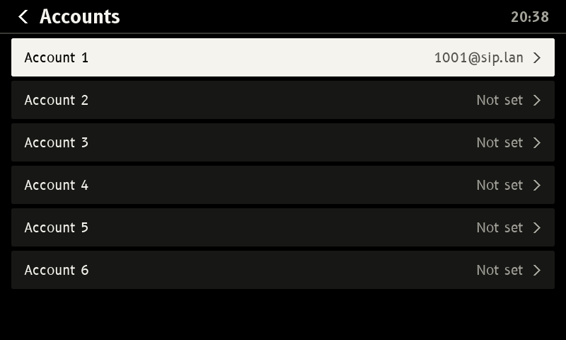
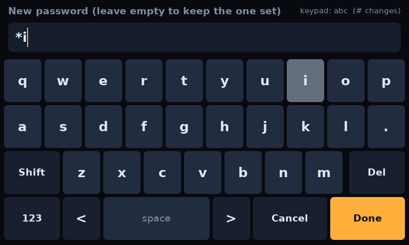
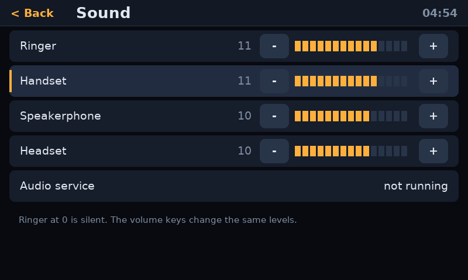
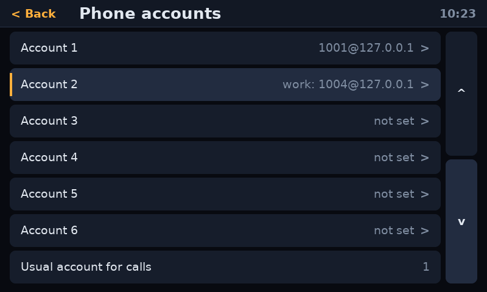
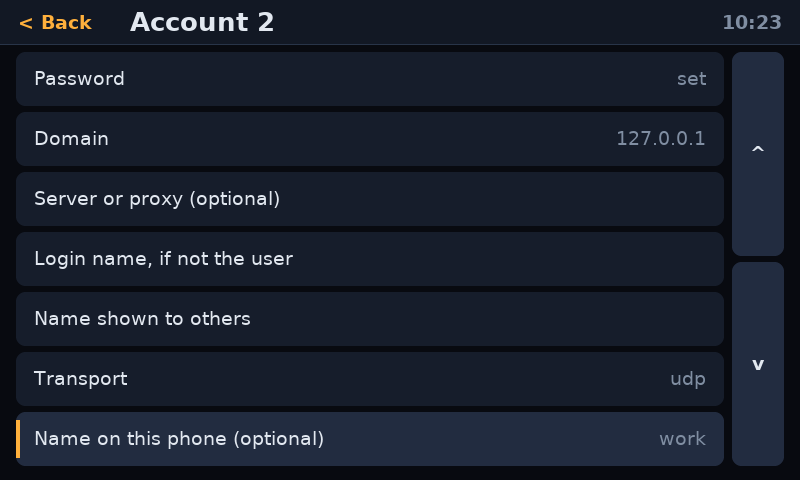
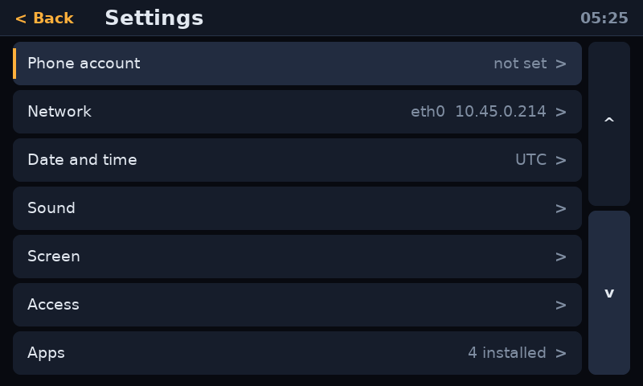
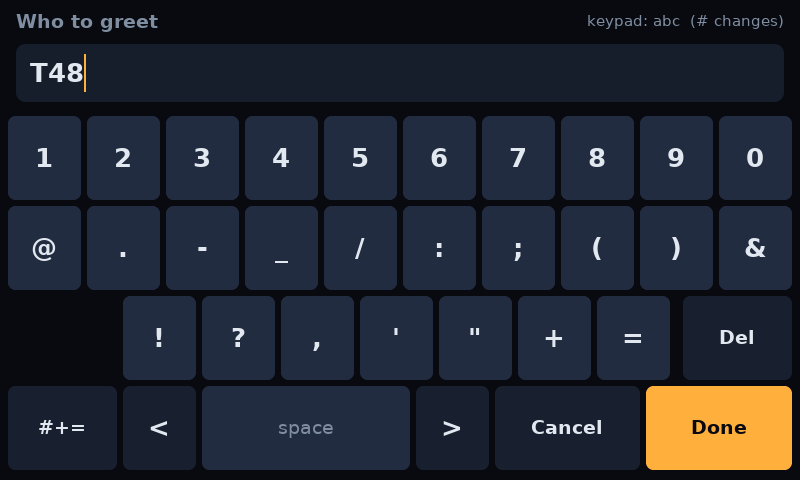
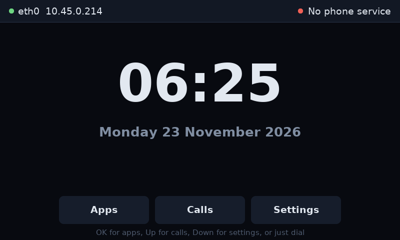

# Settings

Issue [#23](https://github.com/M0LTE/yealink-t48s/issues/23). Design: [architecture.md](architecture.md#the-shell). Source: [`shell/config.c`](../shell/config.c) (the store and `t48-config`), [`shell/settings.c`](../shell/settings.c) (the screens), [`libt48/src/kbd.c`](../libt48/src/kbd.c) (the keyboard).

Press **Down** on the idle screen, or touch **Settings**. Everything here can also be set from a browser, which is easier for anything long: the web setup page, [web.md](web.md). Arrows and OK, or touch, move around; X or the arrow in the header goes back. The words and the look follow [style.md](style.md) and [design/](design/README.md).

| | |
|---|---|
|  |  |
|  |  |
|  |  |

## What is there

| Page | What it sets | Takes effect |
|---|---|---|
| Accounts | up to six accounts ([phone.md](phone.md#several-accounts)), and which is the default for calls. For each: User, Password, Server host (`host:port` for a port), Outbound proxy, Auth user, Display name, Transport, Label (a short name for this phone's screens), Voicemail, Enabled, and Remove account. Advanced: the dial plan ([phone.md](phone.md#dial-plan)), empty for the default | on leaving an account's page: baresip is restarted if it is running. The usual account changes at once |
| Do not disturb | on or off, the same as Right on the idle screen ([phone.md](phone.md#do-not-disturb)) | at once |
| Network | DHCP, or a fixed address, netmask, gateway and DNS server | on leaving the page. If the address is a different one, baresip is started again, as it listens on the address it started with |
| Date and time | time zone, from a list | at once, in the shell and in apps started afterwards |
| Sound | ringer, handset, speakerphone and headset levels, 0 to 15 | at once, through the audio service. Nothing is played. The volume keys change the same levels |
| Screen | brightness, 1 to 10; the theme, from a small picture of each ([design](design/README.md)) | at once ([shell.md](shell.md#the-backlight)): the screen, the open app and the web setup page change together. The page also says when the screen dims and goes off |
| Access | SSH on or off, the phone's host key, the keys that can log in, adding a first key; the web setup page on or off | at once ([access.md](access.md), [web.md](web.md)). Both are off until turned on here |
| Apps | the app manager ([apps.md](apps.md)) | |
| App settings | each installed app's own settings, from its manifest | the next time the app is opened (an open app is closed) |
| Update | the release channel (Stable or Testing), and the buttons that check it, install what it has and restart ([below](#update)) | when a button is pressed and its question answered. Nothing is checked or installed by itself |
| About | firmware and shell version, app API level, kernel, address, MAC, memory, storage | |

## The keyboard

Touch, or the phone's keypad, or both at once.

- Touch: letters, then **123** for digits and common punctuation, then **#+=** for the rest. Every printable ASCII character is on one of the three pages. Shift once for one capital, twice for CAPS.
- Keypad: multi-tap, as on an old mobile. 2 is a, b, c, 2; 1 is `. , @ - _ / : 1`; 0 is space, 0; `*` is `* # + = ! ?`. `#` steps the keypad through abc, ABC and 123. Left and right move the cursor, X rubs out (or cancels when there is nothing to rub out), OK is Done.
- Where a number or an address is wanted the keyboard opens on digits, and `*` types a dot.
- **Passwords** are typed blind: stars, except the character just typed, which shows for a second. The password already set is never put on the screen (the editor opens empty, and leaving it empty keeps the old one); the list shows only "set" or "not set". Nothing typed is written to the log.

The keyboard is part of libt48 (`t48_kbd_*` in [`t48.h`](../libt48/include/t48.h)), so apps can use it.

## The files

Plain text in `/data/config`, one file per subject, `key=value` a line, `#` for comments. Comments are kept when the screens change a value. Files are readable by root only, because one of them holds the SIP password and apps run as other users.

| File | Keys |
|---|---|
| `sip` | account 1: `user`, `password`, `domain`, `outbound_proxy`, `auth_user`, `display_name`, `transport` (udp, tcp, tls), `register_seconds`: the file `t48-sip` has always read ([sip.md](sip.md#running-it)). Also `enabled` (on or off), `label` (the name on this phone's screens), `voicemail` (the number the Message key calls), `mwi` (off: do not ask the server about waiting messages) |
| `sip2` to `sip6` | accounts 2 to 6, the same keys |
| `phone` | `default_account`: 1 to 6, the account calls go out from unless another is chosen. `dnd`: on or off. `dialplan`: a digit map ([phone.md](phone.md#dial-plan)); missing is the default |
| `network` | `mode` (dhcp or static), `address`, `netmask`, `gateway`, `dns` |
| `system` | `timezone`: a name from the list (`Europe/London`), or any POSIX TZ string (`XYZ-3`) for a zone the list lacks |
| `audio` | `ringer`, `handset`, `speaker`, `headset`: 0 to 15 |
| `screen` | `brightness`: 1 to 10. `theme`: `switchboard` (also when missing or unknown), `directory` or `twotone`. Not on the screen: `dim_seconds` (120) and `off_seconds` (1800), how long nothing is touched before the screen dims and goes off; 0 is never. The shell picks changes to this file up within five seconds |
| `access` | `ssh`: on or off (off when missing); `web`: the web setup page, the same ([web.md](web.md)); `t48-apply access` makes it so |
| `feed` | `url`: the app feed, if not the standard one |
| `apps/ID.conf` | that app's settings, by the keys in its manifest |

```
t48-config get sip user
t48-config set network mode static
t48-config unset feed url
t48-config list            # everything; passwords shown only as (set)
t48-apply network          # make the running phone follow a file changed by hand
```

`t48-config` is the shell's own program under another name, so there is one implementation. The shell looks at the files once a second, so a value set this way, or from the web setup page ([web.md](web.md)), shows on the screen by itself; `t48-apply` is still needed for the network, the phone service and SSH. `t48-apply` ([the script](../buildroot/board/t48s/rootfs-overlay/usr/bin/t48-apply)) is what the shell runs when a page that needs it is left.

**Saving is atomic**: the new file is written beside the old one, synced, renamed over it, and the folder synced. A power cut leaves the old file or the new one. All reading and writing goes through two functions at the top of `config.c` (load a file, save a file), which did not need to change when `/data` moved to flash (#29, [flash.md](flash.md)): once `t48-data format` has been run on a phone, settings survive a restart; before that `/data` is in RAM and they are lost at power off.

## An app's settings

From the app's manifest ([app-protocol.md](app-protocol.md#the-manifest)): each has a key, a label, a default and a type.

| Type | Shown as |
|---|---|
| `text` (and anything unknown) | text, edited with the keyboard |
| `number` | the same, with the keyboard on digits |
| `bool` | a switch; stored as `true` or `false` |
| `password` | "Set" or "Not set"; typed blind |


## Accounts

| | |
|---|---|
|  |  |

An account with no user or no domain is not used. Removing an account asks first and deletes its file.

The app gets each value in a SETTING message when it starts. "Reset to defaults" forgets the owner's values.

## Update

Issue [#31](https://github.com/M0LTE/yealink-t48s/issues/31). The page is a front end for `t48-update` ([install.md](install.md), [the script](../buildroot/board/t48s/rootfs-overlay/usr/bin/t48-update)): it shows what `t48-update info` says and runs `check`, `install`, `kernel` and `channel`. Opening the page asks the channel nothing.

| Row | Shows |
|---|---|
| Version | what is running and its slot: `20261124-ac7a8f4, slot a` |
| Channel | Stable or Testing, changed here. A channel that is a URL shows as Custom with the URL under it, and is set with `t48-update channel` or from the web setup page |
| Latest | the channel's newest version, or `Not checked` |
| Status | `Up to date`, `Update available`, `Checking`, `Downloading`, `Writing`, `Restart to finish`, or the updater's own words for what failed. Absent until there is something to say |
| Check now | asks the channel |
| Install | only when there is an update. Asks first (`Install v0.3.0?`), then downloads and writes the slot not in use |
| Restart | only after an install. Asks first; the new slot gets its one try |
| Install kernel | only when the channel's kernel differs. Asks first, with `A failed kernel needs recovery mode` |
| Last result | the last result and when: `v0.3.0 installed, 23 Nov 16:25` |

A phone that is not installed (started from a USB stick) shows its version and `Not installed`, and nothing to press.

The updater runs as a child process and the screen never waits for it: while it works the page asks `t48-update info` again about once a second, and the other buttons are greyed. The phone works as usual meanwhile, and leaving the page does not stop it. The restart is `t48-apply restart`.

## Testing

Brightness is tested in `06-backlight.script`, the Access page in `07-access.script`, themes in `10-themes.script` and the Update page in `12-update.script` (against [`shell/tests/update/update.sh`](../shell/tests/update/update.sh), which plays `t48-update` with files in place of the network and the flash) ([shell.md](shell.md#the-backlight), [access.md](access.md#testing)). `make -C shell check` runs [`shell/tests/04-settings.script`](../shell/tests/04-settings.script) in the simulator: every page, typing by keypad and by touch, the first account, a password (checked to be in the file, mode 600, and absent from the log), a refused address, the time zone reaching `TZ`, volumes, an app's setting reaching the app, and a call taking the screen from the keyboard and giving it back.

## On the phone (2026-11-23)

With injected touches and keys, nobody at it:

- Settings opens from the idle screen; the pages draw and scroll by touch.
- Hello's "Who to greet" was changed to T48 on the touch keyboard (Del, Shift, the numbers page), and Hello then said "Hello, T48".
- The time zone was set to Europe/Berlin by touch: the idle clock went from 05:25 to 06:25 at once. It is back on Europe/London.
- The network came up through `t48-apply network` at boot (DHCP, as before).

| | |
|---|---|
|  |  |
|  |  |

Not tried on the phone: a fixed network address (it would cut the test connection; simulator only), the account page against a running baresip, and anything that makes a sound. The keypad multi-tap has only had injected key presses, not fingers.

## Not done

- The network page has no IPv6, VLAN or 802.1X, and a fixed address takes its time from pool.ntp.org.
- The time zone list is about 55 places with their rules built in (there are no zone files in the image); other zones need a TZ string set over SSH.
- On a phone where the flash has not been set up (`t48-data format`), settings are in RAM.
