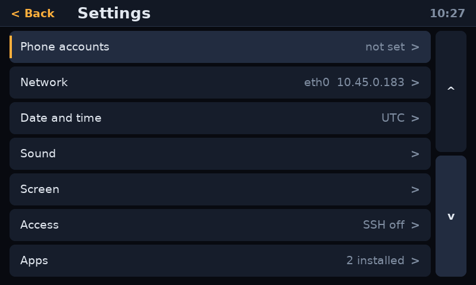
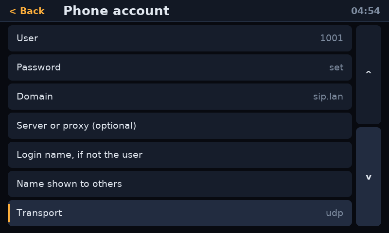
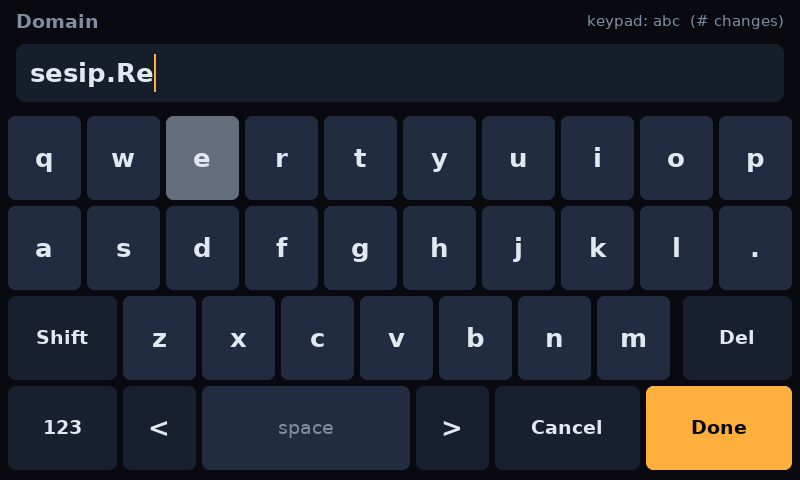
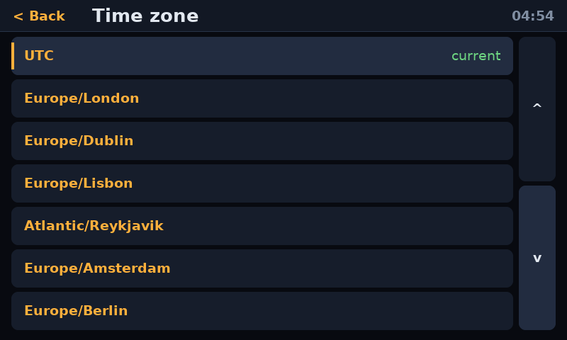
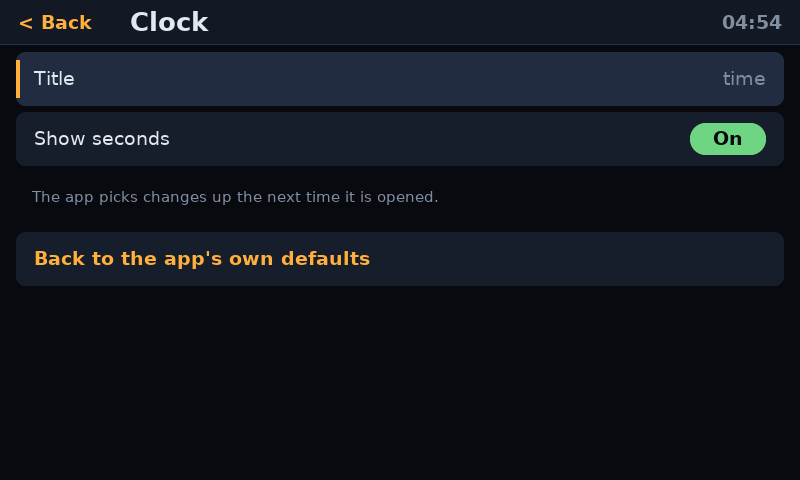
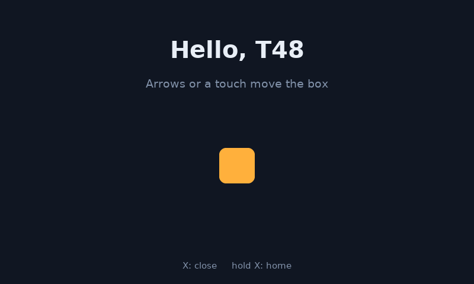

# Settings

Issue [#23](https://github.com/M0LTE/yealink-t48s/issues/23). Design: [architecture.md](architecture.md#the-shell). Source: [`shell/config.c`](../shell/config.c) (the store and `t48-config`), [`shell/settings.c`](../shell/settings.c) (the screens), [`libt48/src/kbd.c`](../libt48/src/kbd.c) (the keyboard).

Press **Down** on the idle screen, or touch **Settings**. Arrows and OK, or touch, move around; X or "< Back" goes back.

| | |
|---|---|
|  |  |
|  |  |
|  |  |

## What is there

| Page | What it sets | Takes effect |
|---|---|---|
| Phone account | user, password, domain, server or proxy, login name, name shown to others, transport | on leaving the page: baresip is restarted if it is running |
| Network | DHCP, or a fixed address, netmask, gateway and DNS server | on leaving the page |
| Date and time | time zone, from a list | at once, in the shell and in apps started afterwards |
| Sound | ringer, handset, speakerphone and headset levels, 0 to 15 | at once, through the audio service. Nothing is played. The volume keys change the same levels |
| Screen | brightness | not yet: there is no backlight driver (#18). The page says so and stores nothing. When a driver registers a standard Linux backlight device the same row starts working |
| Access | SSH on or off | not yet: stored only (#28). Today's test image always runs SSH |
| Apps | the app manager ([apps.md](apps.md)) | |
| App settings | each installed app's own settings, from its manifest | the next time the app is opened (an open app is closed) |
| About | firmware and shell version, app API level, kernel, address, MAC, memory, storage | |

## The keyboard

Touch, or the phone's keypad, or both at once.

- Touch: letters, then **123** for digits and common punctuation, then **#+=** for the rest. Every printable ASCII character is on one of the three pages. Shift once for one capital, twice for CAPS.
- Keypad: multi-tap, as on an old mobile. 2 is a, b, c, 2; 1 is `. , @ - _ / : 1`; 0 is space, 0; `*` is `* # + = ! ?`. `#` steps the keypad through abc, ABC and 123. Left and right move the cursor, X rubs out (or cancels when there is nothing to rub out), OK is Done.
- Where a number or an address is wanted the keyboard opens on digits, and `*` types a dot.
- **Passwords** are typed blind: stars, except the character just typed, which shows for a second. The password already set is never put on the screen (the editor opens empty, and leaving it empty keeps the old one); the list shows only "set" or "not set". Nothing typed is written to the log.

The keyboard is part of libt48 (`t48_kbd_*` in [`t48.h`](../libt48/include/t48.h)), so apps can use it.

## The files

Plain text in `/data/config`, one file per subject, `key=value` a line, `#` for comments. Comments are kept when the screens change a value. Files are readable by root only, because one of them holds the SIP password and apps run as other users.

| File | Keys |
|---|---|
| `sip` | `user`, `password`, `domain`, `outbound_proxy`, `auth_user`, `display_name`, `transport` (udp, tcp, tls), `register_seconds`: the file `t48-sip` has always read ([sip.md](sip.md#running-it)) |
| `network` | `mode` (dhcp or static), `address`, `netmask`, `gateway`, `dns` |
| `system` | `timezone`: a name from the list (`Europe/London`), or any POSIX TZ string (`XYZ-3`) for a zone the list lacks |
| `audio` | `ringer`, `handset`, `speaker`, `headset`: 0 to 15 |
| `screen` | `brightness`: 0 to 10 |
| `access` | `ssh`: on or off |
| `feed` | `url`: the app feed, if not the standard one |
| `apps/ID.conf` | that app's settings, by the keys in its manifest |

```
t48-config get sip user
t48-config set network mode static
t48-config unset feed url
t48-config list            # everything; passwords shown only as (set)
t48-apply network          # make the running phone follow a file changed by hand
```

`t48-config` is the shell's own program under another name, so there is one implementation. `t48-apply` ([the script](../buildroot/board/t48s/rootfs-overlay/usr/bin/t48-apply)) is what the shell runs when a page that needs it is left.

**Saving is atomic**: the new file is written beside the old one, synced, renamed over it, and the folder synced. A power cut leaves the old file or the new one. All reading and writing goes through two functions at the top of `config.c` (load a file, save a file), which is the part to replace when `/data` moves from RAM to flash (#29). Until then `/data` is in RAM and settings are lost at power off.

## An app's settings

From the app's manifest ([app-protocol.md](app-protocol.md#the-manifest)): each has a key, a label, a default and a type.

| Type | Shown as |
|---|---|
| `text` (and anything unknown) | text, edited with the keyboard |
| `number` | the same, with the keyboard on digits |
| `bool` | a switch; stored as `true` or `false` |
| `password` | "set" or "not set"; typed blind |



The app gets each value in a SETTING message when it starts. "Back to the app's own defaults" forgets the owner's values.

## Testing

`make -C shell check` runs [`shell/tests/04-settings.script`](../shell/tests/04-settings.script) in the simulator: every page, typing by keypad and by touch, a password (checked to be in the file, mode 600, and absent from the log), a refused address, the time zone reaching `TZ`, volumes, an app's setting reaching the app, and a call taking the screen from the keyboard and giving it back.

## On the phone (2026-11-23)

With injected touches and keys, nobody at it:

- Settings opens from the idle screen; the pages draw and scroll by touch.
- Hello's "Who to greet" was changed to T48 on the touch keyboard (Del, Shift, the numbers page), and Hello then said "Hello, T48".
- The time zone was set to Europe/Berlin by touch: the idle clock went from 05:25 to 06:25 at once. It is back on Europe/London.
- The network came up through `t48-apply network` at boot (DHCP, as before).

| | |
|---|---|
|  |  |
|  |  |

Not tried on the phone: a fixed network address (it would cut the test connection; simulator only), the account page against a running baresip, and anything that makes a sound. The keypad multi-tap has only had injected key presses, not fingers.

## Not done

- Brightness and SSH do nothing yet (#18, #28).
- The network page has no IPv6, VLAN or 802.1X, and a fixed address takes its time from pool.ntp.org.
- The time zone list is about 55 places with their rules built in (there are no zone files in the image); other zones need a TZ string set over SSH.
- Settings are in RAM until #29.
