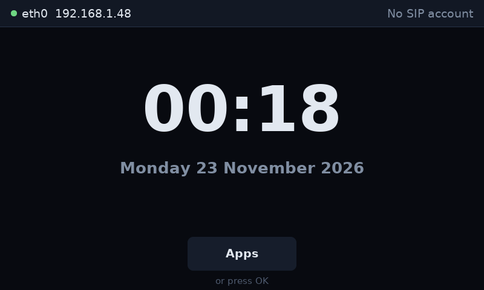
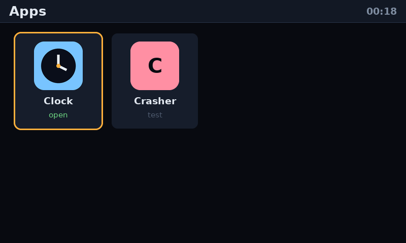
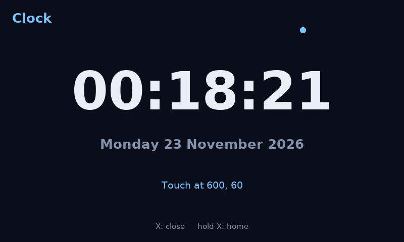

# The shell and the simulator

`t48-shell` owns the screen and every input device, shows the idle screen and the launcher, and runs one app at a time over the [app protocol](app-protocol.md). The same program, started as `t48-sim`, is the PC simulator. Source in [`shell/`](../shell), library in [`libt48/`](../libt48). Design: [architecture.md](architecture.md#the-shell).





## What this first version does

- Idle screen: time, date, network address, and a placeholder where the SIP account status will go.
- Launcher: a tile for each installed app (see [the manifest](app-protocol.md#the-manifest)). Arrows and OK, or touch. X goes back to idle.
- In an app: a short press on X goes to the app as "back"; holding X for 0.8 s is Home. The app is paused and frozen, and its tile says "open"; picking it again brings it back where it was. Picking a different app closes it.
- Lifting the handset takes the screen at once, from anything, and shows a placeholder call screen. Putting it down returns to what was there.
- An app that crashes, exits with an error, never starts or stops reading its events is cleaned up and the owner is told. Phone keys are never passed to apps.
- Apps run as their own unprivileged user when the shell runs as root (user number 20000 to 29999, worked out from the app id), with their own data folder under `/data/appdata`.

Not yet: dialler and real call screens (#26), settings screens (#23), installing apps (#22), backlight (#18), LEDs.

## Build

```
make -C shell                 # this PC: shell/build/t48-shell and t48-sim
make -C shell check           # run the simulator tests; pictures in shell/build/shots/
make -C shell CC=$HOME/src-build/t48s/bin/armcc O=build-arm all build-arm/apps    # the phone: static ARM
```

Plain make and a C compiler; nothing else. The fonts are committed as C (`make -C libt48 fonts` regenerates them).

## The simulator

```
t48-sim --apps DIR --script FILE        # run a script, exit 0 if every check passed
t48-sim --apps DIR --app clock --shot clock.png    # start one app, save its first picture
```

The screen is kept in memory; there is no window yet. Apps are the real programs talking the real protocol. A script is one command per line (`#` starts a comment):

| Command | |
|---|---|
| `key NAME [MS]` | press and release (held 60 ms, or MS). Names: `0`-`9`, `star`, `hash`, `up`, `down`, `left`, `right`, `ok`, `x`, `volup`, `voldown`, `headset`, `mute`, `message`, `hold`, `redial`, `transfer`, `speaker` |
| `keydown NAME`, `keyup NAME` | one half of a press |
| `touch X Y` | a tap; `touchdown X Y`, `touchmove X Y`, `touchup X Y` for a drag |
| `hook off`, `hook on` | lift and replace the handset |
| `wait MS` | |
| `waitframe [MS]` | until the app has drawn since the last input (fails after MS, default 3000) |
| `waitscreen NAME [MS]` | until the shell shows `idle`, `launcher`, `app`, `call` or `message` |
| `expect NAME` | fail unless that screen is showing now |
| `shot FILE` | save the screen as `.png` or `.ppm` |
| `quit` | |

`shell/tests/` has two scripts, run by `make check`: a tour, and apps that crash and hang.

## Running it on the phone

Not done yet: the phone was busy when this was written, so the phone side (framebuffer, grabbed input devices, touch calibration, dropping to an app user) is built but untested. To try it under our kernel:

```
make -C shell CC=$HOME/src-build/t48s/bin/armcc O=build-arm all build-arm/apps
tar -C shell/build-arm -cf - t48-shell apps | tools/ourkernel.sh ssh 'mkdir -p /tmp/t48 && tar -C /tmp/t48 -xf -'
tools/ourkernel.sh ssh '/tmp/t48/t48-shell --apps /tmp/t48/apps --data /tmp/t48/data --config /tmp/t48/config'
```

It logs to the terminal: the input devices it found, each screen change, each app start and stop. Ctrl-C gives the screen back to the text console. Things to check, in order: the idle screen appears; OK opens the launcher; the clock starts and shows key names and a dot under the finger; holding X returns; lifting the handset shows the call screen; the Crasher app's three keys each end in a message, not a dead screen. If phone keys log as "key code N has no meaning yet", the key table in `shell/be_fb.c` needs that code.

To make it the phone's screen for good, replace the `tty1` line in `kernel/kexec-rootfs/etc/inittab` with `::respawn:/usr/bin/t48-shell` (or the equivalent runit service in the Buildroot image, #16) and put apps in `/usr/share/t48/apps`.
