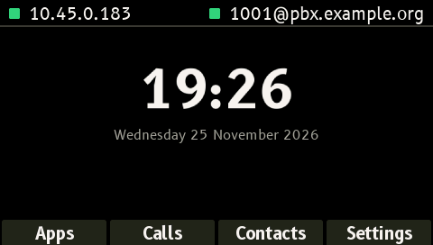
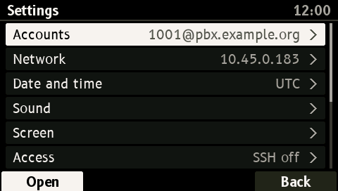
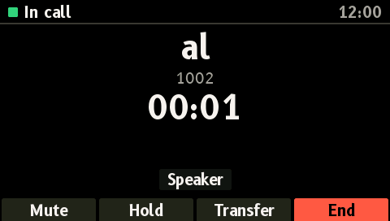
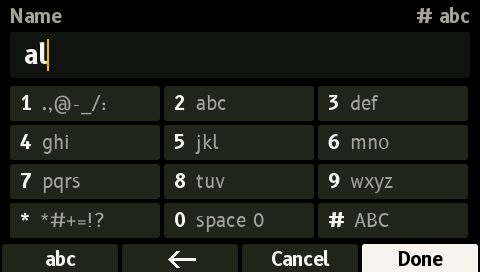
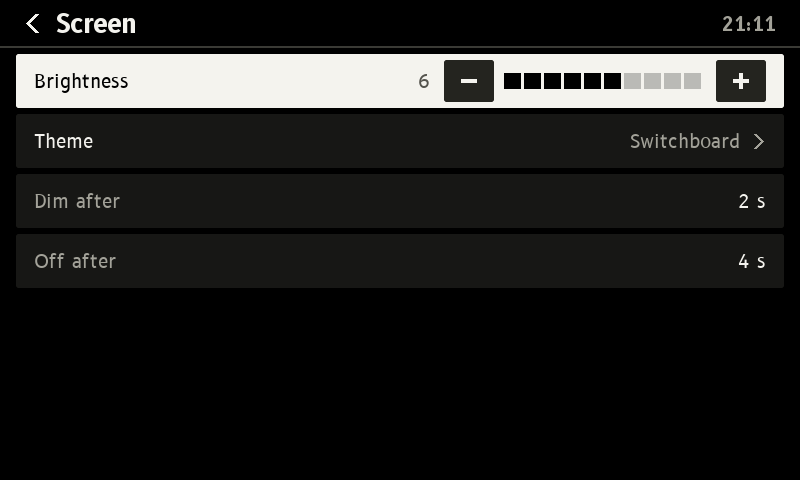
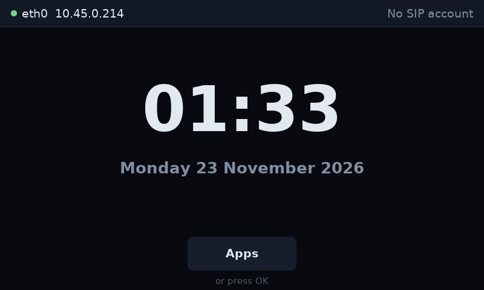

# The shell and the simulator

`t48-shell` owns the screen and every input device, shows the idle screen and the launcher, runs one app at a time over the [app protocol](app-protocol.md), and is the phone ([phone.md](phone.md): dialler, call screens, history, contacts, the phone keys). The same program, started as `t48-sim`, is the PC simulator. Source in [`shell/`](../shell), library in [`libt48/`](../libt48). How it looks is [`shell/ui.c`](../shell/ui.c) and [design/](design/README.md); how it is worded is [style.md](style.md). Design: [architecture.md](architecture.md#the-shell).


## What it does

- Idle screen: time, date, network address, the SIP account and whether it is registered (a line for each when there are several), missed calls, waiting voicemail, an update the daily check found and the count of app updates (a touch opens Settings, Update or Apps: [settings.md](settings.md#update)); DND in the header after the address while do not disturb is on. Buttons for Apps, Calls, Contacts and Settings, the same on OK, Up, Left and Down; Right turns do not disturb on and off, as does Settings, Do not disturb.
- Launcher: a tile for each installed app (see [the manifest](app-protocol.md#the-manifest)), then **Get apps**, the app manager ([apps.md](apps.md)). Arrows and OK, or touch. X goes back to idle.
- Settings, with an on-screen keyboard ([settings.md](settings.md)): Down on the idle screen, or its Settings button.
- In an app: a short press on X goes to the app as "back"; holding X for 0.8 s is Home. The app is paused and frozen, and its tile says "Open"; picking it again brings it back where it was. Picking a different app closes it.
- A call, or lifting the handset, takes the screen at once, from anything. When the call is over, what was there comes back. The phone side is described in [phone.md](phone.md).
- An app that crashes, exits with an error, never starts or stops reading its events is cleaned up and the owner is told. Phone keys are never passed to apps.
- Apps run as their own unprivileged user when the shell runs as root (user number 20000 to 29999, worked out from the app id), with their own data folder under `/data/appdata`.

- The backlight: dims, then goes off, when nothing is touched (below).

## Small screens

The shell draws at the size of the screen it finds. At 800 x 480 that is everything above. On anything smaller (the T46S: 480 x 272, no touch, four soft keys under the screen, [models.md](models.md)) the same screens are laid out for the room there is. The type is the same size, as the two panels have the same pixels to the inch; what changes is how much is on a screen.

 
 

- **Soft keys.** Every screen with something to do says what the four soft keys do along the bottom edge, each label above its key, and the key does it. They take the place of the rows of buttons: nothing needs a finger. The home screen's are Apps, Calls, Contacts and Settings, as the T48S's buttons; do not disturb is on Right and shows in the header, as on the T48S. A question's answers are soft keys 3 and 4 (Cancel, and the verb); OK and X still answer too. In Settings the first says what OK does to the row chosen (Open, Edit, Change, Turn on, Turn off; minus and plus for a level) and the fourth is Back.
- **The header** is 30 pixels, with no way-back mark where there is nothing to touch it with. **Lists** show six rows.
- **The home screen** has the T48S's clock and date at the same share of the screen's height (17/30 of their size). It keeps 88 pixels clear at each side, beside the line keys, for their labels: nothing is drawn there yet, and the line keys do nothing.
- **The dialler and the call screens** have no keypad to touch, as the phone's own is the way in. In a call the soft keys are Mute, Hold, Transfer and End; Answer and Decline when a second call waits; Swap and Join when one is held. Tones sent show as they are keyed.
- **The keyboard** has no touch keys. It shows what each key of the keypad types in the mode it is in, and its soft keys are the mode, rub out, Cancel and Done.
- **Apps** get 800 x 480 fitted to the screen, or the screen's own size if their manifest says so ([app-protocol.md](app-protocol.md#the-screen)). In an app the soft keys are the app's.

The layout follows the screen's size and whether it takes touches, not the model: `shell/main.c` (`shell_screen_is`), and `SMALL` where a screen differs. `T48_FIT=1` in the shell's environment has it draw 800 x 480 and fit that to a small screen, as it did before this layout: for comparing. Every small screen is in [img/t46s/](img/t46s), drawn by `make -C shell check`.

## The backlight

Issue [#18](https://github.com/M0LTE/yealink-t48s/issues/18). Source: [`shell/backlight.c`](../shell/backlight.c); the driver is [`kernel/drivers/t48s_backlight.c`](../kernel/drivers/t48s_backlight.c) ([kernel/README.md](../kernel/README.md#backlight-2026-11-23)).

| State | When | What the screen does |
|---|---|---|
| bright | something was touched in the last two minutes, or the phone is in use | the brightness from Settings, Screen |
| dimmed | nothing touched for two minutes | the lowest level; still readable |
| off | nothing touched for thirty minutes | lamp off |

- A key, a touch, the handset, or a call arriving brings it back to bright.
- **From off, the key or touch that wakes the screen does nothing else.** Nobody can see what it would have pressed. The whole press is swallowed, down and up, and the next one works as usual.
- Lifting the handset, and the Speakerphone and Headset keys, wake the screen and also do their job: they ask for a line whatever is showing.
- From dimmed nothing is swallowed, as the screen can still be read.
- The screen stays bright while the phone is dialling, ringing or in a call.
- While an app is showing the screen dims but does not go off: an app is often something to watch. Back in the launcher or on the idle screen it goes off in the end.

The two times are `dim_seconds` and `off_seconds` in `/data/config/screen` ([settings.md](settings.md#the-files)); they are not on the screen. The shell's log has a line for each change (`backlight: dim (nothing touched)`).

`shell/tests/06-backlight.script` checks all of the above in the simulator, with a folder of files standing in for `/sys/class/backlight`.



On the phone (2026-11-23), with injected input and the two times set to 15 and 30 seconds, reading the hardware's registers at each step:

| | PWM register 0x80002040 | GPIO18 (0x80004000 bit 18) |
|---|---|---|
| bright, brightness 7 | 0x4f | low: lit |
| dimmed | 0xdf (level 1) | low |
| off | 0xdf | high: lamp off |
| after a key, a touch or the handset | 0x4f | low |

The key and the touch that woke it did nothing else (the touch was on the Settings button; Settings did not open). Lifting the handset woke it and showed the call screen, and it stayed bright for the 35 seconds the handset was off. Brightness from the Screen page, by touch and by the arrow keys, reached the register each time.

**Needs eyes**, as registers are all that could be read:

1. Settings, Screen: step the brightness from 10 down to 1. Each step should be visibly dimmer, with no flicker, and 1 should still be readable.
2. Leave the phone alone: after two minutes it dims, after thirty the screen goes dark (lamp off, not just a black picture).
3. Dark screen: press OK. The screen lights and stays on the idle screen. Press OK again: the launcher.
4. Dark screen: touch where the Settings button is. The screen lights, Settings does not open.
5. Dark screen: lift the handset. The screen lights on the call screen.
6. Open the clock app and leave it: it dims after two minutes but is still lit half an hour later.

## The key test

For a phone whose key table is in doubt and which has no console (the T46S, [models.md](models.md)). It shows each press and release with its row, column and code in the key matrix (the keypad driver's `MSC_SCAN`) and the Linux key the table gives it, in type large enough to read in a photo, above the codes seen so far in the order they were first pressed. A place the table does not hold reads "Not mapped" and its code is in red: the driver sends those as `KEY_UNKNOWN`. A table can be put right from the photos.

- **Open:** hold any key for 5 seconds at the clock, other than volume, Speaker, Headset, Mute, Message, Hold, Redial and Transfer (the key may do its usual thing first; a dialler it opened goes away), or Settings, About, Key test. Neither needs the table to be right. It does not open over an app or a call.
- **Leave:** hold any key for 3 seconds. A call or the handset also ends it.
- While it shows, no key does anything else.

`shell/keytest.c`; `shell/tests/18-keytest.script`.

## Build

```
make -C shell                 # this PC: shell/build/t48-shell and t48-sim
make -C shell check           # run the simulator tests; pictures in shell/build/shots/
make -C shell CC=$HOME/src-build/t48s/bin/armcc O=build-arm all build-arm/apps    # the phone: static ARM
```

Plain make and a C compiler; nothing else. The fonts (B612, IBM Plex and Figtree, one family for each theme, in `libt48/fonts`) are committed as C (`make -C libt48 fonts` regenerates them).

## The simulator

```
t48-sim --apps DIR --script FILE        # run a script, exit 0 if every check passed
t48-sim --apps DIR --app clock --shot clock.png    # start one app, save its first picture
```

`--screen WxH` sets the screen's size (800x480 unless told; smaller gets the small layout), `--no-touch` makes it a screen that takes no touches with four soft keys under it, and `--model t46s` is that phone whole: 480x272, 16 bits a pixel and upside down as its panel is (so the same packing and turning runs as on the phone; pictures and pixel checks see it the right way up), no touch, soft keys.

The screen is kept in memory; there is no window yet. Apps are the real programs talking the real protocol. A script is one command per line (`#` starts a comment):

| Command | |
|---|---|
| `key NAME [MS]` | press and release (held 60 ms, or MS). Names: `0`-`9`, `star`, `hash`, `up`, `down`, `left`, `right`, `ok`, `x`, `volup`, `voldown`, `headset`, `mute`, `message`, `hold`, `redial`, `transfer`, `speaker`, and `soft1` to `soft4` (the soft keys of a phone that has them: [models.md](models.md)) |
| `keydown NAME`, `keyup NAME` | one half of a press |
| `scandown CODE [KEY [NAME]]`, `scanup CODE KEY [NAME]` | a key as the phone's keypad sends it: its place in the matrix (row x 8 + column + 1), the Linux key code its table gives (240, `KEY_UNKNOWN`, for a place not in the table; none at all for a place that comes with no key event), and the name the shell knows the key by, if any. These go through the hold that opens the key test, as a real key does; `key` does not |
| `type TEXT` | into the open keyboard at once, as if typed; `$PWD` in it is the folder the test runs in |
| `touch X Y` | a tap; `touchdown X Y`, `touchmove X Y`, `touchup X Y` for a drag |
| `hook off`, `hook on` | lift and replace the handset |
| `wait MS` | |
| `waitframe [MS]` | until the app has drawn (a DAMAGE or a FLIP) since the last input (fails after MS, default 3000) |
| `waitscreen NAME [MS]` | until the shell shows `idle`, `launcher`, `app`, `call`, `message`, `history`, `settings`, `contacts` or `keys` (the key test) |
| `expect NAME` | fail unless that screen is showing now |
| `expectstate KEY VALUE` | fail unless that is so now (spaces in a value are written `_`). Settings and apps: `settings.page`, `settings.row` and `settings.value` (the selected row), `settings.rows`, `settings.heading` (the group heading above the selected row on Apps, `-` for none), `kbd` (`open`, `closed`), `kbd.text`, `overlay` (`none`, `busy`, `message`, `confirm`, `door`: the password screen of [access.md](access.md)), `door.password` (`(shown)` or `(none)`, never the password), `backlight` (`on`, `dim`, `off`), `backlight.level` (0 to 10, as last told to the hardware), `overlay.title`, `store` (`loading`, `loaded`, `error`), `store.ID` (`available`, `installed`, `update`, `unsupported`, `builtin`), `store.errors` (how many feeds failed), `storesrc.ID` and `storealso.ID` (the app's feed, the other feeds that have it, `-` for none), `settings.sub` (the quiet words after the chosen row's label), `feeds` (how many), `installed.ID` (its version, or `no`), `cfg.FILE.KEY` (from the settings store; `apps:ID` for an app's file), `tz`, `appid`, `flip` (`on` while the app in front is flipping, otherwise `off`), `theme` (`switchboard`, `directory`, `twotone`), `notes` (the idle screen's notices as drawn, `|` between them; `-` for none), `font`, `layout` (`full`, `small`), `soft1` to `soft4` (a small screen: the label over that soft key, `-` for none), `appsize` (the open app's picture, `800x480` or the screen's own). The phone: `phone` (`idle`, `dial`, `outgoing`, `incoming`, `incall`, `ended`), `route` (`none`, `handset`, `speaker`, `headset`), `mute`, `hold`, `number`, `autodial` (the dialler's countdown in whole seconds, or `off`), `peer`, `dtmf`, `ended` (and `ended.detail`, the small line under it), `reg`, `missed`, `history`, `last`, `vol.ringer` (and the others), `led.speaker` (and `led.headset`, `led.mute`, `led.message`: what the phone wants there, `off`, `on`, `blink`, `slow`), `lamp.speaker` (and the others: what is lit, which is the same unless the app in front has the lamp, and then its level, `0` to `255`), `app`, `sip`, `audio`; the second call: `other` (`none`, `waiting`, `held`), `other.peer`, `consult`, `parked`; `name` (who the call is with, by name), `note`, `dnd`, `messages`; accounts: `accounts` (how many are in use), `acct` (the one in use, 1 to 16), `acct.default`, `acct.name.2` (what the screens call account 2, and the others), `acct.line` (the status bar's account), `reg.2` (and the others), `last.acct`, `last.name`; contacts: `contacts` (how many), `contacts.mode` (`list`, `name`, `number`, `confirm`), `contacts.sel`, `contacts.number`; the key test: `keys.last` (`CODE/KEY/down`, `up` or `none`; `-` before any key), `keys.seen` (how many different keys so far); and what the audio service itself reports: `audio.route`, `audio.mute`, `audio.tone`, `audio.ring`, `audio.call`, `audio.vol.handset` |
| `waitstate KEY VALUE [MS]` | until that is so (fails after MS, default 3000) |
| `expectpixel X Y COLOUR`, `waitpixel X Y COLOUR [MS]` | the colour of one pixel of the screen: `RRGGBB`, or a colour of the theme in use by name (`bg`, `panel`, `text`, `key`, `sel`, `head`, `accent`, `good`, `bad`, `ring`, `call`, `hold`) |
| `run COMMAND` | run a command on the PC and fail if it does; used to make the far end of a test call do things |
| `shot FILE` | save the screen as `.png` or `.ppm` |
| `quit` | |

`shell/tests/` has the scripts, run by `make check`: a tour, apps that crash and hang, the phone screens with no services behind them, the settings screens and keyboard, the app manager against feeds made on disk, the backlight, the Access page ([access.md](access.md#testing)), contacts, the history's buttons and do not disturb, the standing notice, the notices of updates, flipping, sound and lamps from an app, and the key test. `make check-live` does the app manager against the real feed ([apps.md](apps.md#testing)). The call scenarios in `shell/tests/phone/` need baresip and the audio service and are run by `sip/test/phone-test.sh` ([phone.md](phone.md#testing)).

With `--sip SOCKET` and `--audio SOCKET` the simulator talks to a real baresip and audio service; without them it has neither, so nothing on a PC is touched by accident. For the same reason it runs no `t48-apply` when a setting changes unless `--apply PROGRAM` names one (`make check` names `shell/tests/access/apply.sh`, which only plays the access part, and notes a restart in a file instead of doing it). The same goes for the updater behind Settings, Update: none unless `--update PROGRAM` names one (`make check` names `shell/tests/update/update.sh`; on the phone it is `t48-update`). `--access DIR` is where the Access page looks for `t48-access`'s status file, `--notice FILE` names a file of one or two lines that the idle screen shows for as long as the file exists: the first leads the row of notices, ahead of missed calls and messages (what does not fit the row is left out from the end), and the second takes the bottom line in place of the key hints (on the phone `/run/t48-notice`, which `t48-live` writes after a start from a USB stick: [live-image.md](live-image.md)), and the environment variable `T48_BACKLIGHT` names a folder to use in place of `/sys/class/backlight`. `--runner qemu-arm` starts apps through that program, for apps built for the phone.

The same program is also `t48-app` and `t48-config` when started by those names ([apps.md](apps.md#on-the-command-line), [settings.md](settings.md#the-files)).

## Running it on the phone

The kexec image starts `t48-shell` on the screen at boot, as a runit service ([boot.md](boot.md)), with the clock app in `/usr/share/t48/apps`. Its log is `/var/log/t48/shell/current` on the phone: the input devices it found, each screen change, each app start and stop. If it is killed, runit starts it again.



The image gets the shell, libt48 and the clock from their Buildroot packages (`buildroot/package/t48-shell`, `buildroot/package/libt48`), built from this repo's `shell/` and `libt48/`, so a new image build picks up the current code.

To try a build without a new image, copy it over and restart the shell; extra apps can go in `/data/apps` (in RAM for now, so gone at the next boot):

```
tools/ourkernel.sh ssh 'cat > /usr/bin/t48-shell.new && chmod +x /usr/bin/t48-shell.new && mv /usr/bin/t48-shell.new /usr/bin/t48-shell && killall t48-shell' < shell/build-arm/t48-shell
tar -C shell/build-arm/apps -cf - crasher | tools/ourkernel.sh ssh 'tar -C /data/apps -xf -'
```

### Testing without being there

`tools/phone-input.sh` presses keys, touches the screen and lifts the handset from a PC, and saves the phone's real screen as a PNG. It uses test hooks in our keypad and touch drivers (`kernel/README.md`), so the events travel through the real input devices and the shell cannot tell them from a finger. The names are the simulator's:

```
tools/phone-input.sh key ok -- shot launcher.png
tools/phone-input.sh key x 1000          # hold X for a second: Home
tools/phone-input.sh touch 400 420       # screen pixels
tools/phone-input.sh hook off -- shot call.png -- hook on
tools/phone-input.sh log
```

### What has been checked on the phone (2026-11-23)

All with injected input, nobody at the phone:

- The idle screen draws at boot, and the clock on it follows NTP.
- OK, or a touch on Apps, opens the launcher; OK or a touch on its tile starts the clock, as its own user (uid 23373), with its own folder in `/data/appdata`.
- The clock shows key names and puts a dot under a touch. A touch asked for at 600, 60 arrives as 599, 59, so the calibration is applied; with a changed `/etc/pointercal` the same touch lands elsewhere, so the file is read.
- Holding X goes Home, the app is frozen (process state T), its tile says "open", and picking it resumes it. A short X closes it. Volume and the other phone keys are logged and do not reach the app.
- Hook off shows the call screen and freezes the app; hook on brings it back. A shell started with the handset already lifted goes straight to the call screen.
- The devices are grabbed: a second program reading `/dev/input/event0` sees nothing while keys are pressed, and nothing is typed on the text console underneath.
- `kill -9` on the app gives "Clock has stopped", no process or buffer left behind. The Crasher test app's three cases (crash, error exit, hang) all end the same way as in the simulator. Killing the shell takes its app with it, and `init` restarts the shell.

No fault was found in the shell or libt48 on the phone: the phone side worked as built. The time zone is a setting now ([settings.md](settings.md#on-the-phone-2026-11-23)); installing apps from the feed on the phone is in [apps.md](apps.md#on-the-phone-2026-11-23).


### Still needs fingers

1. Press each key on the idle screen, in the launcher and in the clock: digits, `*`, `#`, arrows, OK, X. The clock should name each one.
2. Hold X in the clock for a second: Home. Tap its tile: back in the clock.
3. Tap Apps, tap the clock, drag a finger around: the dot should follow under the finger, to the edges.
4. Lift the handset in the clock: the call screen at once. Put it down: the clock again.
5. Press Volume, Mute, Headset, Speakerphone, Hold, Transfer, Redial, Message in the clock: nothing happens on the screen, and `tools/phone-input.sh log` has a "phone key" line for each.
