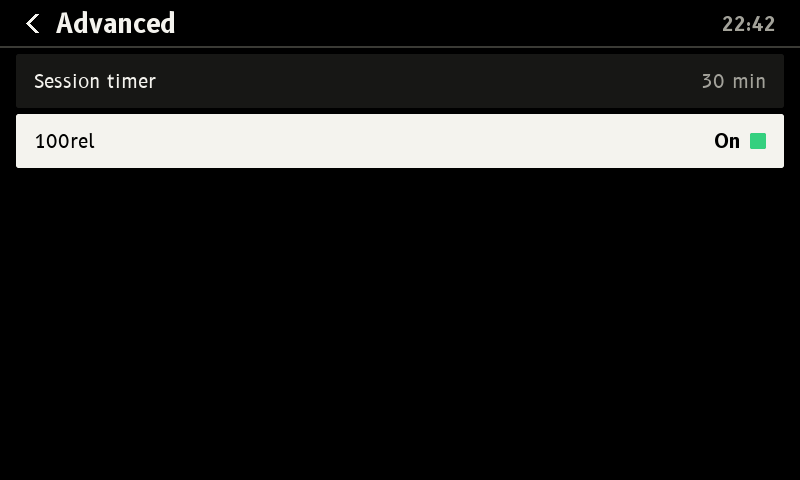
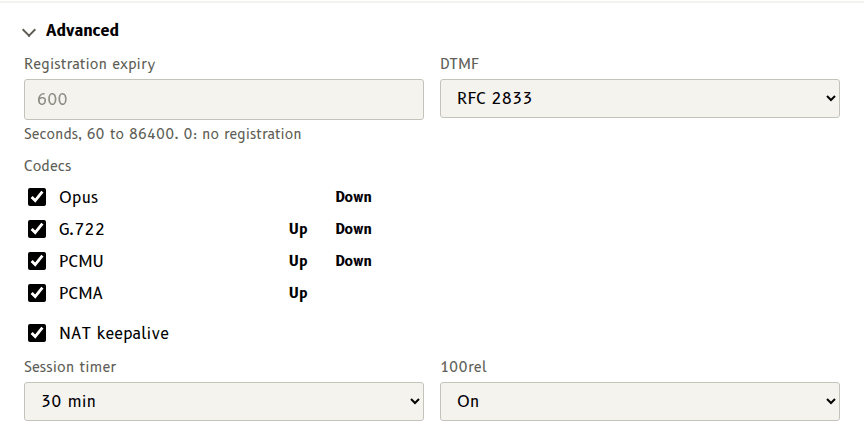
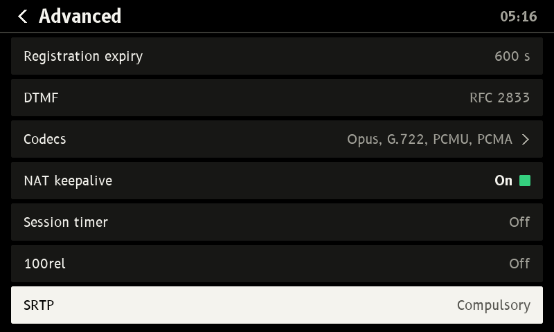
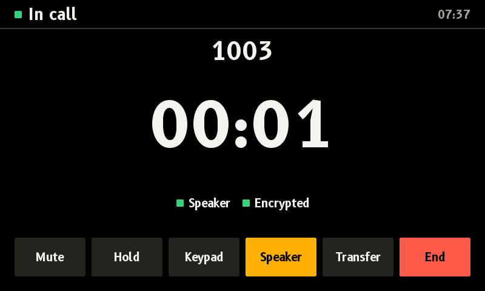
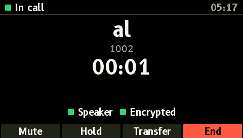
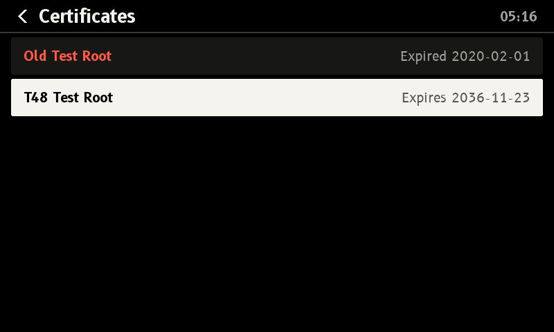
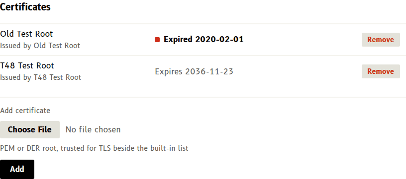

# SIP: baresip on the phone

Issue [#25](https://github.com/M0LTE/yealink-t48s/issues/25). Design: [architecture.md](architecture.md#sip-stack). Files in [`sip/`](../sip).

## Summary

- baresip 4.13.0 and libre 4.13.0 (both BSD-3-Clause, current releases) build as one static ARMv6 musl soft-float binary of **4.2 MB**, with only the modules we need. It was 1.3 MB before SIP over TLS and SRTP (#78), which in libre mean OpenSSL; the system image grew by 1.1 MB ([Sizes](#sizes-and-memory)).
- **SIP over TLS** with the server's certificate checked against the image's CA list and any root certificates the owner adds, **SRTP** per account (Off, Optional, Compulsory, DTLS-SRTP), and **Encrypted** on the call screen when the audio is SRTP ([SIP over TLS](#sip-over-tls), [SRTP](#srtp), [Certificates](#certificates)).
- Calls offer **Opus, G.722, G.711**, in that order. Opus runs wideband at the audio service's 16 kHz, with in-band FEC for lossy links. CPU on the phone is measured below ([Codecs](#codecs)).
- Proved off the phone, through a throwaway Kamailio registrar on loopback: two instances **register with a password** (one over UDP, one over TCP; a wrong password is refused), one **dials**, the other **answers**, both **hear the other's tone**, in G.711 and in G.722. The **ARM binary does the same under qemu-arm**: registers, calls, sends and receives audio.
- Calls are driven with JSON in netstrings: commands in, answers and events out. That is the protocol of baresip's ctrl_tcp module, served by our own module **t48ctrl** on a Unix socket only root can open, so apps cannot place calls. The shell speaks it ([phone.md](phone.md)).
- Our own audio module, **t48audio**, carries the call's audio to and from the audio service `t48-audiod` (#24, [audiod.md](audiod.md)). The boundary is written down in [`t48audio_proto.h`](../sip/modules/t48audio/t48audio_proto.h). With no audio service running it is a null device, so SIP work does not depend on it.

## What is built

| Module | Why |
|---|---|
| `account` | reads the accounts file that `t48-sip` writes |
| `menu` | the call commands (`dial`, `accept`, `hangup`, `reginfo`, ...) that t48ctrl runs |
| `t48keepalive` | ours: NAT keepalives while an account is registered ([NAT keepalives](#nat-keepalives)) |
| `srtp`, `dtls_srtp` | media encryption, per account: SDES-SRTP and DTLS-SRTP ([SRTP](#srtp)). Loaded only when an account uses them |
| `t48timer` | ours: session timers, RFC 4028 ([Interoperability](#interoperability)) |
| `t48mwi` | ours: asks each account's server about waiting voicemail (RFC 3842) and passes the answer on as an event, for the message lamp. baresip's own `mwi` module is not built: it can spin for ever at start when an account registers before its start-up timer runs (seen against a server on the same machine), and it delays shutdown by half a second |
| `opus`, `g711`, `libg722` | codecs: Opus, G.711 (PCMU, PCMA) and G.722 ([Codecs](#codecs)). Neither Opus nor G.722 is inside baresip: `opus` wraps [libopus](https://opus-codec.org) 1.6.1 (BSD-3-Clause), built fixed point; `libg722` wraps sippy's [libg722](https://github.com/sippy/libg722) (two C files, BSD-2-Clause and public domain) |
| `auresamp` | converts the 16 kHz device audio to and from 8 kHz for G.711 |
| `t48audio` | ours: the call stream to the audio service (see below) |
| `aufile`, `ausine` | WAV file and tone audio, for tests |
| `t48ctrl` | ours: JSON control for the shell, on a root-only Unix socket (see below) |
| `stdio` | a console for trying things by hand |

libre is built without BFCP, PCP, RTMP, zlib and backtraces. Its crypto library is **OpenSSL 3.6** (Apache-2.0): libre does SIP over TLS and SRTP only through OpenSSL, and needs a crypto library anyway (MD5 for digest login, SHA-1 and HMAC for STUN). Until #78 that was mbedTLS 3.6 for the hashes alone, with no TLS. OpenSSL is configured down to what TLS 1.2 and 1.3, DTLS and SRTP use: no SSLv3, old ciphers and hashes (DES, RC2, RC4, MD4, IDEA, SEED, Blowfish, CAST, Whirlpool, RIPEMD), PSK, QUIC, compression, engines or modules (the `BR2_PACKAGE_LIBOPENSSL_ENABLE_*` lines in [`t48s_defconfig`](../buildroot/configs/t48s_defconfig); `sip/build.sh` passes the same to its own OpenSSL build). Kept: AES (CBC, GCM), ChaCha20-Poly1305, X25519 and the NIST curves, RSA, ECDSA. curl keeps mbedTLS, which is smaller.

### Sizes and memory

| | Before #78 (mbedTLS) | Now (OpenSSL) |
|---|---|---|
| baresip, ARM, `sip/build.sh` (clang) | 1,290,360 bytes | 3,810,200 bytes |
| baresip in the image (Buildroot, GCC) | | 4,187,104 bytes |
| baresip, x86-64, for the PC tests | 1,456,312 bytes | 6,108,288 bytes |
| `system.img` (squashfs, xz), which the phone holds in RAM | 2,981,888 bytes (main at 066c0f2) | 4,075,520 bytes |

Of the 2.5 MB more in the binary, the SRTP modules are 10 KB and DTLS-SRTP 5 KB; the rest is OpenSSL. The system image slots are 20 MB, so space is no concern; the image costs its own size in RAM ([boot.md](boot.md)), 1.1 MB more.

baresip's memory, measured running the ARM binary natively (32-bit, on a Cortex-A72 in AArch32), with one account and no call, 2026-11-26:

| | Resident | Of which heap and stacks | Of which program pages |
|---|---|---|---|
| Before #78, UDP | 0.9 MB | 128 KB | 0.8 MB |
| Now, UDP, SRTP off or Optional | 2.7 MB | 320 KB | 2.4 MB |
| Now, TLS | 3.3 MB | 460 KB | 2.9 MB |
| Now, UDP, DTLS-SRTP | 4.0 MB | 580 KB | 3.5 MB |

So a phone with a TLS account uses about 3.5 MB more than before (1.1 MB image, 2.4 MB baresip), and about 3 MB with UDP alone. The program pages are page cache from the system image, which the kernel can drop and read again; the heap is what is really taken. That fits the T46S's 64 MB as well as the T48S's 128 MB. `t48-sip` leaves out the TLS transport and the SRTP modules when no account uses them, because `dtls_srtp` alone makes a key and a certificate as it loads (0.7 MB).

Four patches ([`sip/patches`](../sip/patches)). libre reads an address flag (`IFA_FLAGS`) that arrived in Linux 3.14, and we build against our 3.6.11 kernel's headers, whose kernel never sends it. libre gives a REGISTER that could not be sent the same back-off as one that failed, and can send one at once on an existing registration; baresip uses that to register again without unregistering first ([below](#registration-back-off)). baresip gets four small hooks for `t48timer`: a call's setup message, its SIP session, a way to set its custom headers, and those headers on the 2xx that answers it.

## Building

```
docker build -t t48-sip sip
docker run --rm -u $(id -u):$(id -g) -e HOME=/work -e T=/work/t48s \
    -v "$PWD":/src -v "$HOME/t48-work":/work -w /src t48-sip sh -c \
    'native/build-toolchain.sh && sip/build.sh && TARGET=host sip/build.sh && sip/test/call-test.sh'
```

- `native/build-toolchain.sh` makes the musl cross toolchain (`$T/bin/armcc`) that `native/Makefile` already expects, now with the 3.6.11 kernel headers in its sysroot.
- `sip/build.sh` downloads pinned, checksummed sources and builds into `$T/sip-arm/bin/baresip`. `TARGET=host` builds the same thing for the PC. Licence texts of everything linked in are copied to `$T/sip-*/share/licences/`; they ship with the binary. (`TLS=1` is gone: every build has TLS.)
- OpenSSL's `libcrypto.pc` asks for `-latomic` on ARM, which the clang sysroot does not have; the line is taken out after the install. Nothing in libcrypto needs it: clang makes OpenSSL's atomics inline on ARMv6 (no `__atomic_*` calls in the library), and CMake's FindOpenSSL, which libre and baresip use, never read the file anyway. The blocker reported in #78 does not happen in the `sip/Dockerfile` container (2026-11-26): both the ARM and the PC build link.
- A build takes a minute or two on 8 cores. The container image is about 2 GB.

The phone's image builds the same thing with Buildroot (#16): packages `libre`, `libg722` and `baresip` in `buildroot/package`, with the same versions and checksums, the patches from `sip/patches` (libre's and baresip's), Buildroot's OpenSSL (3.6.2; `sip/build.sh` uses the same), and the module list read from `sip/build.sh`. They install `baresip`, `t48-sip`, the config and `sip.example` in `/usr/share/t48/sip`, and the licence texts; nothing starts baresip at boot. The scripts stay for the PC build and the call test.

## Running it

`t48-sip` is the program runit starts. It reads the owner's accounts from `/data/config/sip` (account 1) and `sip2` to `sip16` beside it (#36, #77: 16, as the stock firmware's lines), leaves out any that are switched off or have no user or server host, writes baresip's accounts file into `/run/t48-sip` (mode 0700, as it holds the password) beside a copy of the config, and runs baresip there.

```
# /data/config/sip  (see sip/config/sip.example)
user=1001
password=...
domain=sip.example.com
# optional: auth_user, display_name, transport (udp, tcp, tls), outbound_proxy, register_seconds,
#           enabled (off), mwi (off), keepalive (off), dtmf (rfc2833, inband, info), codecs,
#           session_timer (seconds, off), 100rel (on, required), srtp (optional, compulsory, dtls);
#           label, voicemail, ringtone and forward_* are for the shell
```

`domain` is the server host, shown as Server host in Settings and on the web setup page; the key keeps its old name so existing files work. With no port the server is found by DNS SRV records for the account's transport, then the plain address on 5060 (5061 for TLS). With a port (`sip.example.com:5070`, `[2001:db8::1]:5070`) that host and port are used, without SRV. `outbound_proxy` (Outbound proxy) takes a host, `host:port` or a `sip:` URI, and is reached on the account's transport.

The rest are under Advanced on the account's page, on the phone and the web setup page (#77):

| Setting | Key | Default | To baresip |
|---|---|---|---|
| Registration expiry | `register_seconds`: 60 to 86400, or 0 not to register | not set: 600 s, as before | `;regint=` |
| DTMF | `dtmf`: `rfc2833`, `inband`, `info` | RFC 2833 | `;dtmfmode=rtpevent` or `info` |
| Codecs | `codecs`: all four in the order offered, an off one with `-` in front: `g722,opus,-pcmu,pcma` | not set: Opus, G.722, PCMU, PCMA, all on | `;audio_codecs=` |
| NAT keepalive | `keepalive`: `off` | on | `;keepalive=no` from us ([below](#nat-keepalives)) |
| SRTP | `srtp`: `optional`, `compulsory`, `dtls` | off | `;mediaenc=srtp`, `srtp-mand` or `dtls_srtp` ([SRTP](#srtp)) |

A value `t48-sip` cannot use is logged and the default used; that includes a `register_seconds` other than 0 or 60 to 86400, which before #77 was passed to baresip as it was. A `codecs` that names only some leaves the others off; one with all off offers all.

**DTMF.** RFC 2833 sends each key as a telephone-event in the RTP stream, which nearly every server takes. SIP INFO sends an INFO request (`application/dtmf-relay`) for each key. In-band puts the key's two tones into the call's audio: baresip has no such mode, so for an account set to it the shell sends `t48inband` with the digit, and `t48audio` replaces the microphone with the tones for 100 ms, then 60 ms of microphone before the next digit: the low tone at -11 dBm0 and the high at -9, faded in and out over 2.5 ms. The queue is emptied whenever the call in front changes, so a tone never reaches another call. In-band suits a far end that listens for tones only; a lossy codec can blur them, so G.711 is safest for it. The phone keeps offering telephone-event in its SDP in every mode, as baresip always does.

### NAT keepalives

Behind a home router, the router's UDP binding for the phone's SIP port lasts from 30 s to a few minutes without traffic. Registrations are about 9 minutes apart (600 s unless set), so between them the server's INVITE would hit a closed binding and the call would be lost.

While an account is registered, our module `t48keepalive` sends its server an OPTIONS request on the account's own transport and route (through the outbound proxy, if set): every **23 to 29 s over UDP**, every **96 to 120 s over TCP and TLS**. These are RFC 5626's intervals, spread the way libre spreads its own. Every SIP server answers OPTIONS (200, 401, 404 or 405); any answer will do.

- **The server sees a new public address or port** (its `received` and `rport` on our Via): the router lost the binding and made a new one, so the account registers again and calls follow. The test below finds this within one interval of a router restart.
- **No answer at all over TCP or TLS** (32 s: the connection has gone): the account registers again, once per run of failures. Over UDP no answer only means packets are being lost; libre's own refresh deals with an outage, and the address check catches a new binding when answers resume.
- **A registration that fails** is left to libre's back-off ([below](#registration-back-off)); the module does not register an account that is not registered, which would start the back-off again.

libre's own keepalives are not used: it starts them only when the registrar does SIP outbound (RFC 5626), which most providers do not; over UDP they are STUN requests that most SIP servers ignore; and over TCP it closes the connection when the server does not answer the CRLF ping.

On by default for every account. The **NAT keepalive** switch under Advanced on the account's page (phone and web setup) turns them off, for a server that objects; it writes `keepalive=off` in the account's file. A custom `/data/local/sip/config` replaces the whole config, so it must load `t48keepalive.so` to keep them, and to register again when the cable comes back ([below](#registration-back-off)).

Every account follows a 3xx answer to a call it makes (`sip_autoredirect`): call forwarding at the far end ([phone.md](phone.md#call-forwarding)).

### Registration back-off

A REGISTER that fails (no answer, a 403 or 5xx, or one that could not be sent at all) is tried again after 30 to 60 s, then 60 to 120 s, doubling each time to 15 to 30 min, where it stays: RFC 5626's back-off, random within each range. A successful registration starts it again from the top, and then the account refreshes on its own interval (`register_seconds`, 600 s unless set). A new address (from DHCP or the Network page) and saving the account restart baresip, which registers at once.

Over UDP a single REGISTER with no answer is sent 11 times in 32 s (0.5, 1, 2, then every 4 s; RFC 3261's retransmissions) before it counts as failed. On the wire that looks like a REGISTER every few seconds; they are one attempt, with the same CSeq. Until 26 Nov 2026 libre already backed off between attempts, but a REGISTER that could not be sent was retried by `t48keepalive` every 30 to 60 s with no back-off, which also restarted libre's when it had one of its own; now libre does both (`sip/patches/re-0002`).

**The cable put back.** eth0 is the switch's CPU port, so the Ethernet driver gives it the carrier of the switch's external ports: up while the LAN or PC jack has a link, checked every 2 s. It fails safe: the carrier is on from the start and only follows the switch once an external port has read link up, so a register that never reads right leaves the network as it was. Two watchers act on it, each on a netlink socket (no polling), each at most once in 30 s (a carrier back sooner is acted on 30 s after the last time, and dropped if the cable goes again first):

- `t48-linkd`, the runit service `link`, always running, account or none: runs `t48-apply link-up`, which starts udhcpc again asking for the address the phone has. On the same network it keeps it and nothing else changes: the address stays while udhcpc asks, as the kick file in `/run` names it. On another network it takes the new one there, and the DHCP script starts baresip again on it. `t48-apply network` runs one at a time (a lock in `/run`) and clears a kick file left over; udhcpc and ntpd are started with descriptors 3 to 9 closed, so they keep nobody's sockets or the lock (not by listing them: busybox ash keeps its own above 9, and closing those made it spin, which left a test build with no network at boot).
- `t48keepalive`, in baresip: every account sends a REGISTER at once on its existing registration: a refresh if it is registered, the next try now if it is backing off (whose back-off then goes on). It is not a new registration, which would unregister the old one first, and the two could cross at the server (`sip/patches/baresip-0002`). An account stopped by hand is left alone. The NAT keepalives register again the same way. Over TCP or TLS the connection the cable took with it may not be noticed at once: then the refresh fails straight away and the account waits one back-off step (30 to 60 s) before it registers.

Log lines, for checking it by hand: the kernel's `switch: external link down` and `up` (`dmesg`), `t48-linkd: eth0 down`, `t48-linkd: eth0 up, new DHCP lease` (`/var/log/t48/link/current`), and `t48keepalive: eth0 up, registering again` (`/var/log/t48/sip/current`).

DHCP: `udhcpc` stays running and renews the lease (until 26 Nov 2026 it ran with `-q`, exited after the first lease and never renewed it, so the phone kept the address after the lease ran out). A renewal changes the default route and restarts ntpd only when they change.

Tests, none of them timed: `sip/test/regbackoff-test.sh` (about a second, fake clocks) runs libre's registration with the clock, sending and jitter replaced: the retransmissions, every wait to the cap at the lowest and the highest jitter, a REGISTER that cannot be sent, a new registration with one failure carried over as baresip does, a refresh while one is on its way and while backing off, and an unregister that cannot be sent; then the 30 s rule above (`native/linkwatch.h`, shared by both watchers). `sip/test/link-test.sh` (the build container with `--cap-add NET_ADMIN`, a few seconds) takes a dummy link's carrier down and up under two baresips and `t48-linkd`: the registered account refreshes, the one backing off tries at once, `t48-linkd` runs its command once and passes it no socket, an MTU change does nothing, and a second cycle at once is put off by both. `tools/test-link.sh` (CI, on files) checks `t48-apply network` and `link-up` and the DHCP script with stand-ins for the network commands, under the PC's `sh` and again under the image's own busybox ash (`SH="qemu-arm .../busybox ash"`).

### Block direct calls

Issue [#77](https://github.com/M0LTE/yealink-t48s/issues/77). Off by default, for the whole phone: `block_direct=on` in `/data/config/phone` (Settings, Accounts, Advanced; or Advanced on the web setup page's Accounts) turns it on. Then a call, or an OPTIONS or REFER, that does not come from the account's server is refused with **403 Forbidden** and never rings.

- **Which addresses.** baresip's own check (`check_origin`, on for every account; the config line `filter_registrar udp,tcp,tls`, which `t48-sip` adds when the setting is on): the request's source address must be the one address that answered the account's last successful registration. That is the server host, or the outbound proxy when one is set, as DNS (SRV, then A or AAAA) gave it for that registration. It is renewed with every registration, so it follows the server when its address changes, and the NAT keepalives register again when the phone's own public address changes. Port is not compared.
- **Which providers it suits.** Those that send calls from the same server the phone registers with, as most do for a phone behind NAT. Not those that send calls from several addresses (a pool of edge servers, or a media gateway apart from the registrar): their calls would be refused. Leave it off for them.
- **403, not silence.** The answer is one short packet, sent without keeping any state, so a flood from a SIP scanner costs no more than dropping it would, and is never larger than the request. A dropped INVITE would be sent again by an honest but misrouted server for 32 s, and its owner would see a timeout instead of a refusal. A scanner learns nothing new: the phone answers on its SIP port either way.
- **Peer-to-peer.** Calls straight to this phone's address, with no server between, need it off. An account that does not register (`register_seconds=0`) has no server address to hold calls to, so `t48-sip` gives it `check_origin=no` whatever the setting.
- An account that has not registered yet gets no calls at all while it is on.

A custom `/data/local/sip/config` gets the line too: `t48-sip` takes any `filter_registrar` out of it and adds its own.

When an account is changed in Settings, `t48-apply sip` kills baresip and starts `t48-sip` again a second later. `t48-sip` keeps its process number in the run directory and waits (up to five seconds) for an old baresip to let go of the SIP port before starting the new one.

The config is [`sip/config/config`](../sip/config/config), installed as `/usr/share/t48/sip/config`; `/data/local/sip/config` replaces it. No credentials are in the repository; the test's passwords are made up for the throwaway registrar.

## Interoperability

Issue #77. What baresip 4.13 and libre 4.13 do on their own, what we changed, and how each was tested: `sip/test/interop-test.sh`, in the build container, about 8 minutes. It runs calls through the test Kamailio in several shapes (variants of [`kamailio.cfg`](../sip/test/kamailio.cfg) chosen with `-A`) and against a scripted far end, [`uac.py`](../sip/test/uac.py), where a second baresip cannot play the part.

| Feature | Default | Tested how | Result |
|---|---|---|---|
| Loose routing (Record-Route with `;lr`) | always | Kamailio record-routes, twice as it moves the call from UDP to TCP; hold, resume and hang up | both entries honoured; re-INVITEs and BYE go through the proxy |
| Transparent proxy (no Record-Route) | always | Kamailio without `record_route()`, both phones on UDP | the same requests go straight between the phones |
| Stateful proxy | always | every test: Kamailio is transaction stateful (`tm`) | passes |
| B2BUA-like topology hiding | always | Kamailio's `topos`: each side sees only the proxy in Via, Contact and Record-Route | call, hold, resume, hang up pass |
| Session timers (RFC 4028) | **off**, per account; on with an interval | far end as caller and as callee, either side the refresher, by UPDATE (also one answered 100, then 200) and by re-INVITE (with and without SDP); a caller that requires timers; a caller without them; a caller asking for 60 s; the setting off | all pass; when on, the phone refreshes every half interval and refuses under 90 s with 422 |
| Session timers through a proxy that enforces them | as above | Kamailio's `sst` at 90 s, which ends calls that are not refreshed | refreshed calls stay up past 130 s; a call nobody refreshes is ended (61 s) |
| 100rel and PRACK (RFC 3262) | **off**, per account | two phones with it on; a caller that requires it; early media in a reliable 183; a phone that requires it | all pass (with the setting on where it must be) |

Both settings are under Advanced on an account's page, on the phone and on the web setup page:

 

**Session timers.** baresip has none, so a caller that required them got 420 and nothing ever refreshed a call. Our module `t48timer` adds them. They are **off by default**, as stock Yealink and Polycom phones ship, because providers that use them refresh calls themselves when the phone does not. Turn them on for an account (Advanced, Session timer) if its provider drops calls at a fixed time into them, such as 15 or 30 minutes. When on, the phone says `Supported: timer` and asks for its chosen interval on calls it makes; offered a call with Session-Expires it answers with that interval (under 90 s: 422 with `Min-SE: 90`) and a refresher (the one the caller named, else the caller if it supports timers, else the phone). When the phone is the refresher it sends UPDATE every half interval, or re-INVITE if the far end does not allow UPDATE or refuses it. A refresh that times out or gets 408 or 481 ends the call, as RFC 4028 says. Settings: `session_timer=SECONDS` (90 or more; the screens offer 5 min to 1 h, as some servers refuse less than 120 s) or `off`. Off is plain baresip: no timers offered, the far end refreshes if it wants to (RFC 4028 makes it), a caller that requires them gets 420. Limits: the phone's 2xx to the far end's own refresh has no Session-Expires, which by the RFC turns the timer off after it (the far end may stop refreshing, nothing is ended); the phone's own refresh re-INVITE, used when UPDATE is not allowed, carries no Session-Expires either (libre has no way to add it); and the phone does not end a call itself when the far end, as refresher, stops refreshing: the RTP timeout (60 s) does that.

**100rel.** baresip's default, kept: off. A caller that requires it gets 420, which RFC 3261 says it should answer by calling again without; one that only supports it gets an ordinary 180, and early media in an ordinary 183 plays. `100rel=on` adds `Supported: 100rel` and PRACK, sends 180 reliably to callers that support it and acknowledges reliable 18x. On, libre sends the reliable 180 without SDP, which some strict callers may reject: hence off by default. `100rel=required` refuses callers without it (421); the screens offer Off and On, and show Required only for a file that already says it. One fix: answering before the caller's PRACK came in was refused by baresip; `t48ctrl` now tries the answer again every 100 ms for up to 10 s.

**TCP and TLS.** The phone's Contact on a TCP or TLS account is its end of the connection to the server, so a far end cannot open a new connection to it. A server on TCP or TLS has to Record-Route, which every provider does; a transparent proxy works over UDP only.

## SIP over TLS

Issue [#78](https://github.com/M0LTE/yealink-t48s/issues/78). Transport TLS on an account's page (phone and web setup), `transport=tls` in its file.

- **Finding the server.** With no port in Server host, DNS SRV `_sips._tcp.<host>`, then the host itself on 5061. With a port, that host and port. An outbound proxy is reached over TLS too.
- **The server's certificate** must chain to a root the phone trusts and name the host typed in Server host (or the outbound proxy's host). That is the name checked even when SRV sends the phone to another host, as RFC 5922 says, so the server's certificate must cover the SIP domain: providers' certificates normally cover the domain and its SRV targets. Wildcards match one label only. An expired certificate, one from an unknown CA or one for another name is refused, and the account does not register; the log says why (`tls_verify_handler: err = 20`, `9`, `10` or `62`: OpenSSL's codes for unknown issuer, not yet valid, expired, wrong name).
- **The clock.** The phone has no clock that runs while it is off: until NTP sets it, the date is 1970 and every certificate is not yet valid (err 9). So when any account uses TLS or DTLS-SRTP, the runit service waits to start `t48-sip` until the year is at least the one the image was built in (`built=` in `/etc/t48-release`), as it waits for an account, the audio service and an address.
- **The CA list missing:** `t48-sip` logs `CA list /etc/ssl/certs missing or empty; TLS servers will be refused` when a TLS account is set and the folder has no hashed certificates.
- **Trusted roots:** the image's CA list (Mozilla's, from Buildroot's `ca-certificates`), looked up by hash in `/etc/ssl/certs` so the 144 roots are never all loaded, and the [roots the owner adds](#certificates).
- **TLS 1.2 and 1.3** (OpenSSL's defaults; nothing older). No client certificate is sent.
- **NAT keepalives** run over the TLS connection every 96 to 120 s; when one goes unanswered the account registers again on a new connection ([NAT keepalives](#nat-keepalives)).
- baresip listens for TLS on the port after `sip_listen`'s (5061) only while an account uses TLS; nothing needs it, as a TLS account's calls come over its own connection.

## SRTP

Per account, under Advanced (phone and web setup), **off by default**: most providers do not use it, and a provider that does not would refuse every call made with Compulsory.

| Setting | `srtp=` | Offer | Plain RTP far end | SRTP far end |
|---|---|---|---|---|
| Off | (not set) | `RTP/AVP` | plain call | plain call (a Compulsory caller's call is refused, 488) |
| Optional | `optional` | `RTP/AVP` with `a=crypto` keys (baresip `srtp`) | plain call | **SRTP** |
| Compulsory | `compulsory` | `RTP/SAVP` with `a=crypto` (`srtp-mand`) | refused, 488, never rings | **SRTP** |
| DTLS-SRTP | `dtls` | `UDP/TLS/RTP/SAVPF` with a fingerprint (`dtls_srtp`) | refused | **SRTP**, if the far end does DTLS-SRTP |

- **Optional is opportunistic SRTP** as most phones and PBXs do it ([marrold.co.uk](https://www.marrold.co.uk/2021/03/opportunistic-srtp-support-in-voip.html)): an ordinary `RTP/AVP` offer that also carries keys. A far end that knows SRTP answers with its own keys and the call is encrypted; one that does not ignores them and the call is plain. Offered `RTP/SAVP`, as from a Compulsory caller, an Optional phone answers SRTP too. A strict far end that insists on `RTP/SAVP` refuses an Optional offer (488); for such a provider, choose Compulsory.
- **Tried with a provider (2026-11-26):** TLS registration and calls worked; that provider refused Optional (488, Q.850 cause 88, after the far end answered) and worked with Compulsory, which showed Encrypted.
- **Keys** (SDES, RFC 4568) travel in the SDP, so they are only as private as the signalling: use SRTP with TLS. `t48-sip` logs a warning for an account with Optional or Compulsory on UDP or TCP. The suite offered is AES_CM_128_HMAC_SHA1_80; baresip also takes _32 and AES-GCM.
- **DTLS-SRTP** (RFC 5764) is there because it cost 5 KB, but few SIP providers use it (WebRTC does). It makes a key and certificate when it loads, so it is loaded only when an account uses it.
- **On the screen:** when a call's audio is SRTP and its keys did not travel in clear (the account is on TLS, or uses DTLS-SRTP), the call screen shows **Encrypted**, a lamp and a word beside Speaker and Muted, on both models. SRTP with SDES over UDP or TCP shows nothing: anyone who saw the SIP could decrypt it. The shell learns it from baresip's `CALL_MENC` event, and from `"secure":true` in t48ctrl's catch-up events after a restart.
- ZRTP is not built (#77: its library is unmaintained and adds about 1 MB).



 

## Certificates

Root certificates for servers whose certificate the image's list does not cover: a private PBX, a self-signed server. Added on the web setup page (Accounts, Advanced, Certificates), listed with their expiry on the phone under Settings, Accounts, Advanced, Certificates, and removable in both. Trusted for SIP over TLS beside the built-in list.

- **What is taken:** a PEM file (one or more `CERTIFICATE` blocks, other text ignored) or one DER certificate, up to 64 KB. A certificate given twice in one file is kept once. Each must be a root: its issuer is its subject (a self-signed server certificate is one too). An intermediate is refused with its issuer named, as OpenSSL would not use it as a trust anchor. A file with `PRIVATE KEY-----` anywhere in it is refused whole, so a key pasted by mistake is never kept.
- **Read with care.** The file may come from anywhere: [`shell/certs.c`](../shell/certs.c) reads the DER with every length checked against what is left, no recursion, and only the fields shown (names, dates, basic constraints). It is shared by the shell and the web setup page. `shell/tests/test_certs.c` runs it over every cut and every changed byte of a good certificate, 20,000 random changes, and hostile files, under AddressSanitizer.
- **What is kept:** the certificate written out again as PEM, not the file given, as `/data/config/certs/<16 hex digits>.pem`; at most 16. The same certificate twice is kept once. Not in the settings backup.
- `t48-sip` copies the certificates (and nothing else from the files) into `ca.pem` in its run directory and gives it to baresip as `sip_cafile`. Adding or removing one restarts baresip.
- A certificate's own signature is not checked when it is added: as a trust anchor OpenSSL does not check it either. Expiry is shown, in red once past, and an expired root does not help a connection.
- Pinning a server's certificate per account is not done: an owner who wants only one server trusted can add that server's self-signed certificate, but the built-in list stays trusted too.

 

## Control interface

| Interface | Verdict |
|---|---|
| `stdio` | one terminal, text for people. For hand testing only. |
| `cons` | text console over UDP/TCP: commands work, but the output is text for people and events are not structured. |
| **`ctrl_tcp`** | **its protocol chosen**, but not the module itself (see the catch below). JSON commands with a token, a JSON answer for each, and JSON events (`REGISTER_OK`, `CALL_INCOMING`, `CALL_ESTABLISHED`, `CALL_CLOSED`, ...) with the account, peer and call id. Netstring framing (`<length>:<json>,`), trivial to parse in C. |
| `ctrl_dbus`, `mqtt` | ruled out: need D-Bus or a broker. |

```
-> 61:{"command":"dial","params":"sip:bob@example.com","token":"1"},
<- {"response":true,"ok":true,"data":"","token":"1"}
<- {"event":true,"class":"call","type":"CALL_ESTABLISHED","accountaor":"sip:alice@...","direction":"outgoing","peeruri":"sip:bob@...","id":"..."}
```

The commands the shell needs: `dial <uri>`, `accept`, `hangup`, `hold`, `resume`, `mute`, `transfer <uri>`, `sndcode <digit>` (DTMF, sent as RFC 4733 events by default), `reginfo`, `listcalls`. Those that act on a call take its id, which is how the shell handles two calls.

The catch: ctrl_tcp only listens on TCP, so any local program, including an app running as its own user, could connect and place calls. So it is not built. Our own module, **t48ctrl** ([source](../sip/modules/t48ctrl/t48ctrl.c)), serves the same protocol on a Unix socket:

- **Where:** `ctrl.sock` in `t48-sip`'s run directory, so `/run/t48-sip/ctrl.sock` on the phone (`t48ctrl_socket` in the config moves it).
- **Who:** the socket is mode 0600 inside a 0700 directory, and the module also checks each connection: only root, or the user baresip runs as, gets in.
- **Several clients at once** (the shell, and a tool over SSH); each gets every event.
- **Catching up:** a client that has just connected is told how things stand, as events marked `"sync":true`: one `REGISTER_OK`, `REGISTER_FAIL` or `REGISTERING` for each account and one `CALL_INCOMING`, `CALL_OUTGOING`, `CALL_RINGING` or `CALL_ESTABLISHED` for each call (with `onhold` and `duration`). That is how a restarted shell picks a call back up. The command `sync` asks for the same again.
- Level meter and RTCP report events are left out; the shell has no use for them.
- **Which account:** a command may carry `"account":"sip:user@domain"` and is then run for that account, so `dial` calls out from it. Every event already says which account it is about (`accountaor`).
- **`joincalls <call-id> <call-id>`** is ours: it connects the two people we are talking to with each other and takes us out (an attended transfer, REFER with Replaces). The first call is the one sent away, the second where it is sent.
- **`redirect <call-id> <target>`** is ours: a call that is still ringing is answered with 302 Moved Temporarily and the target as its Contact, for call forwarding. A target with no `sip:` and no `@` is a number at the account's server.
- `MWI_NOTIFY` events (from `t48mwi`) carry the server's message-summary text in `param`.

To try it by hand: `python3 sip/test/far.py /run/t48-sip/ctrl.sock cmd reginfo`.

## Audio: the boundary with the audio service

`t48audio` ([source](../sip/modules/t48audio/t48audio.c)) is baresip's audio source and player for the phone. The contract ([`t48audio_proto.h`](../sip/modules/t48audio/t48audio_proto.h)) was proposed here and agreed in #24 with small changes; [audiod.md](audiod.md#the-call-stream-baresip) has the details.

- **One call stream** per baresip process, shared by all its calls: the phone can have two (one on hold, or one being asked before a transfer). Each call's source gets the microphone frame and the players' frames are added together; a held call sends and plays nothing. The stream is on a Unix socket the audio service owns (`/run/t48-audiod/call.sock`; `t48audio_socket` in the config moves it). Framing as the app protocol: `u16 type, u16 len`, payload, little endian.
- **Fixed format: 16 kHz, mono, signed 16-bit, always 20 ms frames.** baresip resamples for G.711 (`ausrc_srate`/`auplay_srate 16000` in the config) and re-cuts frames for the codec's packet time.
- **The audio service is the clock.** Every 20 ms it sends one MIC frame; baresip answers each with one SPK frame. Both directions run off the codec's own clock, so nothing drifts, and a missing SPK frame is simply silence.
- **Not on this socket:** routes (handset, headset, speaker), volume, mute, ringing and tones. The shell asks the audio service for those directly, so they survive a baresip restart and baresip never needs to know which path is live.
- **No audio service, no problem:** the module then keeps its own clock, feeds silence as the microphone, drops the speaker audio and retries the socket twice a second. A call survives the audio service restarting.

baresip's own `alsa` module is not built. In the design only the audio service touches the hardware; `alsa` would also pull in alsa-lib. It could still be useful for one quick on-phone test before #24 exists, at a size cost not yet measured.

## Codecs

Offered in this order: **Opus, G.722, G.711**. Measured on the phone on 2026-11-25, silently: a second baresip (the Buildroot build) ran from `/tmp`, called a PC with a speech file as its microphone and a file as its speaker, and its CPU was read over 25 s of the call. That includes RTP, the jitter buffer and the file audio, so most of G.711's 10% is not the codec.

| Codec | Audio | CPU in a call | Offered |
|---|---|---|---|
| Opus, complexity 3, 32 kbit/s, FEC | wideband | 28% | yes, first |
| G.722 | wideband, 64 kbit/s | 13% | yes |
| G.711 (PCMU, PCMA) | narrowband, 64 kbit/s | 10% | yes, last |
| G.729 | narrowband, 8 kbit/s | not built | no |
| Speex | narrow or wideband | not built | no |
| iLBC | narrowband | not built | no |
| AMR-WB (G.722.2) | wideband | not built | no |
| Codec2 | narrowband, under 3.2 kbit/s | not built | no |

- **G.729:** narrowband and worse than G.711; its only use is a thin trunk, and a provider with G.729 also has G.711. bcg729 (GPL-3.0-or-later) would fit our licence if one is ever needed.
- **Speex:** replaced by Opus, by the same people; few providers offer it.
- **iLBC:** narrowband; Opus with FEC copes with loss better.
- **AMR-WB:** a mobile-network codec with patents still licensed through a pool; rare on SIP providers.
- **Codec2:** no registered RTP format, so only our own phones would speak it. baresip has a module, but there is no use for it yet.

### Opus

libopus 1.6.1, fixed point (the processor has no FPU) with its ARMv5E and ARMv6 assembly. The image uses Buildroot's own `opus` package, the same version, built with `-O2`; it would use NEON only after asking the processor, which has none. `sip/build.sh` builds the same with clang. It adds 300 KB to baresip.

The codec alone, from [`sip/test/opus-bench.c`](../sip/test/opus-bench.c) on the phone: 60 s of speech in 20 ms frames, Buildroot's libopus, share of the processor.

| Complexity | Encode, 24 or 32 kbit/s | Encode, 32 kbit/s with FEC | Decode |
|---|---|---|---|
| 0 | 9% | 11% | 1.6% |
| 3 | 13% | 17% | 1.6% |
| 5 | 19% | 24% | 1.7% |
| 10 | 53% | 62% | 1.7% |

At 48 kHz (fullband, 32 kbit/s) encoding costs 16, 21, 28 and 62% at the same complexities, and decoding 6%. The bitrate makes almost no difference. Above complexity 6 libopus adds an analysis in floating point, which this processor emulates, hence the jump at 10.

The settings, in [`sip/config/config`](../sip/config/config):

- **16 kHz:** the audio service's rate, so nothing is resampled, and a third cheaper than 48 kHz. A peer may still send fullband, as baresip cannot advertise `maxplaybackrate`; it is decoded at 16 kHz.
- **Complexity 3:** a call costs 28% of the processor, against 21% at 0 and 34% at 5. That leaves room for the echo canceller (16.5%, [aec.md](aec.md)), the shell and an app. 5 adds perceptual noise shaping and is worth a listen: set `opus_complexity` in `/data/local/sip/config`.
- **32 kbit/s, mono, voice.**
- **In-band FEC, for 10% loss:** each packet carries a coarse copy of the one before, so a single lost packet is rebuilt rather than guessed. It costs about 4% more encoding. We ask peers for it and send it to peers that ask.
- **No DTX:** on a steady tone it falls to comfort noise after a second (a test tone came out 15 dB down), so held notes and tones would suffer; and baresip still sends a packet every 20 ms, so it saves only bytes.

## The test

`sip/test/call-test.sh` (in the build container) starts Kamailio on loopback with digest login for REGISTER and INVITE ([`kamailio.cfg`](../sip/test/kamailio.cfg)), then runs alice and bob through `t48-sip` with settings files, as on the phone. [`ctrl.py`](../sip/test/ctrl.py) checks both are registered, makes alice dial and bob answer over t48ctrl, waits 4 s, hangs up, and checks each recording for the other side's tone (alice sends 440 Hz, bob 1000 Hz). Each call takes out the codecs offered ahead of the one under test, and checks from alice's log that the call used it.

Result on 2026-11-23, all passing (Opus rows 2026-11-25):

| Check | Result |
|---|---|
| Registration with password: alice over UDP, bob over TCP | both `OK`, the registrar saved both |
| Wrong password | `401 Unauthorized`, refused |
| G.711 (PCMU) call, dialled and answered over the control socket | bob heard 440 Hz, alice heard 1000 Hz |
| G.722 call | the same |
| Opus call, nothing taken out of the offer | the same, at the tone's full level |
| G.722 call with bob on `t48audio` and no audio service running | established and closed cleanly; alice heard silence, as she should |
| G.722 call with **alice as the ARM binary under qemu-arm** | bob heard 440 Hz, alice heard 1000 Hz |
| Opus call with alice as the ARM binary under qemu-arm | the same |

`sip/test/nat-test.sh` (in the build container, about 4 minutes) puts alice behind a router's UDP NAT ([`nat.py`](../sip/test/nat.py)) that drops a binding after 40 s with nothing going out, and bob on TCP with no NAT. Both register for 600 s, so only keepalives cross the NAT between registrations. Result on 2026-11-25, all passing:

| Check | Result |
|---|---|
| alice, UDP, over 130 s | OPTIONS 28, 24, 24 and 28 s apart; the binding stayed |
| bob, TCP | one OPTIONS, about 100 s after registering |
| bob calls alice after 130 s | alice rang |
| The router restarts (every binding gone) | alice's next OPTIONS showed a new port, she registered again (26 s after the restart); bob's call rang |
| alice with `keepalive=off` | the binding went after 40 s and bob's call did not reach her |

`sip/test/tls-test.sh` (in the build container, about 3 minutes; issue #78) makes a test CA and certificates when it starts, gives the test Kamailio a TLS listener on 5061 with a certificate for `sip.test`, and answers `_sips._tcp.sip.test` from a DNS server of its own on loopback ([`dns.py`](../sip/test/dns.py)). alice and bob run through `t48-sip` with the test CA as an added root. Calls are checked by [`srtp_call.py`](../sip/test/srtp_call.py): encrypted or not (the `CALL_MENC` event and `"secure"` in a catch-up), and each side hears the other's tone. Result on 2026-11-26, all passing:

| Check | Result |
|---|---|
| TLS registration, no port: found by SRV | registered, the server saw it over TLS |
| TLS registration to `host:port` | registered |
| No added root (the test CA unknown) | refused, err 20; not registered |
| A name the certificate is not for (`other.test`, same server) | refused, err 62 |
| An expired certificate | refused, err 10 |
| Calls over TLS, alice's SRTP and bob's: Off/Off, Optional/Off, Off/Optional | plain calls, both tones heard, nothing says encrypted |
| Optional/Optional, Compulsory/Compulsory, Compulsory/Optional | SRTP (AES_CM_128_HMAC_SHA1_80) both ways, tones heard, both say secure |
| Optional/Compulsory, Compulsory/Off, Off/Compulsory | refused before ringing (488) |
| DTLS-SRTP both ends | SRTP after the DTLS handshake, fingerprint checked |
| DTLS-SRTP to Off | refused |
| alice as the ARM binary under qemu-arm, Compulsory both ends | SRTP, tones heard |

`sip/test/phone-test.sh` has the shell's side ([`28-srtp.script`](../shell/tests/phone/28-srtp.script)): Optional over UDP to a far end that takes SRTP is SRTP but not shown as Encrypted (keys in clear), to one that does not makes a plain call, Compulsory to it fails, and DTLS-SRTP both ends shows Encrypted.

`sip/test/audiod-test.sh` adds an Opus call through two audio services, and one with alice's side as the ARM binaries under qemu; both pass.

## What's left for the phone

1. Copy the ARM binary, `t48-sip`, the config and a settings file to the phone under our kernel and register to a real SIP server; dial out and in from an SSH session with `sip/test/far.py` on the control socket. The null backend is enough for this.
2. Done: CPU of a call in each codec, measured on the phone ([Codecs](#codecs)).
3. Done off the phone: our control module on a Unix socket (`t48ctrl`), and the shell's client for it ([phone.md](phone.md)).
4. Done off the phone: the real `t48audio` and the audio service, tested with calls between two of each (`sip/test/audiod-test.sh`, results in [audiod.md](audiod.md#tests-and-results)). On the phone it waits for playback in the kernel driver.
5. A runit service for `t48-sip`. (Buildroot packages: done, #16.)
6. Done (#78): SIP over TLS and SRTP, in the image. Tried against a real provider on 2026-11-26: TLS registration and calls work; SRTP Compulsory works where Optional was refused.

## Licences

baresip, libre and libopus are BSD-3-Clause, libg722 BSD-2-Clause and public domain, OpenSSL Apache-2.0. Their sources are used unmodified apart from the patches above, and their licence texts are installed with the binary. Our files in `sip/` are AGPL-3.0-or-later.
