# The web setup page

Issue [#37](https://github.com/M0LTE/yealink-t48s/issues/37). Source: [`webconfig/`](../webconfig) (the server `t48-web`: [`http.c`](../webconfig/http.c), the pages: [`pages.c`](../webconfig/pages.c)), [`shell/watch.c`](../shell/watch.c) (how the phone's screens notice a change), the Access page in [`shell/settings.c`](../shell/settings.c).

Typing a SIP password on the phone's on-screen keyboard works but is fiddly. This is the comfortable way: a page served by the phone itself, for a browser on the same network. It reads and writes the same settings files as the phone's own Settings screens ([settings.md](settings.md)), so the two always agree. It uses the same words and the same look as the phone's screen: [style.md](style.md), [design/](design/README.md).

| | |
|---|---|
| 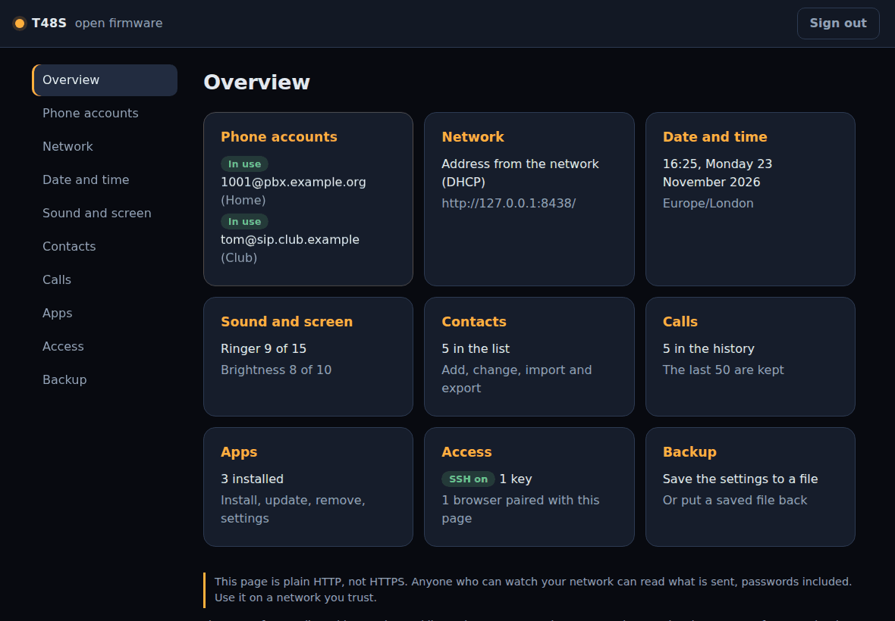 | 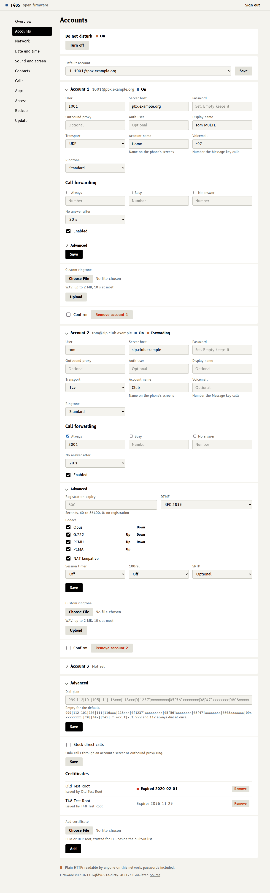 |
| 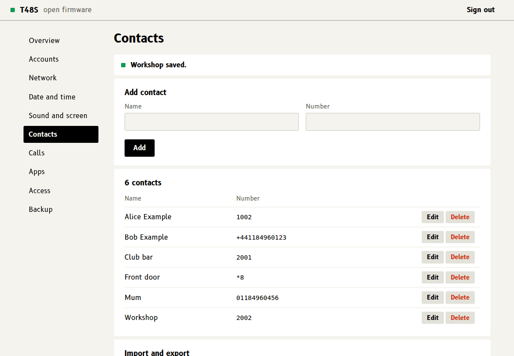 | 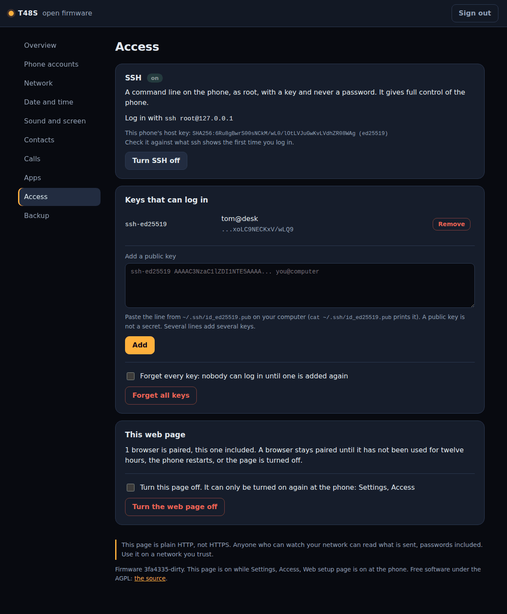 |

## Turning it on, and pairing a browser

The page is **off until the owner turns it on at the phone's own screen**: Settings, Access, Web setup. The phone asks first. The Access page then shows the address to open.

| | |
|---|---|
| 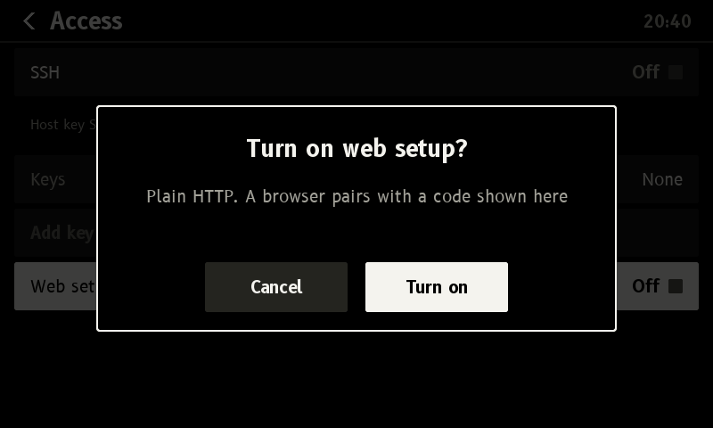 | 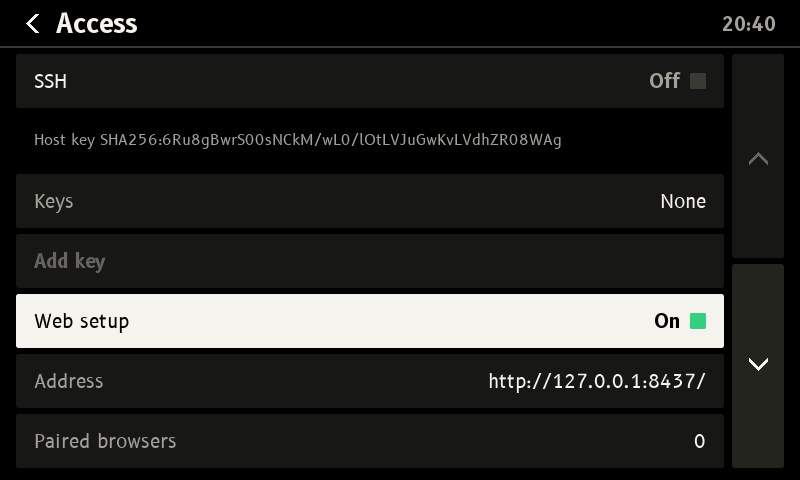 |

Open that address in a browser. A browser the phone has not seen gets one page only, with one button: **Show code**. The phone puts six digits on its screen; type them into the page and the browser is paired. Being able to read the phone's screen is the proof of ownership, as it is for SSH ([access.md](access.md)).

| | |
|---|---|
| 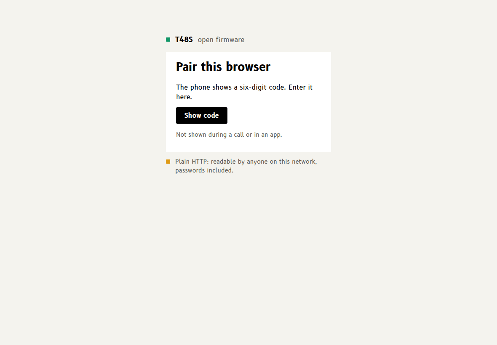 | 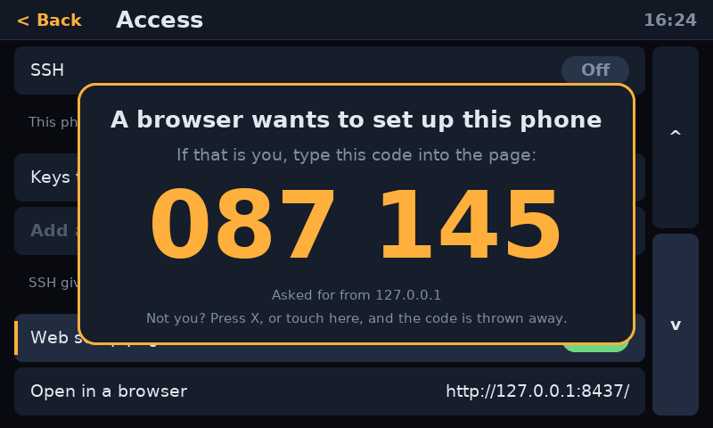 |
| 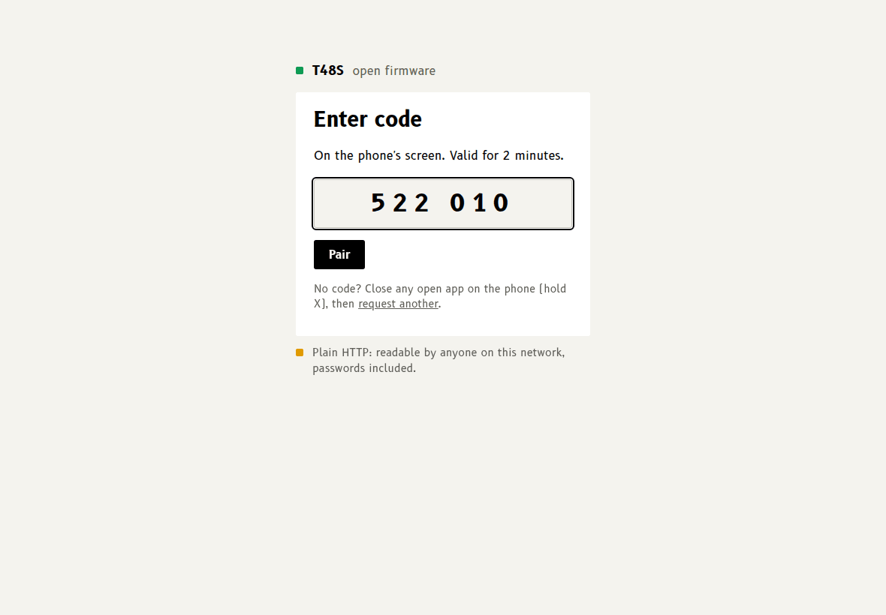 | |

- The code shows over the idle screen, Settings, the launcher, the history and the contact list; not over a call or an app.
- X, or a touch on the box, refuses: the code is thrown away.
- A browser stays paired until it signs out, has not been used for twelve hours, the phone restarts, or the page is turned off. Off and on again at the screen forgets every browser.

## What is on it

| Page | What it does |
|---|---|
| Overview | where things stand, a tile for each page |
| Accounts | all six SIP accounts: every field the phone's screen has. The default account. Remove |
| Network | DHCP, or a fixed address, netmask, gateway and DNS server |
| Date and time | the time zone, from the phone's list, or a TZ string for a place the list lacks |
| Sound and screen | ringer, handset, speaker and headset levels; brightness, and when the screen dims and goes off; the theme, which the page wears too ([design](design/README.md)) |
| Contacts | add, change, delete; import a CSV or vCard file (added to the list, or replacing it); download as CSV or vCard |
| Calls | the call history, and Clear |
| Apps | what is installed and what the feed offers: install, update, remove; each app's own settings; the feed address |
| Access | SSH on and off, the host key's fingerprint, the keys that can log in: **paste a public key** to add one, remove one, forget all. The browsers paired with the page; turn the page off |
| Backup | download the settings as one text file; put a saved file back |
| Update | the version and slot that are running, the channel, the newest release on it; check, install, restart, and the kernel when the channel's differs |

**Passwords go one way only.** A password box is always empty and says only "Set" or "Not set"; leaving it empty keeps the one that is set. That goes for SIP passwords and for any app setting its manifest calls a password.

**Pasting a key** is the easy way to get SSH access: turn SSH on, paste the line from `~/.ssh/id_ed25519.pub`, done. The ten-minute password door on the phone's screen ([access.md](access.md)) is still there for when there is no browser.

## Staying in step with the phone's screens

- The page writes through the shell's own settings store (`shell/config.c` is compiled into `t48-web`), with the same atomic save. Contacts and the call history are the shell's files in `/data/phone`.
- **The shell looks at those files once a second** (`shell/watch.c`): about two dozen `stat` calls. A file that is not the one it last saw is read again, by the part of the shell that holds it: accounts, volumes (told to the audio service; nothing is played), the time zone, brightness, contacts, history, the installed apps. If Settings is showing, the page on the screen is built again. An app whose settings changed is closed, as when they are changed on the phone.
- This also means `t48-config set` from SSH now shows on the screen by itself.
- An app that is open on the phone is closed when it is removed or updated from the page (or by `t48-app` over SSH): its files have gone.
- For the things the screens hand to `t48-apply` (restart the phone service after an account changes, bring the network up differently, SSH on or off), the web page runs `t48-apply` too. A network change is applied two seconds after the page has answered, so the answer gets back first. The page is then at the new address, and the browser pairs again there.
- The other way needs nothing: every page is made from the files at the moment it is asked for.

## The backup file

Plain text you can read: a first line that says what it is, then a part for each settings file and one for the contacts, then an end mark.

```
# T48S settings backup, format 1
# made: 2026-11-23 16:10 UTC
# passwords: left out
[config sip]
user=1001
domain=pbx.example.org
[contacts]
Alice Example|1002
[end]
```

- In it: the phone accounts, `phone`, `network`, `system`, `audio`, `screen`, `feed`, apps' settings, the contacts.
- Not in it: whether SSH and the web page are on, SSH keys, the host key, the call history, the apps themselves. A restore can never turn SSH on.
- **Passwords are left out unless the box is ticked.** With them, the file says `# SENSITIVE` at the top and its name ends `-SENSITIVE-with-passwords`.
- Restoring a file without passwords keeps the passwords the phone has now.
- A restore replaces each part that is in the file and leaves the rest alone. The whole file is read and checked first; a file that is cut short, or has anything in it that is not a setting, changes nothing.
- The settings of an app that is no longer installed are only in a backup with passwords: without the app's manifest there is no telling which of them are passwords.

## Update

A front end for `t48-update` ([install.md](install.md)), which does all of the work: the page runs `t48-update info` to draw itself and the other commands for its buttons.

- **Nothing is automatic.** Opening the page asks the network nothing. Check now does.
- Install is offered once a check has found an update. It writes the slot that is not in use; Restart, offered when it is done, tries it.
- Install kernel is offered only when the channel's kernel differs from the one in flash, with a Confirm box: there is one kernel slot.
- Check, install and kernel are started and left to run; the page answers at once and asks for itself again every three seconds while one is going (a `Refresh` header, so no script is needed). One at a time.
- A failure is shown in the updater's own words, and so is the last result, with its time.
- The channel is Stable, Testing or a URL. The updater decides what is a URL.
- On a phone started without installing: the version and "Not installed".

## How it is kept safe

Sized for a hobby phone on a home network: not careless, not a bank.

- **Off until turned on at the screen.** `web=on` in `/data/config/access`. `t48-web` refuses to start without it, looks every second, and leaves when it is gone. Under runit the service puts itself down when the setting is off and `t48-apply access` brings it up.
- **The LAN only.** It listens on `eth0`'s own address (and ties the socket to `eth0`), follows the address when it changes, and turns away callers whose address is not a private one.
- **Pairing.** Six digits from `/dev/urandom`, shown only on the phone's screen (the file the shell reads them from is root's alone, and apps run as other users). Good for two minutes and five tries, and only for the browser that asked for it. A new code at most every three seconds. Fifteen wrong tries in a row and pairing is closed for ten minutes.
- **Sessions.** A paired browser holds 256 random bits in a cookie (`HttpOnly`, `SameSite=Strict`), kept in the server's memory only. Eight browsers at most.
- **Changes need the page's own token.** Every form carries a token tied to the session, and is refused without it. A form sent from another site is refused by its `Origin` as well. Nothing is changed by a GET. No page can be framed, and the pages load nothing from anywhere else (`Content-Security-Policy: default-src 'none'`; the style sheet, the script and the font files are the phone's own).
- **Nothing typed is logged.** The log says which form was sent and from where, never a value. The pairing code and the cookie are not logged either.
- **Plain HTTP, and every page says so.** Anyone who can watch the network can read what is sent, passwords included. HTTPS with a self-signed key was the other choice: it would mean a browser warning on every visit, a TLS library in the server, and slow handshakes on a 500 MHz ARMv6, for a page that is on for the few minutes the phone is being set up. Turn the page off when done.
- **A paired browser can do what the owner can do at the screen**, including turning SSH on and adding a key, which is root on the phone. That is the point of it, and why pairing needs the screen.

### Why a server of our own, and not busybox httpd with CGI scripts

- Pairing, sessions, the tries counter and the lock all want to live in one process's memory. With CGI they would be files, with locking, written by shell scripts.
- Shell scripts that take form fields and write settings are where quoting mistakes become root. Here every value is a C string that goes to the settings store, which already refuses anything that is not one line of text.
- It is one static program of about 200 KB with the style sheet and script inside it, and it shares the store and the manifest reader with the shell as source, so there is one implementation of each.

It handles one request at a time, each with a 20 second limit: there is one owner. An app install holds the page until it is done; an update does not.

## Running it

```
t48-web                     # on the phone: eth0, port 80; under runit as /etc/service/web
t48-web --help              # where everything lives, and how to point it elsewhere
```

On a PC, against a throwaway folder, with the shell's simulator tools:

```
make -C webconfig                     # also builds what it needs of the shell
mkdir -p /tmp/t48/config
shell/build/t48-config --config /tmp/t48/config set access web on
webconfig/build/t48-web --listen 127.0.0.1:8080 --config /tmp/t48/config --state /tmp/t48/phone \
    --apps /tmp/t48/apps:shell/build/apps --data /tmp/t48/appdata --apply /bin/true \
    --app shell/build/t48-app --access /tmp/t48/access --keys /tmp/t48/keep --run /tmp/t48/run
grep pair_code /tmp/t48/run/status    # the code the phone's screen would show
```

| | |
|---|---|
| `/data/config/access` | `web=on` or `off` (off when missing), beside `ssh` |
| `/run/t48-web/status` | for the shell: `url`, `paired`, and while a browser is pairing `pair_code`, `pair_until`, `pair_from`. Root only |
| `/run/t48-web/refuse` | written by the shell when the owner presses X on a code |
| `/var/log/t48/web/current` | the log |

## Testing

```
make -C webconfig check
```

CI runs this and `make -C shell check` on every push to main, as the quick job `check` beside the image build ([build.yml](../.github/workflows/build.yml)).

1. **The handlers** ([`tests/test_web.py`](../webconfig/tests/test_web.py)): the real program over HTTP against a temporary settings tree, 32 tests. It does not start with the setting off, and leaves when it is turned off. Without pairing: only the welcome page, every other page sends the browser back to it, every form is refused. Pairing: the code, a wrong code, another browser trying the right code, five tries, asking again too soon, refused at the phone, fifteen wrong tries closing it, another site's form. Paired: forms without the token, with a wrong one, and from another site are refused and change nothing; then every form, good and bad values; contacts in and out as CSV and vCard; apps installed from the test feed, updated, their settings, removed; SSH and keys (a private key, a line with options and junk are refused); and the backup both ways, with and without passwords, with seven kinds of damaged file. The Update page against a stand-in for `t48-update` ([`tests/update.sh`](../webconfig/tests/update.sh)): before a check, a check that finds an update, an install watched through downloading and writing to the restart, a failed check, the channels and a refused URL, the kernel and its Confirm box, a phone that is not installed. Passwords, the code and the cookie are checked to be in no page and no log.
2. **With the phone's shell** ([`tests/phone.script`](../webconfig/tests/phone.script), run by `with-phone.sh`): the shell as its PC simulator, the real `t48-web`, and a scripted browser. The page is not there until it is turned on at the Access screen; the code appears on the screen; X refuses it; the next one pairs. Then changes made on the web are watched arriving on the phone (time zone, an account, the ringer level while the Sound page is showing, brightness, a contact, the history cleared, an app installed), and changes made on the phone are read back from the web (the volume key, the time zone, SSH). Off at the screen: the page is gone and the browser is a stranger when it comes back.
3. The same 32 handler tests pass against the phone's own ARM build under qemu: `make -C webconfig CC=.../armcc O=build-arm`, then `RUNNER=qemu-arm SHELL_BUILD=$PWD/shell/build python3 webconfig/tests/test_web.py webconfig/build-arm`.
4. `make -C webconfig shots` takes the pictures on this page with Playwright. Taking them found a fault the scripted tests could not: with `Referrer-Policy: no-referrer` a real browser sends `Origin: null` with its own forms, and every form was refused. It is `same-origin` now.

| | |
|---|---|
| 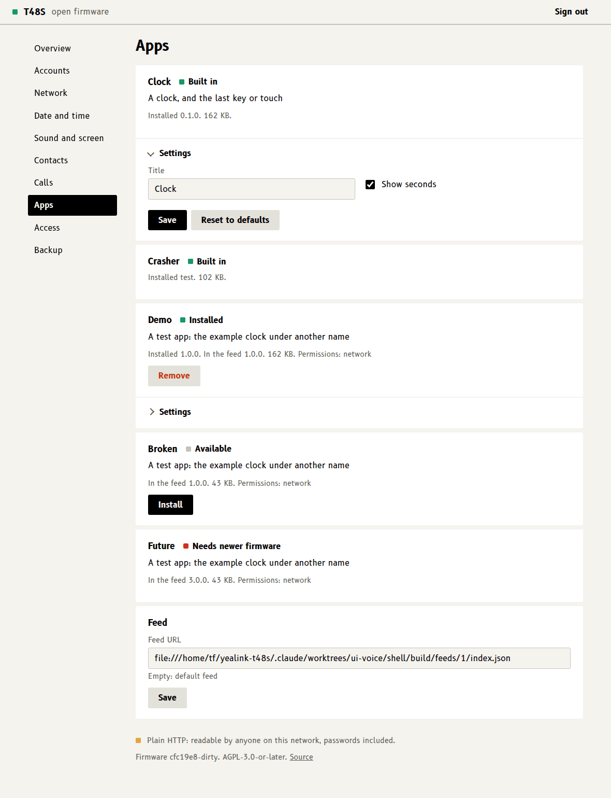 | 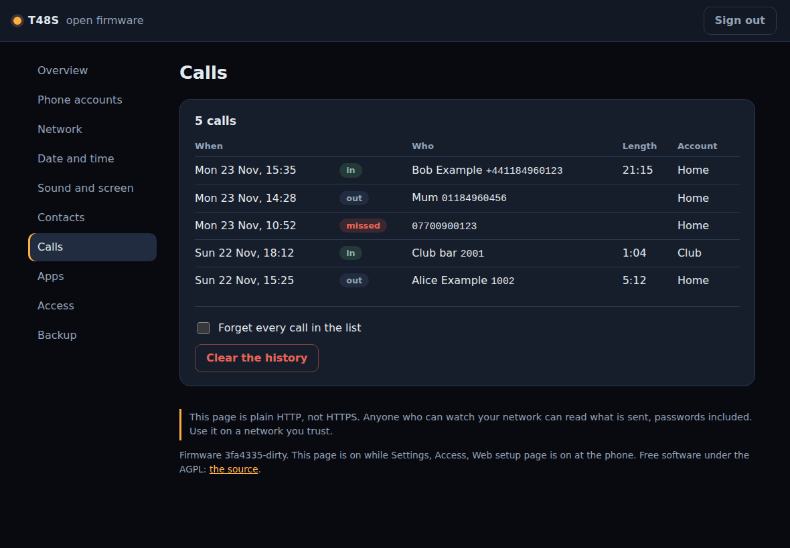 |
| 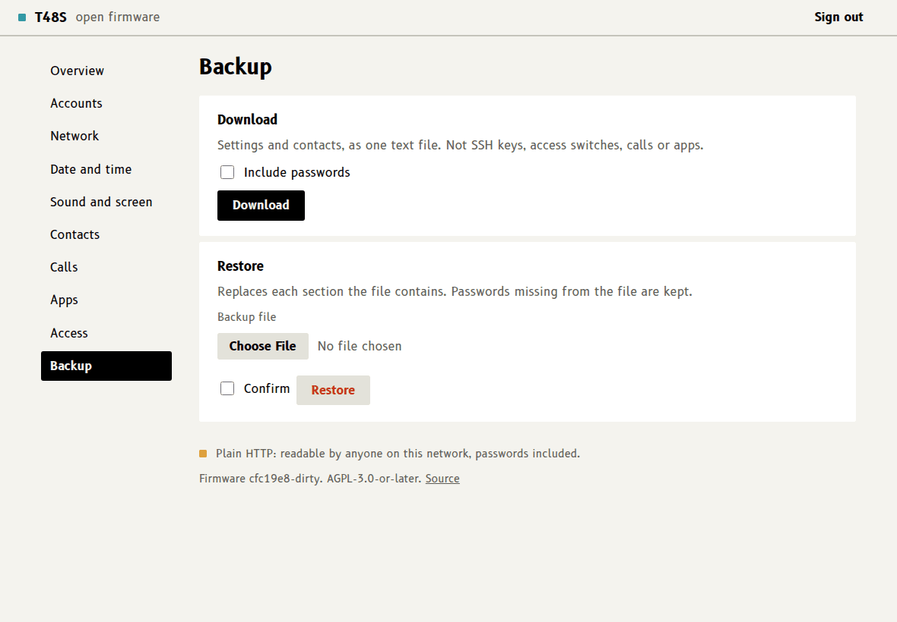 | 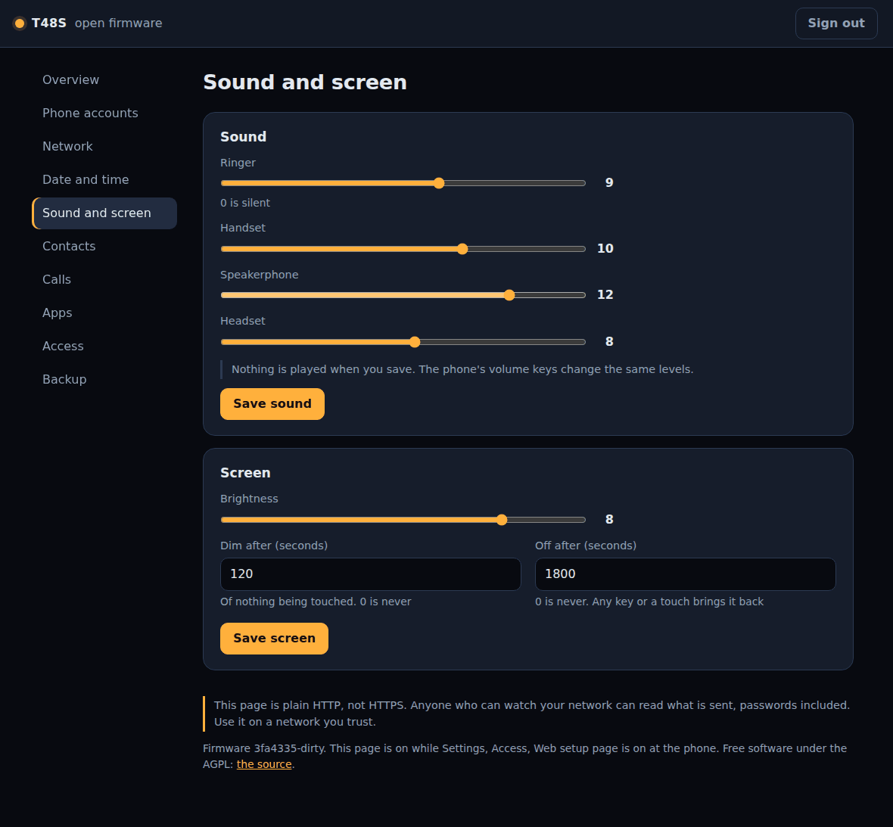 |
| 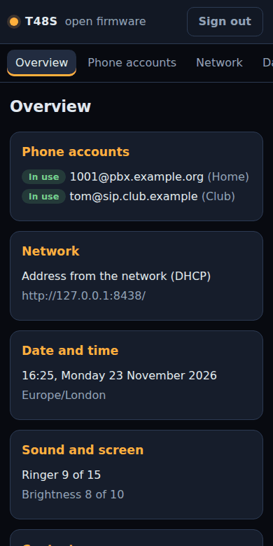 | 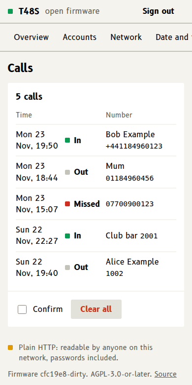 |
| 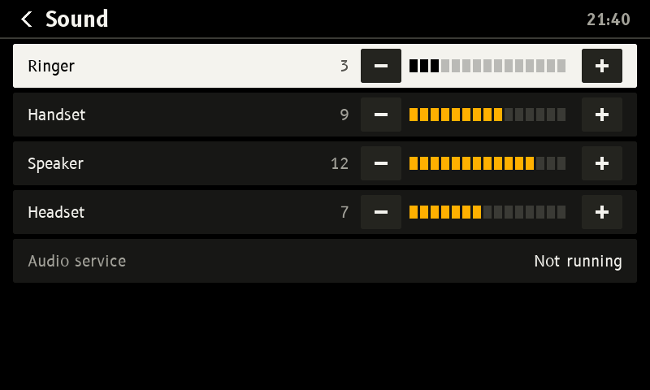 | 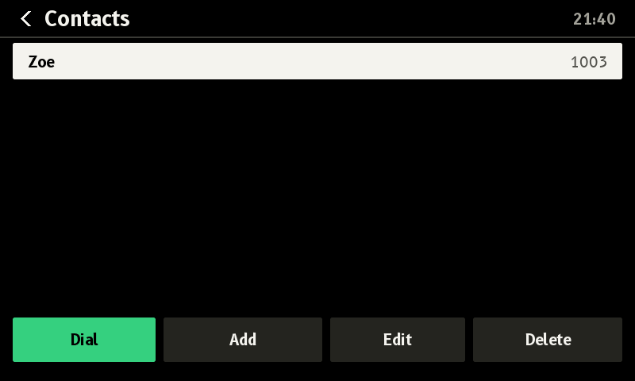 |

## On the phone

Run on the real phone on 2026-11-23, with a build of main under Linux 3.6, a real browser (Chromium, driven by Playwright from another computer on the LAN) and the phone's keys and screen worked through `tools/phone-input.sh`. The code was read off a picture of the screen.

| | |
|---|---|
| 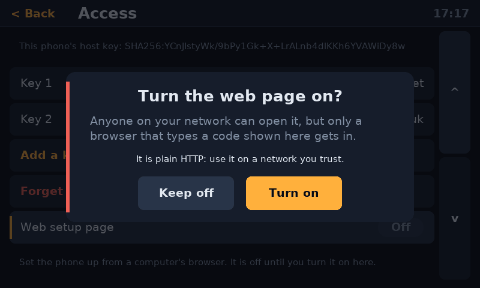 | 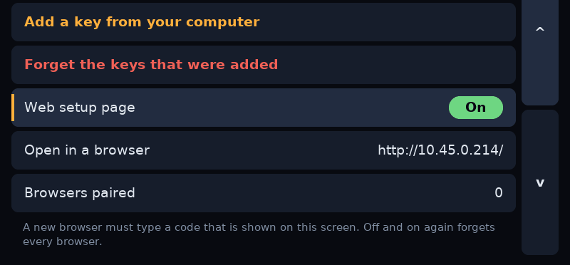 |
| 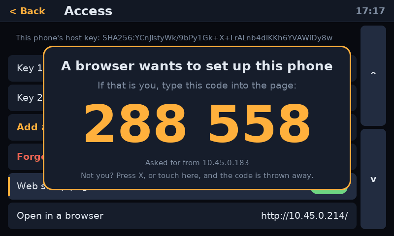 | 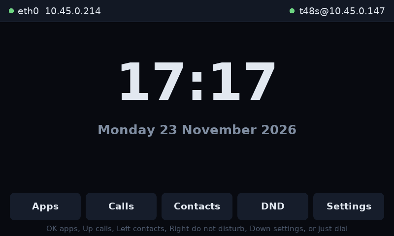 |
| 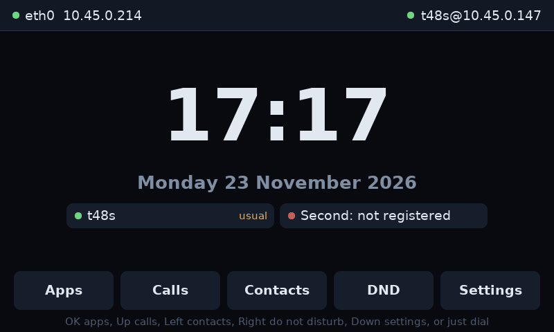 | 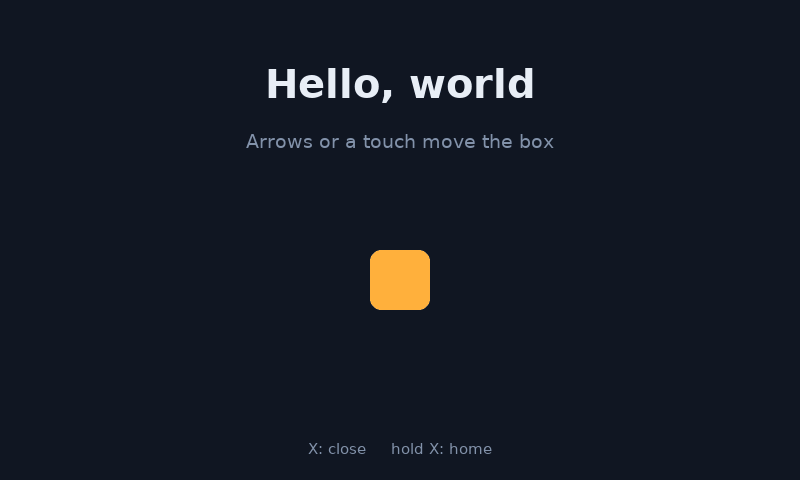 |
| 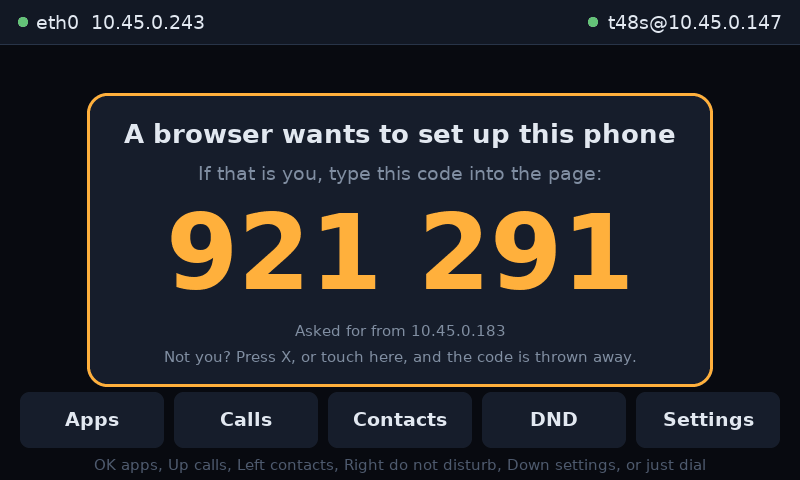 | 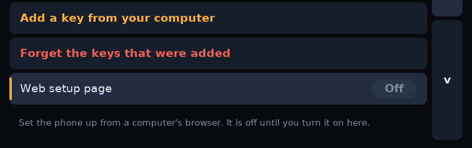 |

| What | How it went |
|---|---|
| The service at boot | down with the setting off, nothing on port 80. Turned on at the screen: listening on the phone's address two seconds later |
| Pairing | the code came up on the screen within a second of the browser asking; typed in, the browser was paired |
| Account 1 saved from the page (the bench account, password and all) | baresip was restarted and had registered four seconds later; the idle screen showed it |
| A second account with a made-up server | on the screen at once, "not registered"; removed from the page, gone from the screen |
| An app from the real feed | Hello, fetched by the phone over HTTPS: the page answered in under two seconds. It opened from the launcher |
| A key pasted in | `ssh` with that key logged in; removed on the page, it was refused |
| A backup without passwords | the account is in it, the password is not |
| A fixed address | the page answered at the new address three seconds after Save, and DHCP came back the same way. The browser has to pair again there: its pairing belongs to the address it was made at |
| Off | at the screen, and from the page's own button: the service is down and the port is closed |

Four faults showed up there and are fixed:

- **An app removed or updated from the page while it was open on the phone stayed on the screen**, running from files that had gone. The shell now closes it (`shell/watch.c`, and a step in `tests/phone.script`).
- **After a change of address the phone could not register or be called** until baresip was restarted: baresip listens on the address it finds when it starts. `t48-apply network` and the DHCP script now start it again when the address is a different one. This was there for the Network page on the phone's own screen too.
- **"SSH is off: turn it on to use it"** after adding a key on a development build, where SSH is always on. The page and the overview now ask the same question the Access page does.
- **The question on the phone's screen was cut short** ("...shown on this screen ge.."). Shorter words.

And one in the shell that the test rig found: a touch in line with the last touch before the shell was restarted landed in the wrong place, because the kernel sends only the coordinate that changed. The shell asks the kernel for both when it starts (`shell/be_fb.c`).

## Not done

- HTTPS.
- The registration state of each account (the phone's screen has it; the page does not ask the shell).
- Do not disturb, and anything about a call in progress.
- Uploading an app package from the computer.
- A page per account for a narrow screen; six accounts on one page is long.
- The pairing box does not show over an app. The page says to leave the app.
